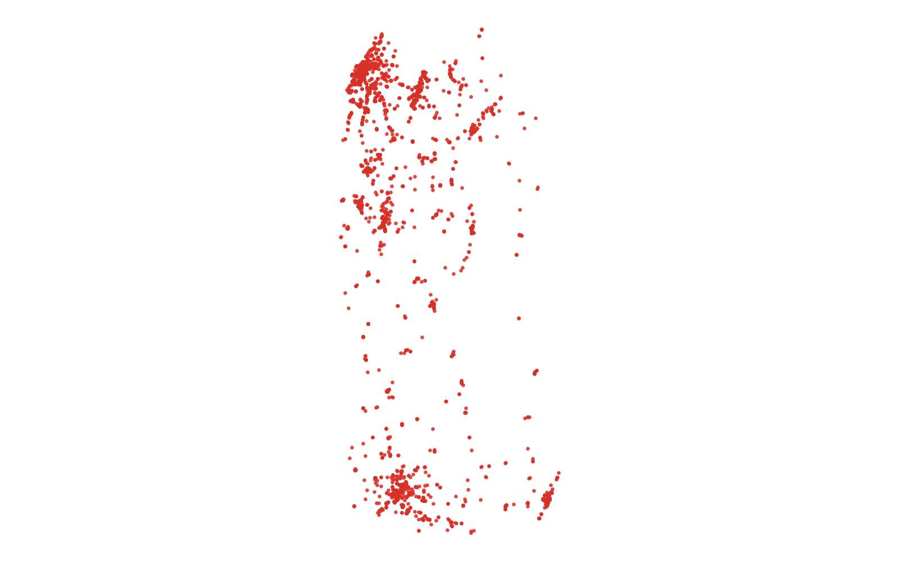
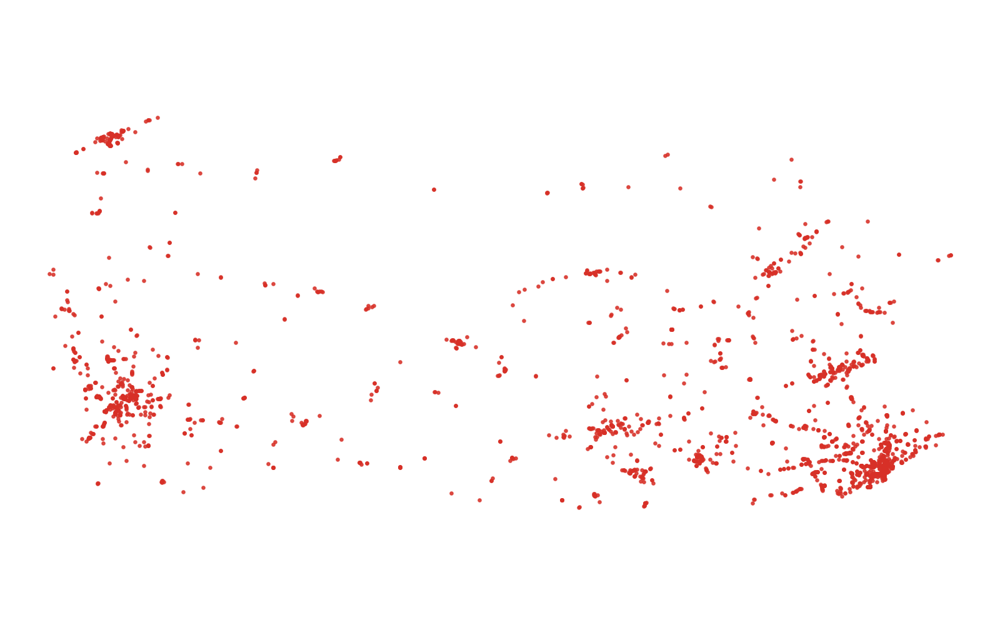

# GIS 错误证据：GeoAgent Task 66

- 主标签：A1 坐标轴顺序误判
- LLM 配置：qwen3.6-plus（dashscope）
- 推理配置：thinking 开关未单列记录
- 视觉审查：至少审查一项可视化成果

## 1. 任务目标

为快餐店图层增加经度和纬度字段，从 DEM 提取各点高程，并将结果保存为新的空间图层。

## 2. 任务执行工作流

1. 将快餐店点图层转换到 EPSG:4326。
2. 把纬度写入 X、经度写入 Y，生成新的点几何。
3. 保留原属性并输出 `axis_swapped.geojson`。

## 3. 错误发生位置

错误出在点几何构造语句。`execution_result/workflow/code.py` 将纬度写入 X 坐标、经度写入 Y 坐标，等价于用 `Point(latitude, longitude)` 生成点。

## 4. 错误机制与结果影响

任务要求为快餐店点增加经纬度字段并继续在原位置提取 DEM 高程；`axis_swapped.geojson` 把 Pennsylvania 附近的点移动到经度约 39–42、纬度约 -80–-74 的错误轴序位置，高程提取对象不再是原快餐店位置。

## 5. 具体错误证据

- `code.py` 使用 `Point(latitude, longitude)` 构造点，顺序与 GIS 通常采用的 `Point(longitude, latitude)` 相反。
- 原始点范围为 [-80.4733, 39.7423, -74.7223, 42.2318]；交换后范围变为 [39.7423, -80.4733, 42.2318, -74.7223]。
- 参考结果保持经度为 X、纬度为 Y，点位仍位于原研究区。

## 6. 任务执行结果预览

下图为该处理流程得到的最终成果。非制图任务不在图内添加解释文字。

## 7. 解决错误后 GIS 任务应有的结果预览

参考图使用相同输入并修正上述 GIS 处理规则，只展示任务应得到的成果。

## 8. 可视化判读说明

轴序交换通常可从点位整体偏移看出，但预览图仍只是辅助证据。本类错误的审查入口是 `execution_result/workflow/code.py` 中的点构造函数、`run_log/run.log` 中的复现步骤，以及输出坐标范围中的经纬度互换模式。
