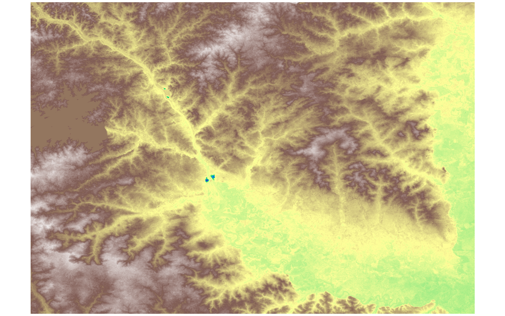
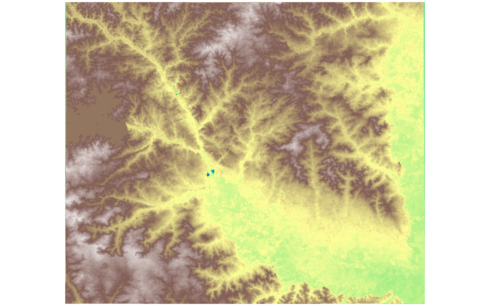

# GIS 错误证据：GeoAgent Task 39

- 主标签：A2 坐标参考系不一致
- LLM：qwen3.6-plus（dashscope）
- 推理配置：thinking 开关未单列记录
- 视觉审查：至少审查一项可视化成果

## 1. 任务目标

为文件指定EPSG6569坐标系。

## 2. 任务执行工作流

1. 读取 Richland DEM 及其原始坐标参考。
2. 把栅格坐标转换到 EPSG:6569。
3. 写出带有目标 CRS 和正确仿射变换的 DEM。

## 3. 错误发生位置

错误出在栅格坐标转换步骤。代码把“转换到 EPSG:6569”实现成修改 CRS 元数据，而不是重算仿射变换和像元位置。

## 4. 错误机制与结果影响

输出文件标成 EPSG:6569，但像元网格仍沿用源 DEM 的坐标和 transform；`richland_dem_epsg6569.tif` 不能作为真正转换到 EPSG:6569 的 DEM。

## 5. 具体错误证据

- `plan.json` 将步骤写成只更新 CRS 元数据，并要求保留原始像元、尺寸和 geotransform。
- `step_01_code.py` 只执行 `profile["crs"] = "EPSG:6569"`，随后 `dst.write(src.read())` 原样写出像元数组。
- 代码没有调用 `rasterio.warp.calculate_default_transform`、`rasterio.warp.reproject` 或 `gdal.Warp`，因此没有生成 EPSG:6569 下的新 transform、bounds 和 width/height。

## 6. 任务执行结果预览

下图由错误运行写出的最终成果生成。图层或表格内容以原文件为准，错误判定依据上述处理逻辑和数值证据。

## 7. 解决错误后 GIS 任务应有的结果预览

下图来自同一任务的正确运行，展示在修正“仅修改 CRS 标记而没有转换坐标”后应得到的最终成果。

## 8. 可视化判读说明

两个 DEM 预览图都可以渲染成连续栅格表面，肉眼看图不一定能看出“只改 CRS 元数据”和“真实重投影”的差异。本类错误的审查入口是 `execution_result/workflow/plan.json`、`execution_result/workflow/step_01_code.py`、`run_log/run.log` 和 `run_log/trace.jsonl`：`plan.json` 是否把任务写成只更新 CRS 元数据，`step_01_code.py` 是否只执行 `profile["crs"] = "EPSG:6569"`，代码是否缺少 `rasterio.warp.calculate_default_transform`、`rasterio.warp.reproject` 或 `gdal.Warp`，以及输出 GeoTIFF 的 CRS、transform、bounds、width/height 是否仍沿用源 DEM。
