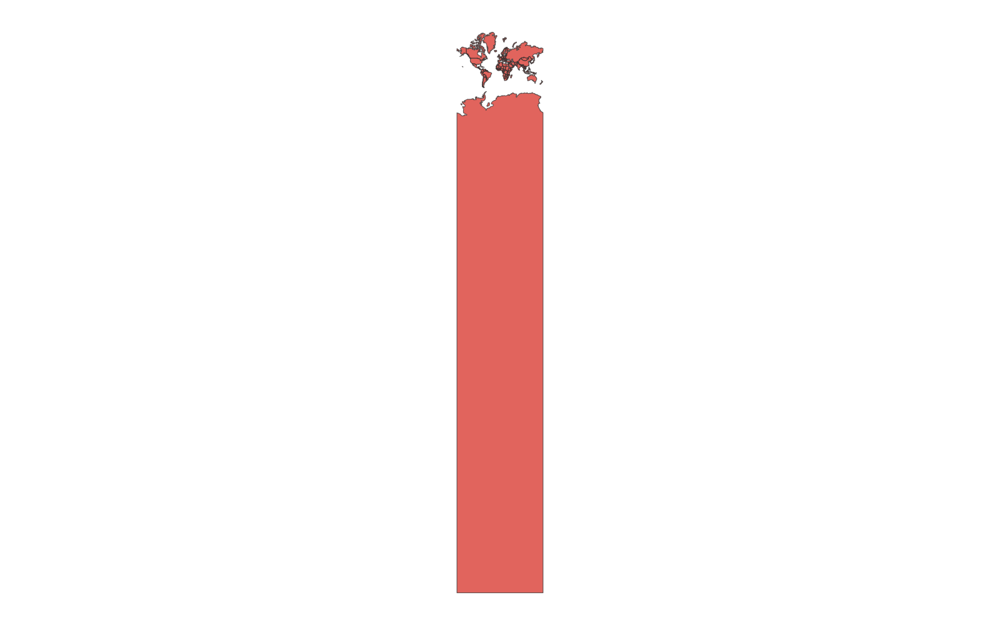
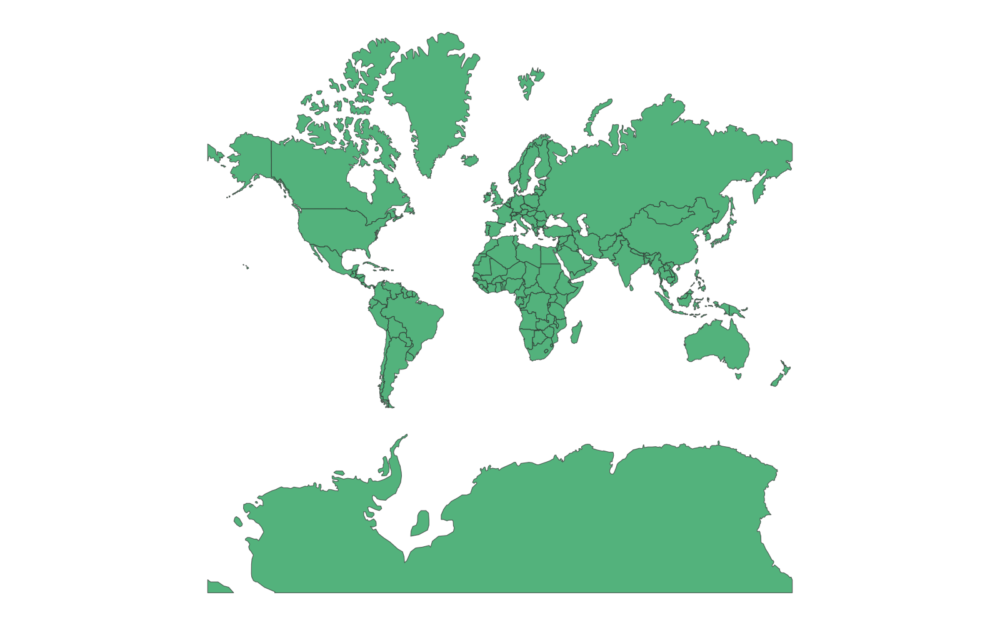

# GIS 错误证据：GeoAgent Task 143

- 主标签：A2 坐标参考系不一致
- LLM：MiniMax-M2.7-highspeed（minimax）
- 推理配置：thinking 开关未单列记录
- 视觉审查：审查全部可视化成果

## 1. 任务目标

将上传的 Shapefile 从 EPSG:4326 转换到 EPSG:3857，并保存为新的 Shapefile。

## 2. 任务执行工作流

1. 读取 EPSG:4326 世界面图层。
2. 调用矢量重投影工具并指定 EPSG:3857。
3. 写出 `country_3857.shp`。

## 3. 错误发生位置

问题出在坐标转换步骤。输出只带有 EPSG:3857 标记，但转换后的坐标超出 Web Mercator 的有效范围。

## 4. 错误机制与结果影响

输出最小 Y 坐标达到 -242528680.94 米，质心相对正确重投影最大偏差为 111861150.77 米。数据虽然可以读取，却不能作为有效的 EPSG:3857 世界图层使用。

## 5. 具体错误证据

- `code.py` 调用重投影工具并报告执行成功。
- `country_3857.shp` 标注为 EPSG:3857，但坐标范围明显越界。
- 输出质心与正确 EPSG:3857 结果的最大偏差为 111861150.77 米。

## 6. 任务执行结果预览

下图是该实验写出的 `country_3857.shp`。图形异常来自错误坐标范围，并非正常的 Web Mercator 世界边界。

### 最终成果：country_3857.shp

- 源成果文件：`steps/step_01/country_3857.shp`

## 7. 解决错误后 GIS 任务应有的结果预览

参考图在处理 Web Mercator 纬度有效范围后执行真正的坐标转换，展示任务应得到的世界面图层。

## 8. 可视化判读说明

本样本的图像差异本身已经能提示错误：执行结果预览中的世界面图层出现异常拉伸和越界形态，不再是 EPSG:3857 下常见的 Web Mercator 世界边界；reference.png 则保持正常的世界面展开形态。这种差异说明坐标转换没有把 EPSG:4326 经纬度正确映射到 Web Mercator 米制坐标。第 5 节中的最小 Y 坐标 -242528680.94 米和最大质心偏差 111861150.77 米，是对该图面异常的定量确认。
