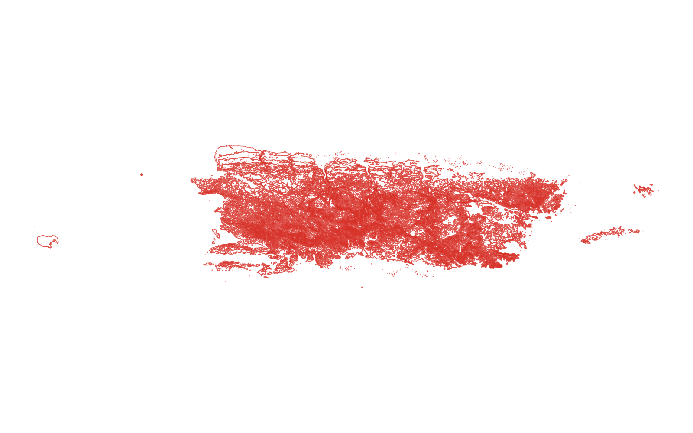
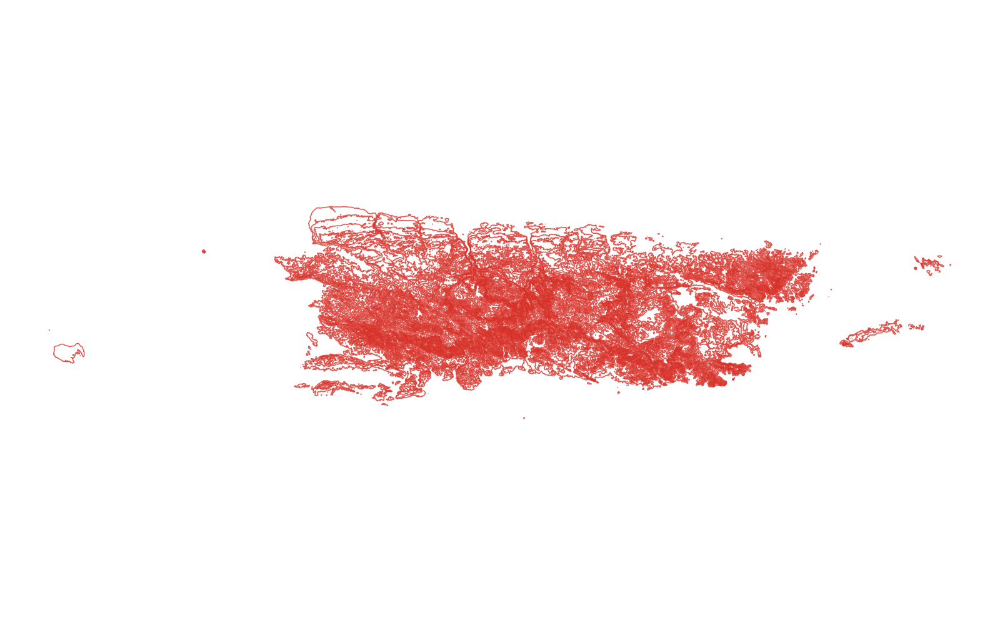

# GIS 错误证据：GeoAgent Task 4

- 主标签：A3 单位误判
- LLM：MiniMax-M2.7-highspeed（minimax）
- 推理配置：thinking 开关未单列记录
- 视觉审查：至少审查一项可视化成果

## 1. 任务目标

基于波多黎各的DEM生成间隔50米的等高线

## 2. 任务执行工作流

1. 读取 Puerto Rico DEM 并确认高程单位。
2. 按指定垂直间隔生成等高线。
3. 将等高线写出为矢量成果。

## 3. 错误发生位置

错误出在等高线级别生成阶段。代码把 `contour_interval = 50.0` 固定作为等值间隔，并在 `levels = np.arange(...)` 中直接使用；日志同时记录 `interval_meters=50` 和 `input_crs=EPSG:4326`。

## 4. 错误机制与结果影响

任务要求的是 50 米间隔的等高线，输出却把 50 作为栅格数值间隔直接传入等值线函数，没有把 DEM 的高程单位、NoData 掩膜和生成级别约束到“米制 50 米”等高线口径；因此 `puerto_contours_50m.shp` 不能作为 50 米等高线结果使用。

## 5. 具体错误证据

- `execution_result/workflow/step_02_code.py` 中 `contour_interval = 50.0` 直接控制 `np.arange(start, end + contour_interval, contour_interval)` 生成等高线级别。
- 同一代码使用 `measure.find_contours(dem_data, level)` 对原始数组逐级提线，没有在生成级别前读取或换算 DEM 高程单位。
- `run_log/run.log` 记录 `interval_meters=50`、`input_crs=EPSG:4326`、`contour_levels=29` 和 `contour_count=7229`，说明输出是按该固定数值直接生成的。

## 6. 任务执行结果预览

下图由错误运行写出的最终成果生成。图层或表格内容以原文件为准，错误判定依据上述处理逻辑和数值证据。

## 7. 解决错误后 GIS 任务应有的结果预览

下图来自同一任务的正确运行，展示在修正“等高线间隔的数值单位与数据坐标单位不一致”后应得到的最终成果。

## 8. 可视化判读说明

本任务的预览图只能呈现成果外观。判读重点是第 5 节列出的函数调用、字段选择、输出元数据和日志参数；这些材料说明错误如何进入 CRS、transform、bounds、像元大小、NoData、字段或 Shapefile 组件。
