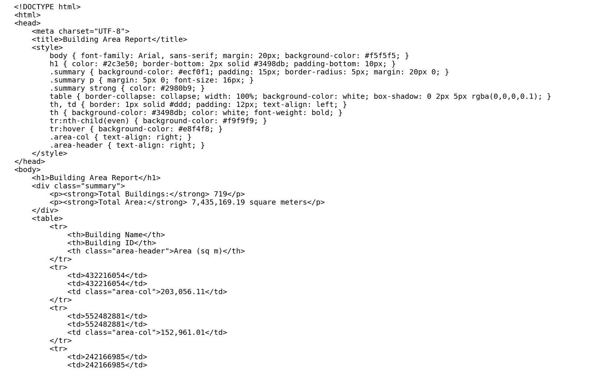
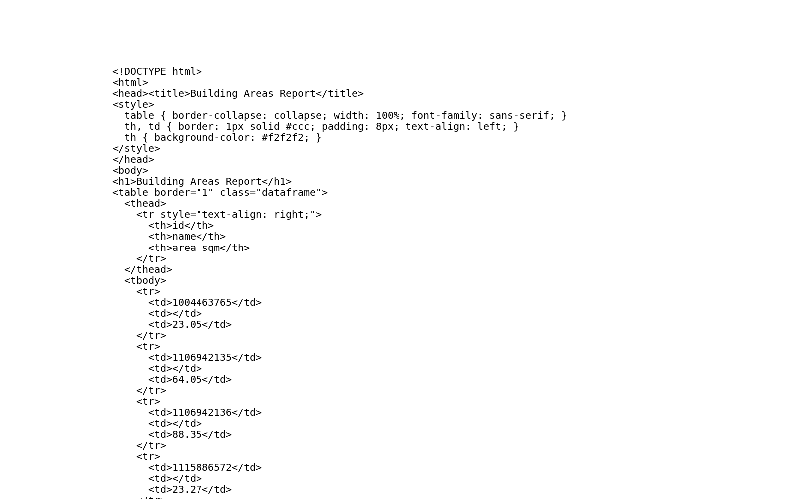

# GIS 错误证据：GeoAgent Task 63

- 主标签：A3 单位误判
- LLM：MiniMax-M2.7-highspeed（minimax）
- 推理配置：thinking 开关未单列记录
- 视觉审查：至少审查一项可视化成果

## 1. 任务目标

请生成HTML报告以显示每个建筑物的建筑面积。您可以查看列信息，如果没有建筑面积，请自行计算。同时请确保在计算面积时使用地图投影。

## 2. 任务执行工作流

1. 读取建筑面并投影到以米为单位的适用 CRS。
2. 计算每栋建筑的平面面积。
3. 以平方米为单位生成 HTML 面积报告。

## 3. 错误发生位置

错误出在面积单位标注阶段。建筑面积按平方英尺计算，却在报告中按平方米解释。

## 4. 错误机制与结果影响

HTML 报告中的面积数值单位与任务要求不一致，后续面积比较和统计会被放大约 10.764 倍。

## 5. 具体错误证据

- `execution_result/workflow/step_01_code.py、execution_result/workflow/step_02_code.py` 先把建筑面重投影到 `EPSG:2272`；该坐标系的线性单位是 US survey foot。
- 随后代码用 `row.geometry.area` 读取面积值，但没有把平方英尺乘以 0.09290304 换算为平方米。
- HTML 模板把同一数值写成 `Total Area: ... square meters` 和 `Area (sq m)`，因此报告标签与实际面积单位不一致。

## 6. 任务执行结果预览

下图由错误运行写出的最终成果生成。图层或表格内容以原文件为准，错误判定依据上述处理逻辑和数值证据。

## 7. 解决错误后 GIS 任务应有的结果预览

下图来自同一任务的正确运行，展示在修正“以平方英尺计算的面积被标注为平方米”后应得到的最终成果。

## 8. 可视化判读说明

本任务的预览图只能呈现成果外观。判读重点是第 5 节列出的函数调用、字段选择、输出元数据和日志参数；这些材料说明错误如何进入 CRS、transform、bounds、像元大小、NoData、字段或 Shapefile 组件。
