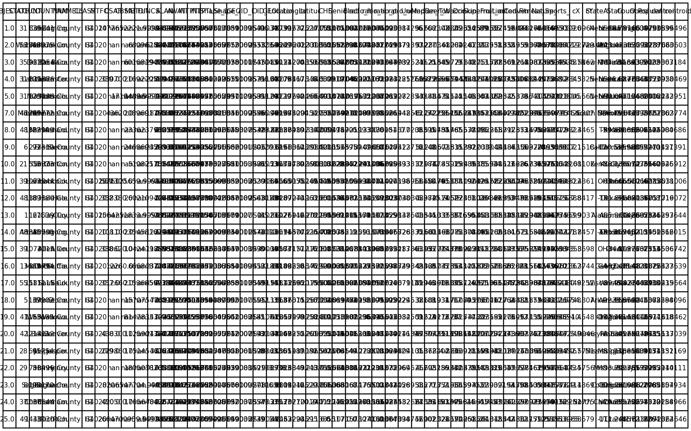
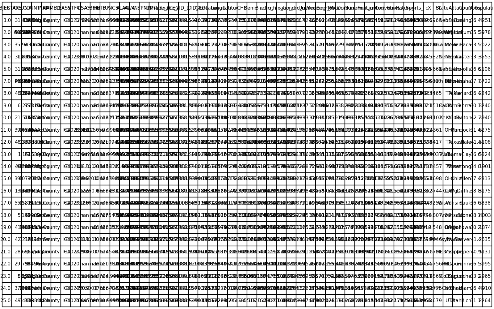

# GIS 错误证据：GeoAgent Task 73

- 主标签：A3 单位误判
- LLM：qwen3.6-plus（dashscope）
- 推理配置：thinking 开关未单列记录
- 视觉审查：至少审查一项可视化成果

## 1. 任务目标

为每个多边形创建质心，并将属性导出为表格。

## 2. 任务执行工作流

1. 读取美国县级面图层。
2. 在适合几何计算的坐标参考下求各县质心。
3. 保留县级属性并导出质心结果。

## 3. 错误发生位置

错误出在县级质心计算的坐标系选择。代码直接在经纬度坐标系中求质心。

## 4. 错误机制与结果影响

`us_counties_centroids_attributes.csv` 中的质心位置受地理坐标计算影响，不能作为面积意义上的县质心结果。

## 5. 具体错误证据

- `execution_result/workflow/step_02_code.py` 读取美国县级面后直接访问 `geometry.centroid` 或等价质心计算。
- 质心计算前没有先转换到适合美国县域面积几何计算的投影坐标系。
- `us_counties_centroids_attributes.csv` 的经纬度字段承接了该地理坐标质心结果。

## 6. 任务执行结果预览

下图由错误运行写出的最终成果生成。图层或表格内容以原文件为准，错误判定依据上述处理逻辑和数值证据。

## 7. 解决错误后 GIS 任务应有的结果预览

下图来自同一任务的正确运行，展示在修正“直接在经纬度坐标系中计算质心”后应得到的最终成果。

## 8. 可视化判读说明

本任务的预览图只能呈现成果外观。判读重点是第 5 节列出的函数调用、字段选择、输出元数据和日志参数；这些材料说明错误如何进入 CRS、transform、bounds、像元大小、NoData、字段或 Shapefile 组件。
