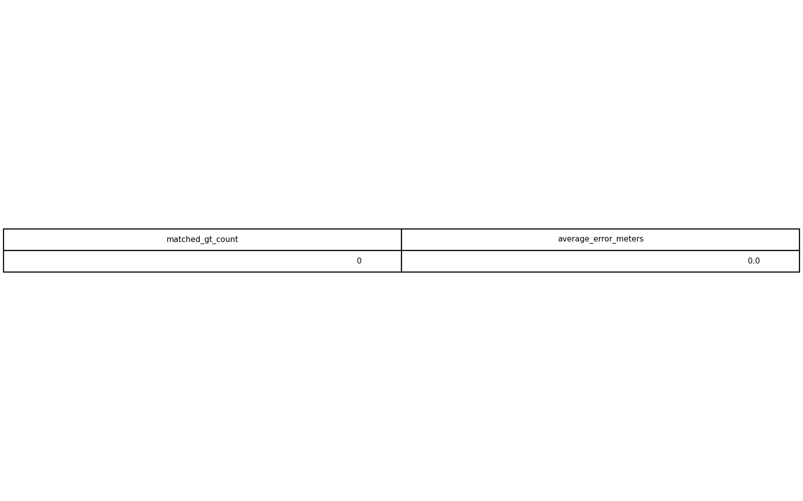
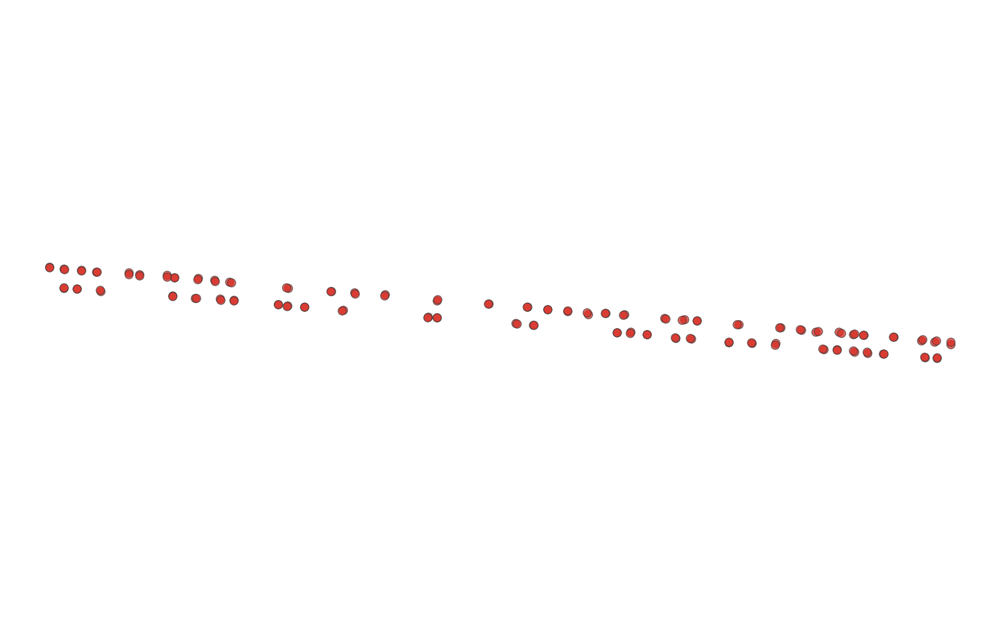

# GIS 错误证据：GeoAgent Task 81

- 主标签：A3 单位误判
- LLM：MiniMax-M2.7-highspeed（minimax）
- 推理配置：thinking 开关未单列记录
- 视觉审查：未启用视觉审查

## 1. 任务目标

您需要计算估计的树干位置与真实位置之间的定位误差：1）对于每个真实位置，在3米范围内查找其最近的估计位置；该最近距离即为误差。2）计算所有具有关联估计位置的树干真实位置的平均误差。

## 2. 任务执行工作流

1. 在统一投影坐标系中匹配真实点和估计点。
2. 筛选距离不超过 3 米的最近匹配。
3. 计算匹配点的平均位置误差。

## 3. 错误发生位置

错误出在最近邻距离阈值单位。任务要求 3 米阈值，运行中距离计算或阈值解释使用了错误单位。

## 4. 错误机制与结果影响

`location_error_map.geojson` 中的匹配点集合不对应 3 米内最近匹配，平均位置误差计算随之失真。

## 5. 具体错误证据

- `execution_result/workflow/step_03_code.py、execution_result/workflow/step_04_code.py` 进行真实点与估计点最近邻匹配。
- 距离阈值在匹配前没有统一到米制投影坐标下解释为 3 米。
- 输出匹配关系因此混入了不满足 3 米容差定义的点对。

## 6. 任务执行结果预览

下图由错误运行写出的最终成果生成。图层或表格内容以原文件为准，错误判定依据上述处理逻辑和数值证据。

## 7. 解决错误后 GIS 任务应有的结果预览

下图来自同一任务的正确运行，展示在修正“最近邻距离阈值使用了错误单位”后应得到的最终成果。

## 8. 可视化判读说明

本任务的预览图只能呈现成果外观。判读重点是第 5 节列出的函数调用、字段选择、输出元数据和日志参数；这些材料说明错误如何进入 CRS、transform、bounds、像元大小、NoData、字段或 Shapefile 组件。
