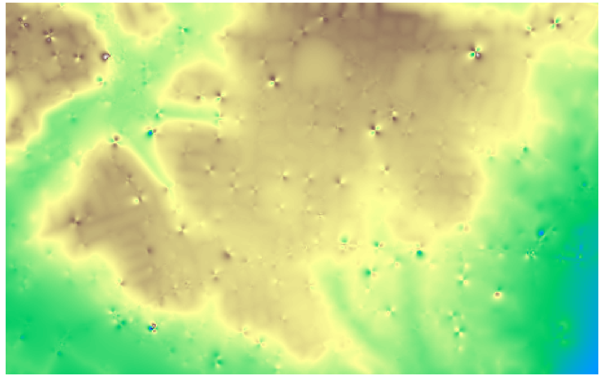
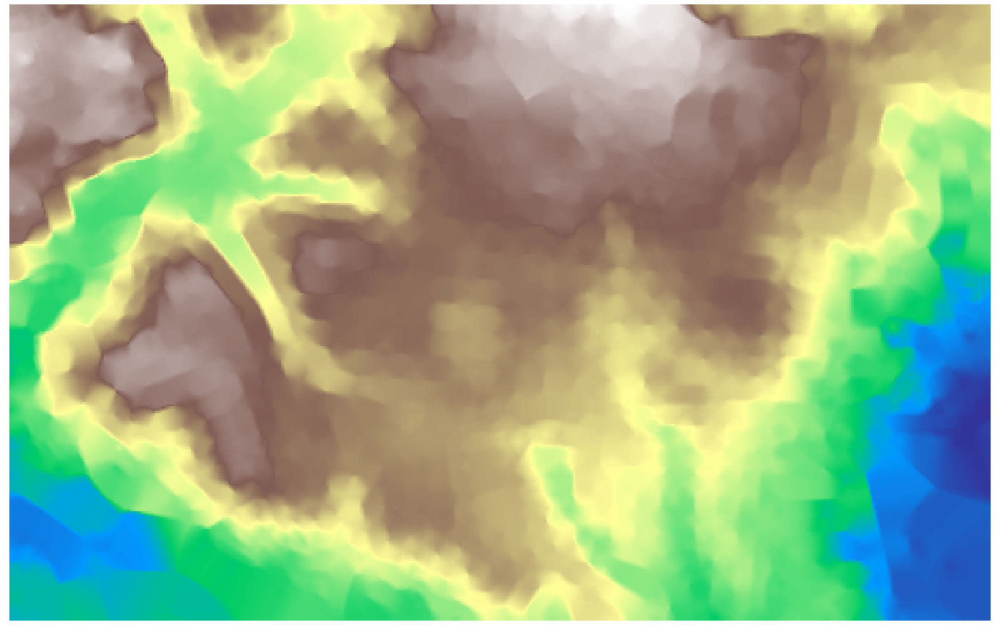

# GIS 错误证据：GeoAgent Task 88

- 主标签：A3 单位误判
- LLM：MiniMax-M2.7-highspeed（minimax）
- 推理配置：thinking 开关未单列记录
- 视觉审查：未启用视觉审查

## 1. 任务目标

筛选 2013 年及之后的高程点，以 IDW 插值生成分辨率为 10 米的 DEM。

## 2. 任务执行工作流

1. 按 `image_date` 筛选点并保留 `elevatio_1`。
2. 在点图层坐标系中建立插值网格。
3. 执行插值并写出 `dem_idw.tif`。

## 3. 错误发生位置

问题出在网格分辨率设置阶段。输入使用以英尺为单位的 EPSG:6569，代码却直接把像元大小设为 10。

## 4. 错误机制与结果影响

输出实际是 10 英尺像元，约等于 3.048 米，而不是任务要求的 10 米；栅格尺寸、采样密度和后续地形分析尺度均随之改变。

## 5. 具体错误证据

- 输入点 CRS 为 EPSG:6569，其线性单位为英尺。
- 输出栅格仍使用 EPSG:6569，像元大小为 10×10。
- 正确实验先转换到米制 CRS，并生成约 10 米像元。

## 6. 任务执行结果预览

下图是该实验生成的 IDW DEM。表面形态可以显示，但图像本身不会暴露像元单位；10 英尺与 10 米的差异由栅格元数据确认。

### 最终成果：dem_idw.tif

- 源成果文件：`steps/step_02/dem_idw.tif`

## 7. 解决错误后 GIS 任务应有的结果预览

参考图来自同一任务中经过验证的米制插值结果，像元大小约为 10 米。

## 8. 可视化判读说明

本任务的预览图只能呈现成果外观。判读重点是第 5 节列出的函数调用、字段选择、输出元数据和日志参数；这些材料说明错误如何进入 CRS、transform、bounds、像元大小、NoData、字段或 Shapefile 组件。
