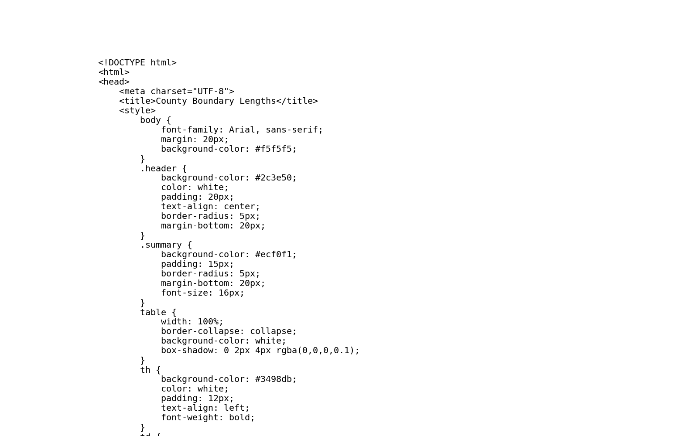
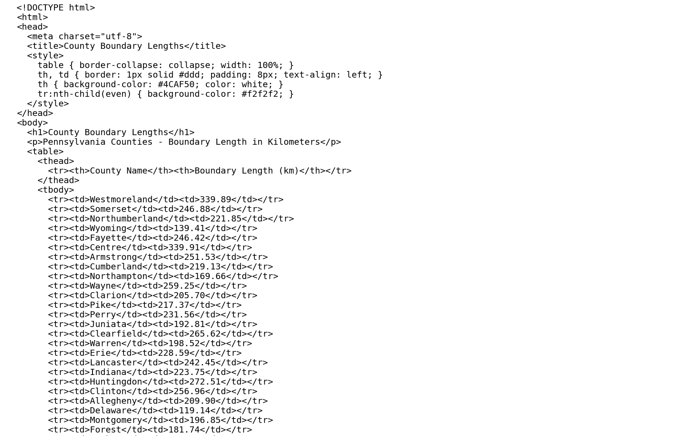

# GIS 错误证据：GeoAgent Task 93

- 主标签：A3 单位误判
- LLM：MiniMax-M2.7-highspeed（minimax）
- 推理配置：thinking 开关未单列记录
- 视觉审查：未启用视觉审查

## 1. 任务目标

基于此输入数据，测量每个县的边界长度（以公里为单位）。然后在HTML文件中显示您的结果。

## 2. 任务执行工作流

1. 将县界转换到适合长度计算的坐标参考。
2. 计算各县边界长度并换算为公里。
3. 生成县级边界长度 HTML 表。

## 3. 错误发生位置

错误出在边界长度计算后的单位标注。代码在度或英尺坐标系中计算长度后直接标为公里。

## 4. 错误机制与结果影响

`county_boundary_lengths.html` 中的长度数值不对应真实公里单位，县界长度比较不可用。

## 5. 具体错误证据

- `execution_result/workflow/step_01_code.py、execution_result/workflow/step_02_code.py、execution_result/workflow/step_03_code.py` 计算县界长度并生成 HTML 报告。
- 长度字段写入报告前没有完成到公里的投影计算或单位换算。
- HTML 中的长度标签使用公里口径，但数值承接的是未正确换算的几何长度。

## 6. 任务执行结果预览

下图由错误运行写出的最终成果生成。图层或表格内容以原文件为准，错误判定依据上述处理逻辑和数值证据。

## 7. 解决错误后 GIS 任务应有的结果预览

下图来自同一任务的正确运行，展示在修正“在度或英尺坐标系中计算后直接标为公里”后应得到的最终成果。

## 8. 可视化判读说明

本任务的预览图只能呈现成果外观。判读重点是第 5 节列出的函数调用、字段选择、输出元数据和日志参数；这些材料说明错误如何进入 CRS、transform、bounds、像元大小、NoData、字段或 Shapefile 组件。
