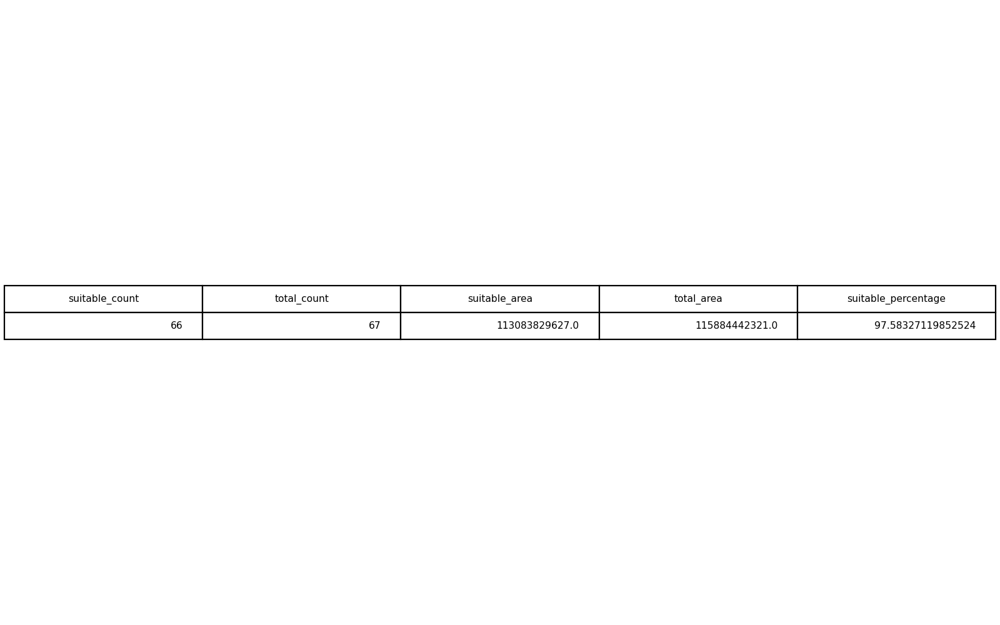
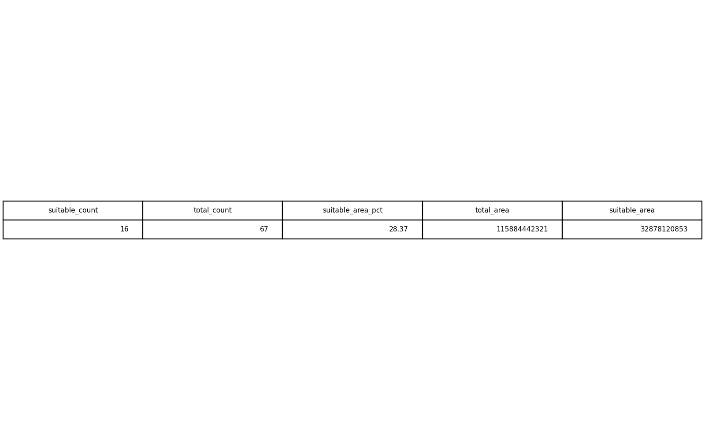

# GIS 错误证据：GeoAgent Task 96

- 主标签：A3 单位误判
- LLM：qwen3.6-plus（dashscope）
- 推理配置：thinking 开关未单列记录
- 视觉审查：审查全部可视化成果

## 1. 任务目标

我想识别宾夕法尼亚州哪些县适合种植更多树木，使用年降水量作为关键参数。年降水量超过2.5英寸的县应被视为适合植树。基于您的分析，请回答以下问题：宾夕法尼亚州有多大比例的地区适合种植更多树木？有多少个县符合植树适宜性标准？

## 2. 任务执行工作流

1. 读取 Pennsylvania 县级降水字段。
2. 把 2.5 英寸阈值换算到数据采用的单位后筛选县。
3. 统计适宜县数量及其面积比例。

## 3. 错误发生位置

错误出在降水阈值单位换算。任务要求年降水量超过 2.5 英寸，运行中把英寸、英尺和米之间的阈值关系处理错误。

## 4. 错误机制与结果影响

`suitability_summary.csv` 中适合植树的县数和面积比例基于错误阈值，不能回答任务中的适宜性问题。

## 5. 具体错误证据

- `execution_result/workflow/step_01_code.py、execution_result/workflow/step_02_code.py` 读取降水字段并按阈值筛选县。
- 筛选阈值没有按输入降水字段单位把 2.5 英寸转换为对应数值。
- `suitability_summary.csv` 中县数和面积比例承接了这个错误阈值。

## 6. 任务执行结果预览

下图由错误运行写出的最终成果生成。图层或表格内容以原文件为准，错误判定依据上述处理逻辑和数值证据。

## 7. 解决错误后 GIS 任务应有的结果预览

下图来自同一任务的正确运行，展示在修正“英寸、英尺与米之间的阈值换算错误”后应得到的最终成果。

## 8. 可视化判读说明

本任务的预览图只能呈现成果外观。判读重点是第 5 节列出的函数调用、字段选择、输出元数据和日志参数；这些材料说明错误如何进入 CRS、transform、bounds、像元大小、NoData、字段或 Shapefile 组件。
