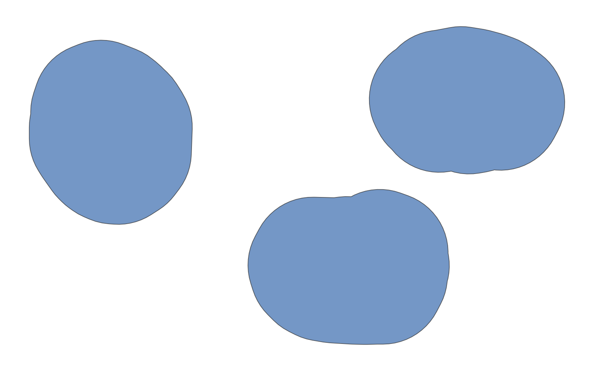
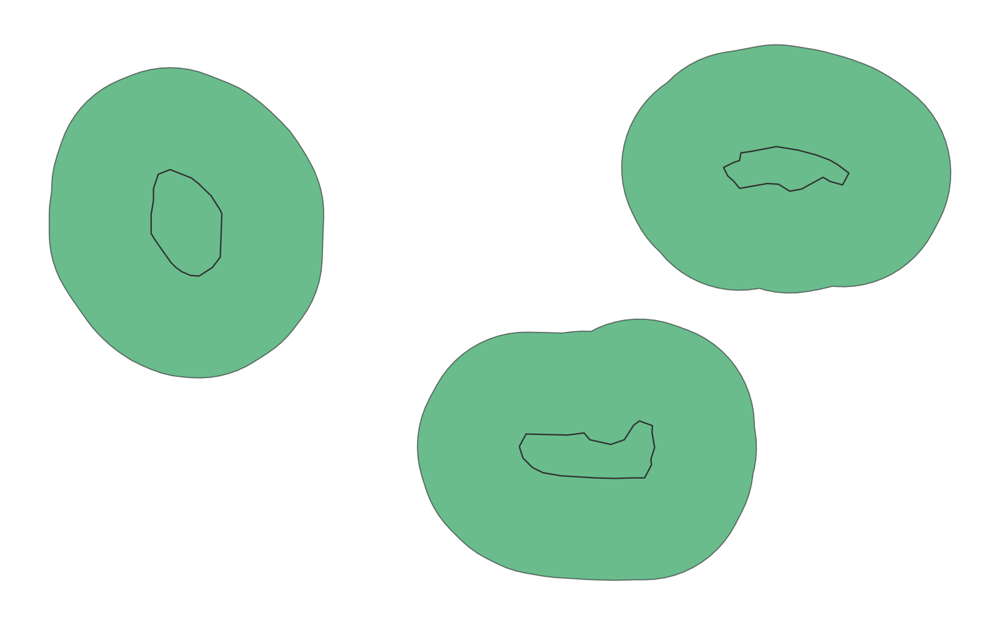

# GIS 错误证据：GeoAgent Task 112

- 主标签：A3 单位误判
- LLM：DeepSeek V4 Pro（DeepSeek thinking 开启）
- 视觉审查：Qwen3-VL（thinking 关闭）

## 1. 任务目标

对输入 Shapefile 中的每个几何要素创建指定距离缓冲区，保留全部原始属性并输出新的 Shapefile。

## 2. 任务执行工作流

1. 读取 `area.shp`。
2. 将缓冲距离设置为 500，并对每个几何直接执行 `buffer(500)`。
3. 把缓冲几何及原属性写入 `area_buffer.shp`。

## 3. 错误发生位置

错误发生在缓冲距离解释与几何运算阶段：程序在读取后没有检查 CRS，也没有把数据投影到米制坐标系。

## 4. 错误机制与结果影响

程序在输入图层没有坐标参考系定义的情况下直接执行 `buffer(500)`，数值 500 的空间单位无法确定，因此不能证明输出满足指定距离缓冲的要求。

输入和输出均无 `.prj`，数值 500 没有可验证的空间单位；输出形状虽然可以绘制，但不能证明代表任务要求的实际距离。

## 5. 具体错误证据

- `buffer_area.py` 将缓冲距离设为 500，并直接调用几何对象的 `buffer()`。
- 输入和输出 Shapefile 均没有 `.prj` 组件。
- 代码中没有补充 CRS、投影转换或单位换算步骤。

## 6. 任务执行结果预览

下图是 LLM 写出的 `area_buffer.shp`。图中可以看到缓冲后的面要素，但由于输入和输出均没有 CRS，图形本身无法说明这段缓冲是否具有正确的距离单位。

### 最终成果：area_buffer.shp

- 源成果文件：`coder/subtask_1/area_buffer.shp`
- 说明：`area_buffer.shp` 的缓冲面预览；颜色仅用于显示输出几何。

## 7. 解决错误后 GIS 任务应有的结果预览

参考图按明确的米制坐标假设绘制 500 米缓冲，只展示任务应产生的最终缓冲几何。

## 8. 可视化判读说明

预览图只能显示空间外观，不能单独呈现 CRS、单位或距离解释错误。本类错误的审查入口是 `execution_result/workflow` 中的缓冲、重投影或坐标处理代码，`run_log/run.log`、`run_log/trace.jsonl` 中的参数记录，以及输出文件的 CRS、bounds、transform 或缓冲参数。
