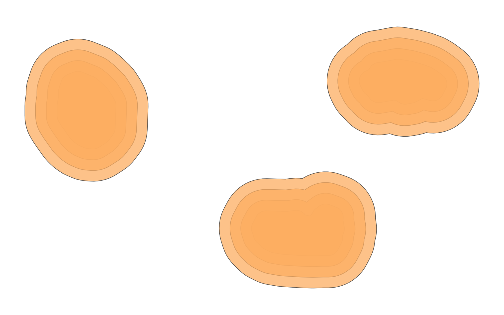

# GIS 错误证据：GeoAgent Task 116

- 主标签：A3 单位误判
- LLM：DeepSeek V4 Pro（DeepSeek thinking 开启）
- 视觉审查：Qwen3-VL（thinking 关闭）

## 1. 任务目标

为灾害区建立 100、200、300、400 米多环缓冲，并与道路叠加，输出受不同缓冲环影响的道路。

## 2. 任务执行工作流

1. 读取灾害区和道路。
2. 创建四级多环缓冲，形成 `multi_ring_buffers.shp`。
3. 将道路与缓冲环叠加，写出 `disaster_impact_roads.shp`。

## 3. 错误发生位置

错误发生在多环缓冲阶段：输入没有 CRS，代码却把 100、200、300、400 直接解释为米。

## 4. 错误机制与结果影响

任务明确要求 100、200、300、400 米缓冲，但代码在两个输入均无 CRS 时直接使用这些数值，无法保证结果单位为米。

所有后续道路叠加均建立在不可验证的缓冲尺度上，`distance_m` 和 `ring_label` 字段无法保证对应真实米制距离。

## 5. 具体错误证据

- `disaster_buffer_analysis.py` 直接用 100、200、300、400 执行缓冲。
- 源数据和生成的 Shapefile 均缺少 `.prj`。
- 代码没有 CRS 推断、投影转换或单位校验。

## 6. 任务执行结果预览

下列两张图分别为 LLM 生成的多环缓冲和道路叠加结果。第一张是关键中间成果，第二张是最终受影响道路；两者都继承了缓冲距离单位无法确认的问题。

### 关键中间成果：multi_ring_buffers.shp

- 源成果文件：`coder/subtask_1/multi_ring_buffers.shp`
- 说明：`multi_ring_buffers.shp` 的四级缓冲环预览。

### 最终成果：disaster_impact_roads.shp

- 源成果文件：`coder/subtask_1/disaster_impact_roads.shp`
- 说明：`disaster_impact_roads.shp` 的受影响道路预览。

## 7. 解决错误后 GIS 任务应有的结果预览

参考图展示在明确米制 CRS 下生成缓冲并完成叠加后应得到的最终受影响道路。

## 8. 可视化判读说明

预览图只能显示空间外观，不能单独呈现 CRS、单位或距离解释错误。本类错误的审查入口是 `execution_result/workflow` 中的缓冲、重投影或坐标处理代码，`run_log/run.log`、`run_log/trace.jsonl` 中的参数记录，以及输出文件的 CRS、bounds、transform 或缓冲参数。
