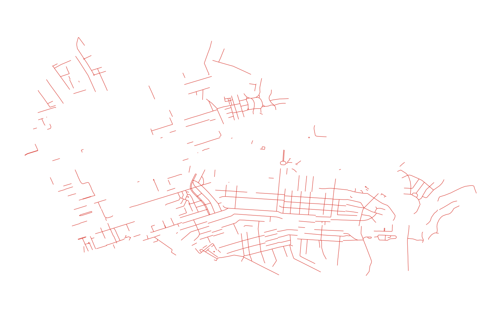
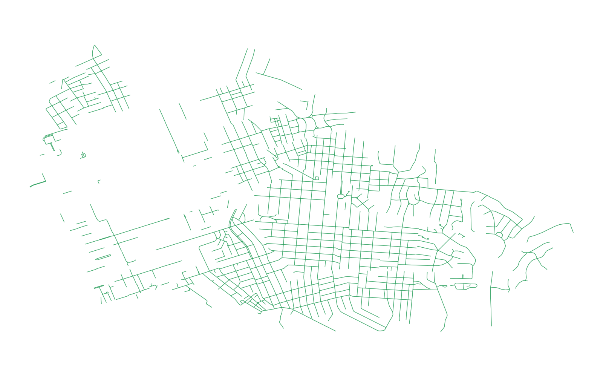

# GIS 错误证据：GeoAgent Task 1

- 主标签：B1 数据集完整性破坏
- LLM：qwen3.6-plus（dashscope）
- 推理配置：thinking 开关未单列记录
- 视觉审查：未启用视觉审查

## 1. 任务目标

解析道路 Shapefile 的字符串型 `tags` 字段，选出 residential 道路并保存为新的 Shapefile。

## 2. 任务执行工作流

1. 读取道路和 `tags` 字符串。
2. 把单引号替换为双引号后调用 `json.loads()`。
3. 保留 `highway="residential"` 的道路并写出结果。

## 3. 错误发生位置

问题出在 DBF 字符串解析阶段。部分 `tags` 在 Shapefile 字段中被截断，并不是完整 JSON；解析失败后代码把道路类型返回为 `None`。

## 4. 错误机制与结果影响

应选出 607 条 residential 道路，实际只保留 397 条，共漏掉 210 条。空间数据被当作普通 JSON 文本处理，造成要素丢失。

## 5. 具体错误证据

- `code.py` 对 `tags` 执行引号替换和 `json.loads()`。
- 异常被捕获后直接返回 `None`，对应记录不会进入结果。
- 输出含 397 条道路；基于字段文本直接提取的参考结果为 607 条。

## 6. 任务执行结果预览

下图是该实验筛选出的 397 条 residential 道路。道路网络中出现的缺口来自字符串解析失败，而不是空间裁剪。

### 最终成果：columbia_residential_roads.shp

- 源成果文件：`steps/step_01/columbia_residential_roads.shp`

## 7. 解决错误后 GIS 任务应有的结果预览

参考图直接从 `tags` 字符串提取 highway 值，保留完整的 607 条 residential 道路。

## 8. 可视化判读说明

本任务的预览图只能呈现成果外观。判读重点是第 5 节列出的函数调用、字段选择、输出元数据和日志参数；这些材料说明错误如何进入 CRS、transform、bounds、像元大小、NoData、字段或 Shapefile 组件。
