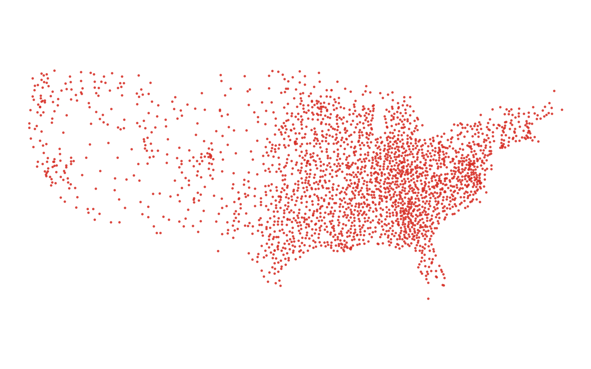

# GIS 错误证据：GeoAgent Task 21

- 主标签：B1 数据集完整性破坏
- LLM：MiniMax-M2.7-highspeed（minimax）
- 推理配置：thinking 开关未单列记录
- 视觉审查：未启用视觉审查

## 1. 任务目标

请将此csv文件转换为shapefile。经度用'X'表示，纬度在'Y'列中。

## 2. 任务执行工作流

1. 读取包含 X、Y 和属性字段的 CSV。
2. 以 X 为经度、Y 为纬度构造点几何。
3. 保留字段类型并写出 Shapefile。

## 3. 错误发生位置

错误出在 CSV 到 Shapefile 的属性写出阶段。任务要求把原 CSV 点位转换为空间图层，属性字段应随点要素一起保留。

## 4. 错误机制与结果影响

字段类型退化会改变后续按属性筛选、连接或统计时的语义，`hiv_points.shp` 虽然有点几何，但不能作为完整的 CSV 转点结果。

## 5. 具体错误证据

- `execution_result/workflow/step_01_code.py` 从 X、Y 字段构造点并写出 Shapefile。
- `hiv_points.shp` 写出后的 DBF 字段类型与原 CSV 字段语义不一致。
- 属性类型退化发生在 CSV 字段进入 Shapefile/DBF 输出的写出阶段。

## 6. 任务执行结果预览

下图由错误运行写出的最终成果生成。图层或表格内容以原文件为准，错误判定依据上述处理逻辑和数值证据。

## 7. 解决错误后 GIS 任务应有的结果预览

下图来自同一任务的正确运行，展示在修正“矢量属性写出时发生类型退化”后应得到的最终成果。

## 8. 可视化判读说明

本任务的预览图只能呈现成果外观。判读重点是第 5 节列出的函数调用、字段选择、输出元数据和日志参数；这些材料说明错误如何进入 CRS、transform、bounds、像元大小、NoData、字段或 Shapefile 组件。
