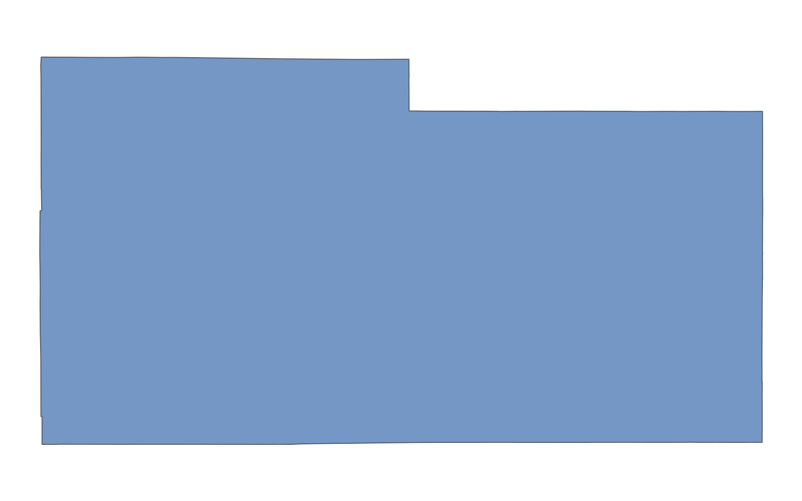

# GIS 错误证据：GeoAgent Task 34

- 主标签：B1 数据集完整性破坏
- LLM：DeepSeek V4 Pro（DeepSeek thinking 开启）
- 视觉审查：Qwen3-VL（thinking 关闭）

## 1. 任务目标

从美国县级边界数据中提取 Laramie County，并保存为独立 Shapefile。

## 2. 任务执行工作流

1. 读取县级边界数据并定位 Laramie County。
2. 提取目标县多边形及属性。
3. 写出 `Laramie_County.shp`。

## 3. 错误发生位置

错误发生在输入完整性检查和输出写入阶段：输入包组件不完整，输出时也没有形成带 `.prj` 的完整 Shapefile。

## 4. 错误机制与结果影响

生成的 Laramie County Shapefile 缺少 `.prj`，无法携带坐标参考系；完整县级数据可提供 EPSG:4326 作为派生参考。

输出边界缺少坐标参考系定义，其他 GIS 软件无法仅凭该数据包确定坐标含义，叠加和重投影存在错误风险。

## 5. 具体错误证据

- 样本输入包仅含 `US_Counties.shp` 和 `US_Counties.shx`，组件不完整。
- 输出具有 `.shp`、`.shx`、`.dbf` 和 `.cpg`，但没有 `.prj`。
- 已有质量检测也报告该输出缺少 CRS 定义。

## 6. 任务执行结果预览

下图是 LLM 提取的 Laramie County 边界。县界几何已经写入 Shapefile，但输出缺少 `.prj`；这一问题需要结合文件组件检查判断，不能只看图形外观。

### 最终成果：Laramie_County.shp

- 源成果文件：`coder/subtask_1/Laramie_County.shp`
- 说明：`Laramie_County.shp` 的县界几何预览。

## 7. 解决错误后 GIS 任务应有的结果预览

参考图由完整县级数据中的 Laramie County 边界生成，对应应保留 EPSG:4326 定义的最终成果。

## 8. 可视化判读说明

预览图只能显示几何外观，不能直接呈现 Shapefile 组件完整性。本类错误的审查入口是样本数据包中的 `.prj`、`.dbf`、`.shx` 等组件，`execution_result/file_metadata.json`，以及 `run_log/run.log` 中的输出写入记录。
