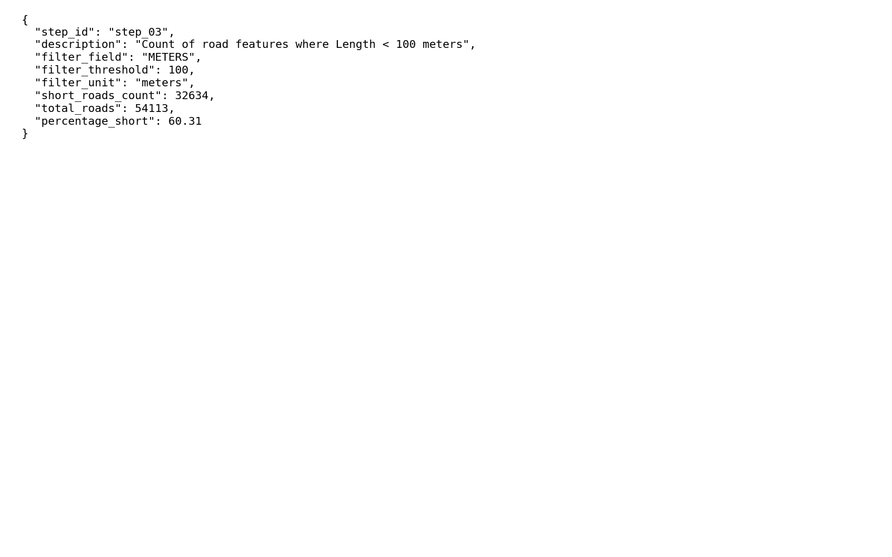

# GIS 错误证据：GeoAgent Task 64

- 主标签：B1 数据集完整性破坏
- LLM：MiniMax-M2.7-highspeed（minimax）
- 推理配置：thinking 开关未单列记录
- 视觉审查：审查全部可视化成果

## 1. 任务目标

执行以下任务：1) 将此道路矢量图层重新投影到NAD27 / UTM Zone 10。2) 创建包含道路要素长度的新字段，字段名为"Length"。3) 使用"Length"列找出长度小于100米的道路数量。

## 2. 任务执行工作流

1. 将道路图层重投影到 NAD27 / UTM Zone 10。
2. 根据投影后几何计算并写入 `Length` 字段。
3. 使用 `Length < 100` 统计道路数量。

## 3. 错误发生位置

错误出在长度字段选择阶段。任务要求新建 `Length` 字段后用它筛选小于 100 米道路，运行中使用了旧长度字段。

## 4. 错误机制与结果影响

`short_roads_count.json` 的计数不是基于任务要求的新计算长度，不能回答长度小于 100 米的道路数量。

## 5. 具体错误证据

- `execution_result/workflow/step_02_code.py、execution_result/workflow/step_03_code.py、execution_result/workflow/step_04_code.py` 包含重投影、长度字段生成和阈值筛选步骤。
- 阈值筛选引用输入数据已有长度字段，而不是任务要求新建并写出的 `Length` 字段。
- `short_roads_count.json` 的道路数量因此不是按新计算的 100 米阈值得到。

## 6. 任务执行结果预览

下图由错误运行写出的最终成果生成。图层或表格内容以原文件为准，错误判定依据上述处理逻辑和数值证据。

## 7. 解决错误后 GIS 任务应有的结果预览

下图来自同一任务的正确运行，展示在修正“阈值筛选使用了旧长度字段而非任务要求的新计算 Length 字段”后应得到的最终成果。

## 8. 可视化判读说明

本任务的预览图只能呈现成果外观。判读重点是第 5 节列出的函数调用、字段选择、输出元数据和日志参数；这些材料说明错误如何进入 CRS、transform、bounds、像元大小、NoData、字段或 Shapefile 组件。
