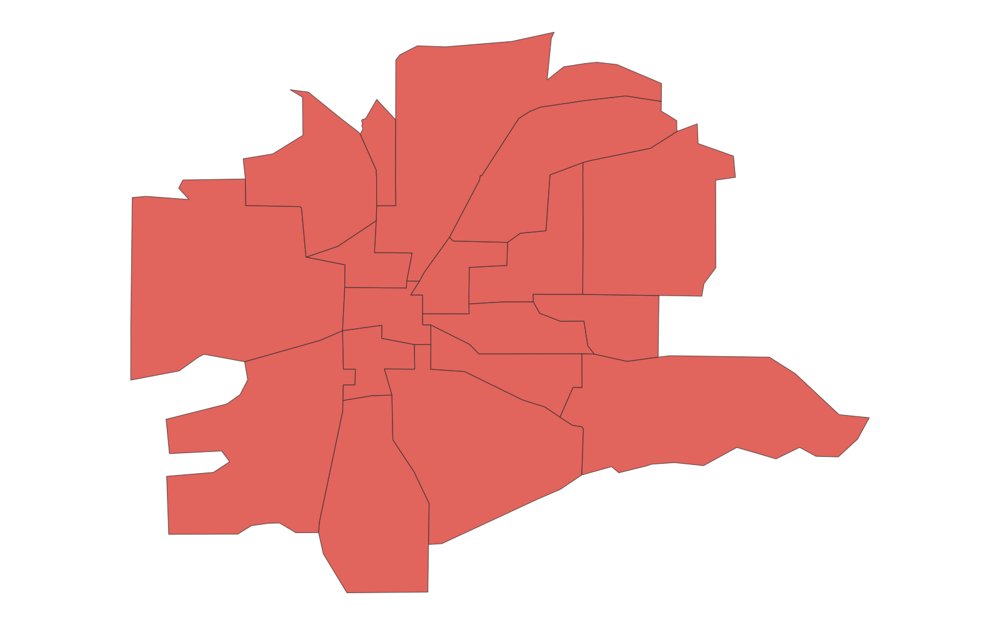

# GIS 错误证据：GeoAgent Task 83

- 主标签：B1 数据集完整性破坏
- LLM：qwen3.6-plus（dashscope）
- 推理配置：thinking 开关未单列记录
- 视觉审查：至少审查一项可视化成果

## 1. 任务目标

将美国人口普查街区组人口表连接到街区组边界。注意，您必须首先通过合并州、县、普查区和街区组的简短FIPS代码来创建完整的街区组FIPS。

## 2. 任务执行工作流

1. 拼接州、县、普查区和街区组短 FIPS，生成完整连接键。
2. 使用完整 FIPS 连接人口表与街区组边界。
3. 检查人口字段的连接完整性并写出结果。

## 3. 错误发生位置

错误出在街区组 FIPS 连接键构造。任务要求把州、县、普查区和街区组短 FIPS 补零后拼接成完整键。

## 4. 错误机制与结果影响

连接键错误导致人口表记录无法正确连接到边界，`rolla_downtown_block_groups_2021_with_population.shp` 的人口字段不完整。

## 5. 具体错误证据

- `execution_result/workflow/step_01_code.py、execution_result/workflow/step_02_code.py` 构造 FIPS 键并执行属性连接。
- 连接键拼接时没有按州、县、普查区和街区组字段的标准位数逐段补零。
- `rolla_downtown_block_groups_2021_with_population.shp` 中人口属性因此无法与全部街区组边界稳定匹配。

## 6. 任务执行结果预览

下图由错误运行写出的最终成果生成。图层或表格内容以原文件为准，错误判定依据上述处理逻辑和数值证据。

## 7. 解决错误后 GIS 任务应有的结果预览

下图来自同一任务的正确运行，展示在修正“FIPS 连接键补零错误造成属性连接缺失”后应得到的最终成果。

## 8. 可视化判读说明

本任务的预览图只能呈现成果外观。判读重点是第 5 节列出的函数调用、字段选择、输出元数据和日志参数；这些材料说明错误如何进入 CRS、transform、bounds、像元大小、NoData、字段或 Shapefile 组件。
