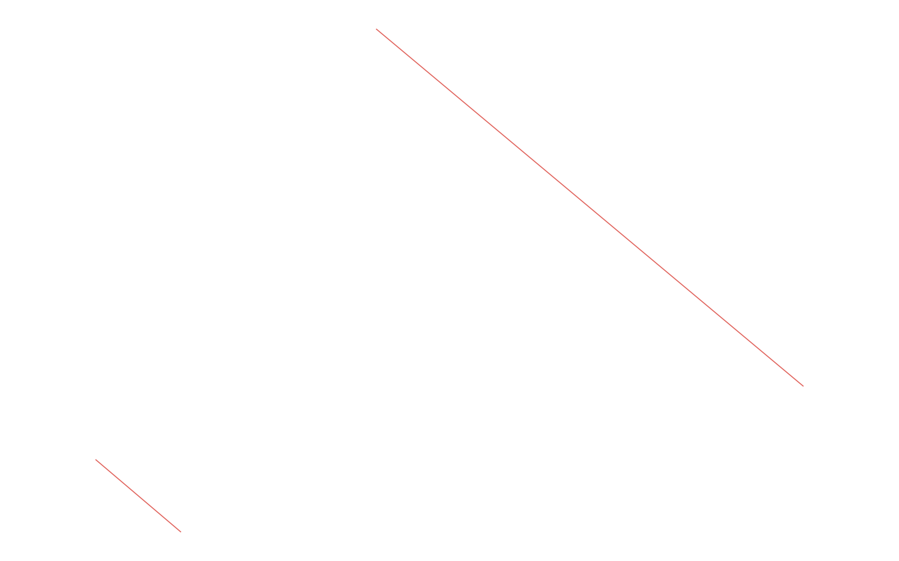

# GIS 错误证据：GeoAgent Task 107

- 主标签：B1 数据集完整性破坏
- LLM：DeepSeek V4 Pro（DeepSeek thinking 开启）
- 视觉审查：Qwen3-VL（thinking 关闭）

## 1. 任务目标

使用 `area.shp` 边界裁剪 `road.shp`，保留道路原属性并输出新的 Shapefile。

## 2. 任务执行工作流

1. 读取裁剪边界和道路图层。
2. 直接执行空间裁剪。
3. 将结果写入 `road_clipped.shp`。

## 3. 错误发生位置

错误发生在空间运算前的 CRS 校验和输出写入阶段：两个输入均无 `.prj`，代码仍继续裁剪。

## 4. 错误机制与结果影响

输入与裁剪输出均缺少 `.prj`，代码仍执行空间裁剪并写出没有权威 CRS 的不完整 Shapefile。

输出几何缺少权威空间参考，无法验证两个输入是否处于同一坐标系，也无法形成完整、可交换的 Shapefile。

## 5. 具体错误证据

- `area.shp`、`road.shp` 和 `road_clipped.shp` 均无 `.prj`。
- `clip_roads.py` 未建立或验证权威 CRS 后继续空间裁剪。
- 既有质量检测报告输出缺少 CRS。

## 6. 任务执行结果预览

下图是 LLM 写出的道路裁剪结果。几何上可以看到裁剪后的道路，但输入和输出均缺少 `.prj`，因此图片不能证明裁剪所依据的空间参考是有效的。

### 最终成果：road_clipped.shp

- 源成果文件：`coder/subtask_1/road_clipped.shp`
- 说明：`road_clipped.shp` 中裁剪后的道路几何预览。

## 7. 解决错误后 GIS 任务应有的结果预览

参考图展示在已验证统一 CRS 并保留投影定义后应得到的最终裁剪道路。

## 8. 可视化判读说明

预览图只能显示几何外观，不能直接呈现 Shapefile 组件完整性。本类错误的审查入口是样本数据包中的 `.prj`、`.dbf`、`.shx` 等组件，`execution_result/file_metadata.json`，以及 `run_log/run.log` 中的输出写入记录。
