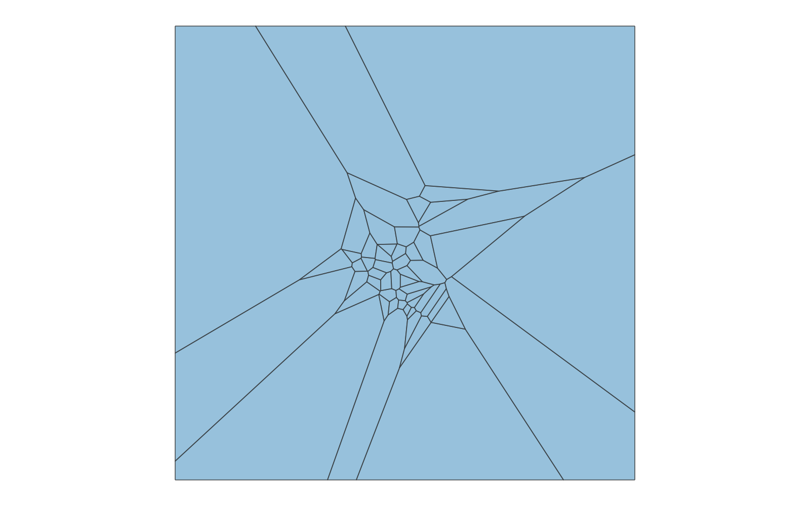
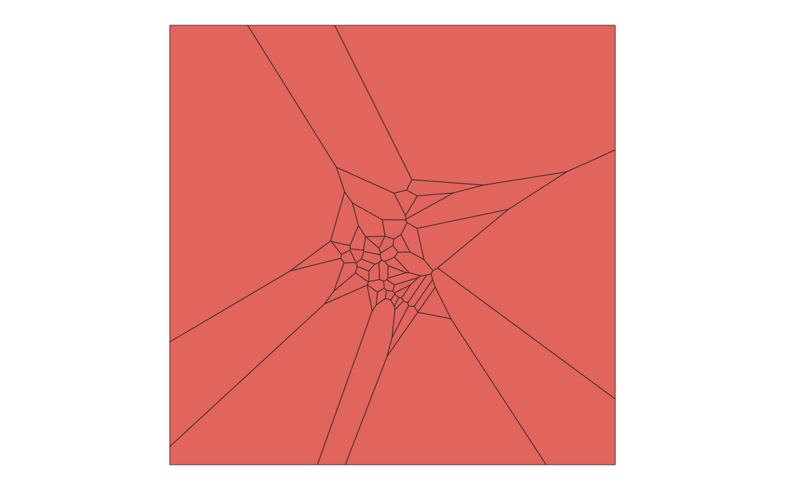
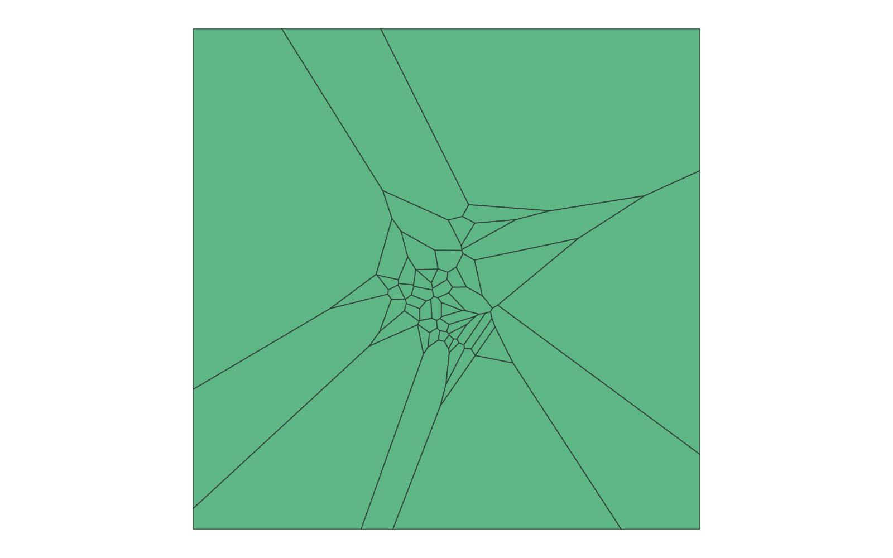

# GIS 错误证据：GeoAgent Task 126

- 主标签：B1 数据集完整性破坏
- LLM：DeepSeek V4 Pro（DeepSeek thinking 开启）
- 视觉审查：Qwen3-VL（thinking 关闭）

## 1. 任务目标

将建筑面转换为点，生成有界 Voronoi 多边形，并与原建筑叠加后保存最终 Shapefile。

## 2. 任务执行工作流

1. 读取建筑面并转换为代表点。
2. 生成有界 Voronoi 多边形，写出 `voronoi_polygons.shp`。
3. 与建筑面叠加并写出 `final_result.shp`。

## 3. 错误发生位置

错误发生在输入校验及两个 Shapefile 的输出写入阶段：源建筑和中间、最终成果都没有 `.prj`。

## 4. 错误机制与结果影响

Voronoi 与叠加结果继承了输入 Shapefile 缺少 `.prj` 的问题，输出空间参考仍未定义。

Voronoi 距离关系没有可验证的坐标单位，最终数据包也无法向后续 GIS 工作流传递空间参考。

## 5. 具体错误证据

- `buildings.shp` 没有 `.prj`。
- `voronoi_polygons.shp` 和 `final_result.shp` 同样没有 `.prj`。
- 代码未建立可验证的 CRS。

## 6. 任务执行结果预览

下列两张图分别为 LLM 生成的 Voronoi 多边形和建筑叠加结果。中间成果和最终成果均没有 `.prj`。

### 关键中间成果：voronoi_polygons.shp

- 源成果文件：`coder/subtask_1/voronoi_polygons.shp`
- 说明：`voronoi_polygons.shp` 的有界 Voronoi 多边形预览。

### 最终成果：final_result.shp

- 源成果文件：`coder/subtask_1/final_result.shp`
- 说明：`final_result.shp` 的 Voronoi—建筑叠加结果预览。

## 7. 解决错误后 GIS 任务应有的结果预览

参考图展示在已定义和保留 CRS 的条件下应得到的最终 Voronoi—建筑叠加结果。

## 8. 可视化判读说明

预览图只能显示几何外观，不能直接呈现 Shapefile 组件完整性。本类错误的审查入口是样本数据包中的 `.prj`、`.dbf`、`.shx` 等组件，`execution_result/file_metadata.json`，以及 `run_log/run.log` 中的输出写入记录。
