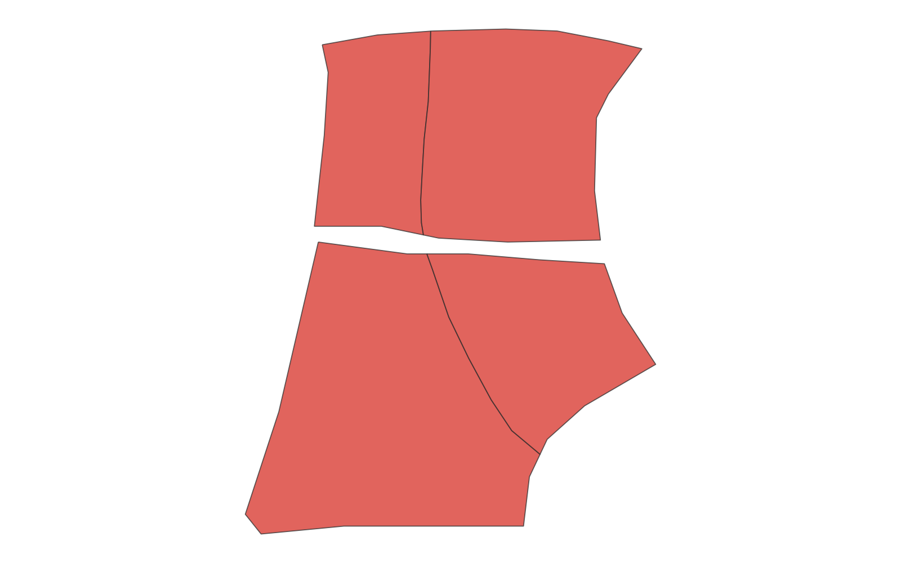
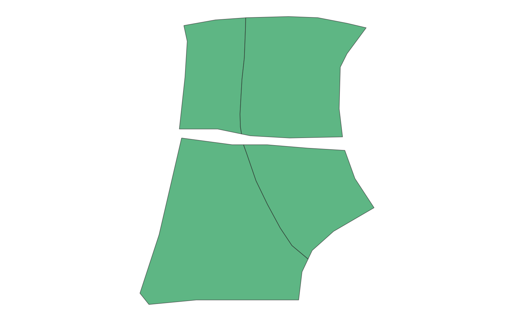

# GIS 错误证据：GeoAgent Task 127

- 主标签：B1 数据集完整性破坏
- LLM：DeepSeek V4 Pro（DeepSeek thinking 开启）
- 视觉审查：Qwen3-VL（thinking 关闭）

## 1. 任务目标

使用线图层分割面图层，并将分割后的新面保存为 Shapefile。

## 2. 任务执行工作流

1. 读取线和宗地面。
2. 使用线几何分割相交宗地。
3. 将分割面写入 `split_parcels.shp`。

## 3. 错误发生位置

错误发生在输入完整性检查和输出写入阶段：输入与输出均缺少 `.prj`。

## 4. 错误机制与结果影响

分割后的 Shapefile 与两个输入一样缺少 `.prj`，输出数据包未保存空间参考定义。

分割面可以被绘制，但输出没有空间参考定义，无法可靠参与后续叠加、距离计算和数据交换。

## 5. 具体错误证据

- `line.shp` 与 `parcel.shp` 均无 `.prj`。
- `split_parcels.shp` 也无 `.prj`。
- 代码未验证或补充 CRS 元数据。

## 6. 任务执行结果预览

下图是 LLM 使用线要素分割宗地后写出的面结果。图中只能检查分割几何，输出缺少 `.prj` 的数据完整性问题需要结合文件组件判断。

### 最终成果：split_parcels.shp

- 源成果文件：`coder/subtask_1/split_parcels.shp`
- 说明：`split_parcels.shp` 中线分割后的面几何预览。

## 7. 解决错误后 GIS 任务应有的结果预览

参考图展示在保留有效 CRS 后应得到的最终分割面。

## 8. 可视化判读说明

预览图只能显示几何外观，不能直接呈现 Shapefile 组件完整性。本类错误的审查入口是样本数据包中的 `.prj`、`.dbf`、`.shx` 等组件，`execution_result/file_metadata.json`，以及 `run_log/run.log` 中的输出写入记录。
