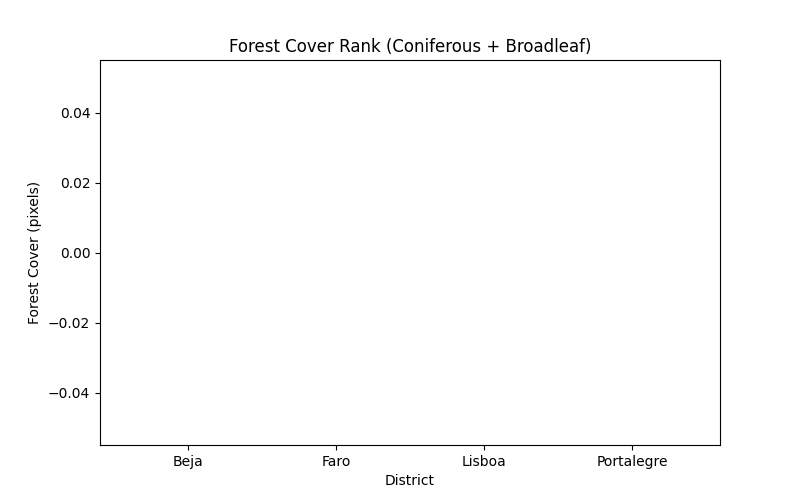
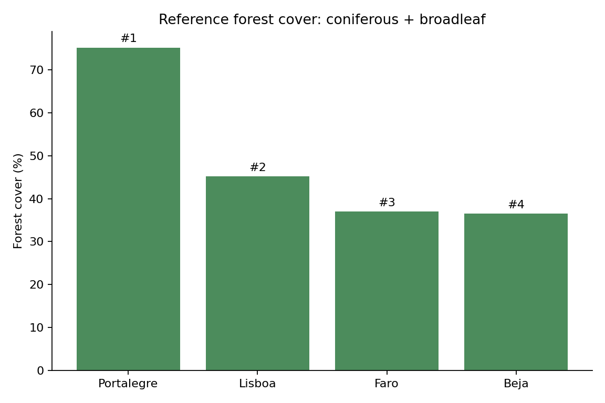

# GIS 错误证据：GeoNatureAgent BigEarthNet Forest Cover Rank

- 主标签：B1. Dataset Integrity Violation
- 次标签：无
- LLM 配置：deepseek-v4-pro（DeepSeek）
- 推理配置：direct request；thinking 开关未单列记录
- 来源项目：GeoNatureAgent Benchmark
- 难度：hard

## 1. 任务目标

按 BigEarthNet 土地覆盖分类统计结构，将 Coniferous Forest 与 Broadleaf Forest 合并为森林覆盖率，并对四个葡萄牙 district 排名和制图。

## 2. 任务执行工作流

1. 读取 BigEarthNet Portugal district 统计 JSON。
2. 代码尝试在 district 顶层直接查找 `1`、`2`、`Coniferous Forest`、`Broadleaf Forest`。
3. 未读取 `breakdown` 列表中的类别标签和百分比。
4. 将缺失字段回退为 0 后生成 CSV、JSON 和柱状图。

## 3. 错误发生位置

错误发生在 `execution_result/workflow/generated_code.py` 的森林覆盖提取逻辑。BigEarthNet LULC 分类信息位于 `breakdown` 列表，每个类别有 `value`、`label`、`percentage`；生成代码却把顶层 JSON 当作平铺类别字段。

## 4. 错误机制与结果影响

这是空间数据结构与属性语义误读：BigEarthNet 的 LULC 统计不是平铺字段，而是 `breakdown` 中带 `value`、`label`、`percentage` 的分类记录。森林覆盖应由 class 1 Coniferous Forest 与 class 2 Broadleaf Forest 的百分比相加；错误运行虽然生成了图表，但图表表达的是全零值，掩盖了 Portalegre、Lisboa、Faro、Beja 的真实差异。

## 5. 具体错误证据

```json
{
  "observed_zero_forest_rows": 4,
  "all_observed_values_zero": true,
  "expected_top_district": "Portalegre",
  "expected_top_forest_cover_pct": 75.2,
  "reference_records": [
    {
      "District": "Portalegre",
      "ConiferousPct": 13.2,
      "BroadleafPct": 62.0,
      "ForestCoverPct": 75.2,
      "ForestPatchEstimate": 4674.43,
      "Rank": 1
    },
    {
      "District": "Lisboa",
      "ConiferousPct": 23.1,
      "BroadleafPct": 22.1,
      "ForestCoverPct": 45.2,
      "ForestPatchEstimate": 648.62,
      "Rank": 2
    },
    {
      "District": "Faro",
      "ConiferousPct": 2.0,
      "BroadleafPct": 35.0,
      "ForestCoverPct": 37.0,
      "ForestPatchEstimate": 2503.79,
      "Rank": 3
    },
    {
      "District": "Beja",
      "ConiferousPct": 2.7,
      "BroadleafPct": 33.8,
      "ForestCoverPct": 36.5,
      "ForestPatchEstimate": 5262.94,
      "Rank": 4
    }
  ],
  "observed_records": [
    {
      "District": "Beja",
      "ForestCover": 0,
      "Rank": 1
    },
    {
      "District": "Faro",
      "ForestCover": 0,
      "Rank": 1
    },
    {
      "District": "Lisboa",
      "ForestCover": 0,
      "Rank": 1
    },
    {
      "District": "Portalegre",
      "ForestCover": 0,
      "Rank": 1
    }
  ]
}
```

## 6. 任务执行结果预览



## 7. 解决错误后 GIS 任务应有的结果预览



## 8. 可视化判读说明

本案例的关键证据是生成代码、运行日志、错误输出表和参考结果之间的差异。图片只作为空间分析或分类统计结果的可视化辅助，最终判定以第 5 节列出的数值与代码证据为准。
