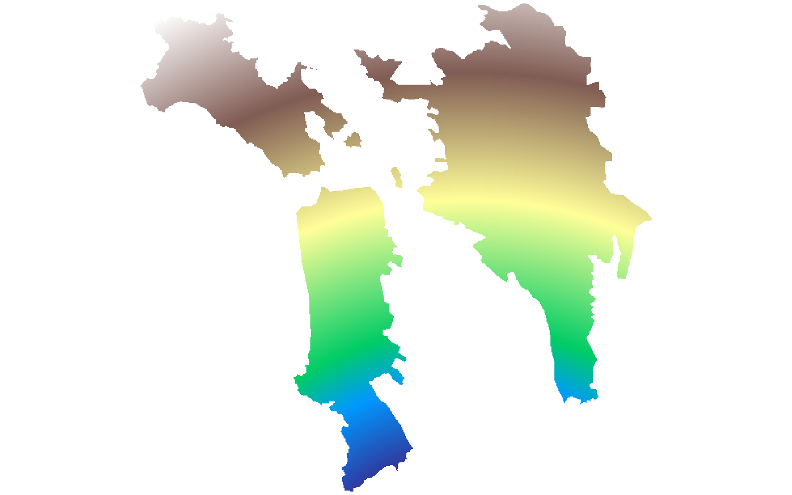
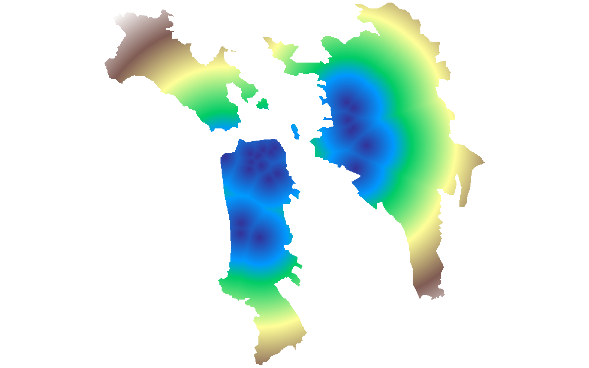

# GIS 错误证据：GeoAgent Task 74

- 主标签：B2 栅格对齐错误
- LLM：MiniMax-M2.7-highspeed（minimax）
- 推理配置：thinking 开关未单列记录
- 视觉审查：未启用视觉审查

## 1. 任务目标

生成栅格地图，展示旧金山市普查区到最近医院的距离，地图分辨率为100米。

## 2. 任务执行工作流

1. 以 100 米分辨率建立 San Francisco 普查区栅格网格。
2. 计算每个像元到最近医院的欧氏距离。
3. 按普查区边界掩膜并写出距离栅格。

## 3. 错误发生位置

错误出在距离栅格的网格定义和距离计算。任务要求 100 米分辨率的医院距离栅格，运行结果与参考网格不一致。

## 4. 错误机制与结果影响

`sf_hospital_accessibility.tif` 的像元距离不能表示普查区到最近医院的正确 100 米网格结果。

## 5. 具体错误证据

- `execution_result/workflow/step_03_code.py、execution_result/workflow/step_04_code.py、execution_result/workflow/step_05_code.py、execution_result/workflow/step_06_code.py` 建立栅格网格并计算到医院距离。
- 输出距离栅格与正确 100 米网格的平均绝对误差为 45889 米，空间相关为 0.28。
- `sf_hospital_accessibility.tif` 的像元距离承接了错误网格或错误距离计算。

## 6. 任务执行结果预览

下图由错误运行写出的最终成果生成。图层或表格内容以原文件为准，错误判定依据上述处理逻辑和数值证据。

## 7. 解决错误后 GIS 任务应有的结果预览

下图来自同一任务的正确运行，展示在修正“距离栅格的网格或距离计算与参考结果不一致”后应得到的最终成果。

## 8. 可视化判读说明

本任务的预览图只能呈现成果外观。判读重点是第 5 节列出的函数调用、字段选择、输出元数据和日志参数；这些材料说明错误如何进入 CRS、transform、bounds、像元大小、NoData、字段或 Shapefile 组件。
