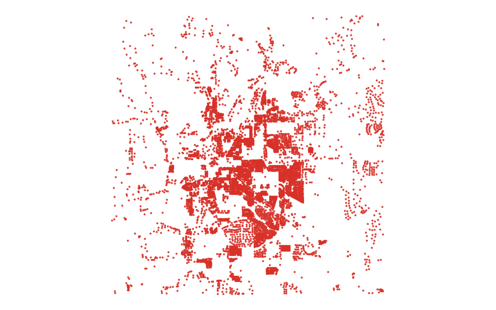

# GIS 错误证据：GeoAgent Task 77

- 主标签：B2 栅格对齐错误
- LLM：MiniMax-M2.7-highspeed（minimax）
- 推理配置：thinking 开关未单列记录
- 视觉审查：审查全部可视化成果

## 1. 任务目标

计算每个建筑物的地形坡度：1) 计算坡度；2) 创建建筑物轮廓的质心；3) 提取建筑物质心处的坡度值。

## 2. 任务执行工作流

1. 根据 DEM 计算地形坡度。
2. 生成每栋建筑的质心点。
3. 在坡度栅格中采样质心位置并写入建筑结果。

## 3. 错误发生位置

错误出在坡度栅格和建筑质心采样的网格对齐。任务要求在建筑质心处提取坡度值，运行结果与参考采样网格不一致。

## 4. 错误机制与结果影响

`buildings_with_slope.shp` 中坡度字段不能代表建筑质心处真实坡度。

## 5. 具体错误证据

- `execution_result/workflow/step_03_code.py、execution_result/workflow/step_04_code.py、execution_result/workflow/step_05_code.py` 计算坡度、生成建筑质心并采样。
- 输出坡度字段相对正确采样结果的 RMSE 为 0.995，空间相关为 0.915。
- `buildings_with_slope.shp` 的坡度值承接了错误网格对齐或采样位置。

## 6. 任务执行结果预览

下图由错误运行写出的最终成果生成。图层或表格内容以原文件为准，错误判定依据上述处理逻辑和数值证据。

## 7. 解决错误后 GIS 任务应有的结果预览

下图来自同一任务的正确运行，展示在修正“坡度栅格计算或质心采样与参考网格不一致”后应得到的最终成果。

## 8. 可视化判读说明

本任务的预览图只能呈现成果外观。判读重点是第 5 节列出的函数调用、字段选择、输出元数据和日志参数；这些材料说明错误如何进入 CRS、transform、bounds、像元大小、NoData、字段或 Shapefile 组件。
