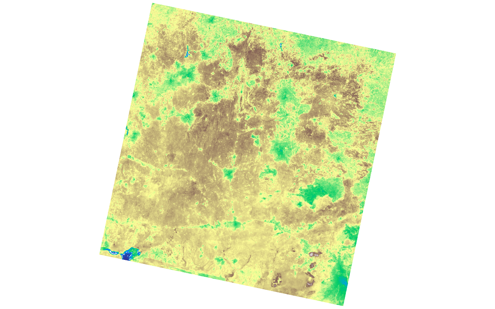
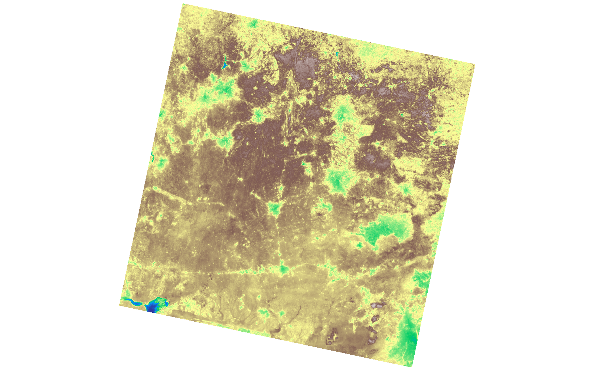

# GIS 错误证据：GeoAgent Task 100

- 主标签：B2 栅格对齐错误
- LLM：qwen3.6-plus（dashscope）
- 推理配置：thinking 开关未单列记录
- 视觉审查：审查全部可视化成果

## 1. 任务目标

我需要您基于这两个波段计算NDVI指数。

## 2. 任务执行工作流

1. 读取 Landsat 8 红光和近红外波段。
2. 应用波段比例因子与偏移量后计算 NDVI。
3. 继承正确网格和 NoData 设置写出 NDVI。

## 3. 错误发生位置

错误出在遥感波段数值转换。计算 NDVI 前应正确应用波段比例因子或偏移量，运行中处理不一致。

## 4. 错误机制与结果影响

`ndvi.tif` 的像元值不对应真实 NDVI，不能用于植被指数分析。

## 5. 具体错误证据

- `execution_result/workflow/step_04_code.py` 读取红光和近红外波段并计算 NDVI。
- NDVI 公式前没有按源栅格元数据一致应用比例因子或偏移量。
- `ndvi.tif` 的像元值因此不是由物理反射率计算得到的 NDVI。

## 6. 任务执行结果预览

下图由错误运行写出的最终成果生成。图层或表格内容以原文件为准，错误判定依据上述处理逻辑和数值证据。

## 7. 解决错误后 GIS 任务应有的结果预览

下图来自同一任务的正确运行，展示在修正“遥感栅格的比例因子或偏移量应用错误”后应得到的最终成果。

## 8. 可视化判读说明

本任务的预览图只能呈现成果外观。判读重点是第 5 节列出的函数调用、字段选择、输出元数据和日志参数；这些材料说明错误如何进入 CRS、transform、bounds、像元大小、NoData、字段或 Shapefile 组件。
