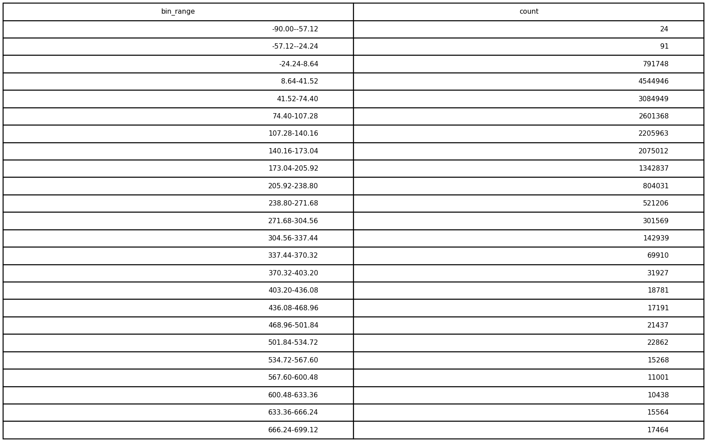
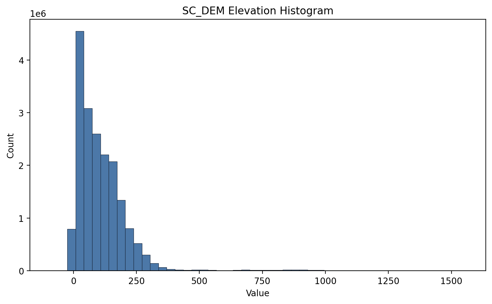

# GIS 错误证据：GeoAgent Task 12

- 主标签：B3 缺失数据误判
- LLM：qwen3.6-plus（dashscope）
- 推理配置：thinking 开关未单列记录
- 视觉审查：至少审查一项可视化成果

## 1. 任务目标

请显示DEM像素值的直方图。

## 2. 任务执行工作流

1. 读取 DEM 并识别有效像元和 NoData。
2. 统计有效高程值的频数分布。
3. 输出直方图及其统计数据。

## 3. 错误发生位置

错误出在直方图统计的样本筛选阶段。DEM 的 NoData 应先从有效像元集合中排除，再统计高程频数。

## 4. 错误机制与结果影响

任务要求绘制 DEM 高程直方图，NoData 混入统计会改变柱形分布和数值范围，`dem_histogram.csv` 不能代表有效高程分布。

## 5. 具体错误证据

- `execution_result/workflow/step_01_code.py` 读取 DEM 后生成直方图数据。
- 输出文件 `dem_histogram.csv` 是由该统计步骤写出。
- 参考图 `dem_histogram.png` 使用有效高程像元生成。

## 6. 任务执行结果预览

下图由错误运行写出的最终成果生成。图层或表格内容以原文件为准，错误判定依据上述处理逻辑和数值证据。

## 7. 解决错误后 GIS 任务应有的结果预览

下图来自同一任务的正确运行，展示在修正“直方图统计未正确排除栅格 NoData”后应得到的最终成果。

## 8. 可视化判读说明

本任务的预览图只能呈现成果外观。判读重点是第 5 节列出的函数调用、字段选择、输出元数据和日志参数；这些材料说明错误如何进入 CRS、transform、bounds、像元大小、NoData、字段或 Shapefile 组件。
