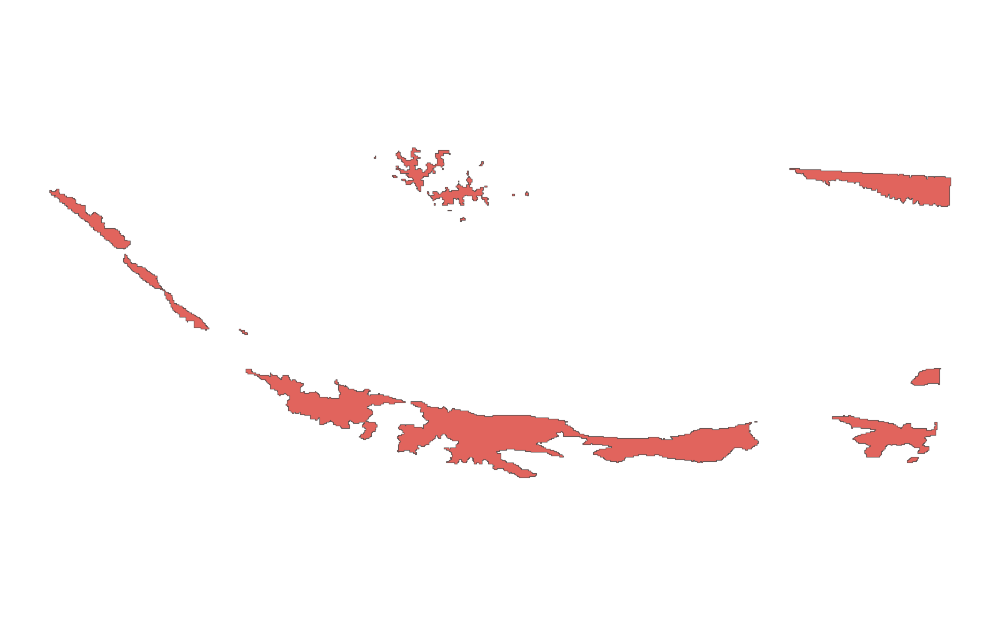
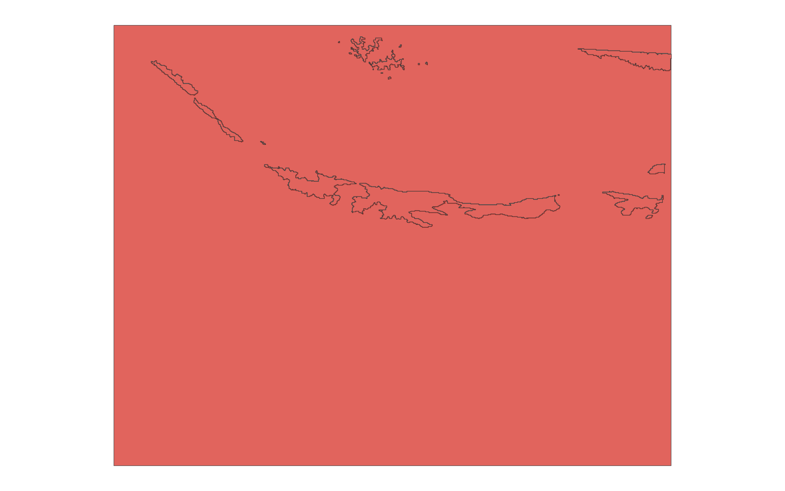

# GIS 错误证据：GeoAgent Task 55

- 主标签：B3 缺失数据误判
- LLM：MiniMax-M2.7-highspeed（minimax）
- 推理配置：thinking 开关未单列记录
- 视觉审查：至少审查一项可视化成果

## 1. 任务目标

将掩膜图层转换为矢量。

## 2. 任务执行工作流

1. 读取浮点型掩膜栅格并识别有效类别。
2. 在保留有效像元的前提下生成二值掩膜。
3. 将目标区域矢量化并写出。

## 3. 错误发生位置

错误出在二值掩膜构造阶段。代码把有效掩膜值当作背景处理，导致目标区域被大量丢失。

## 4. 错误机制与结果影响

输出矢量少于应保留区域，`elevation_mask_nodata_vector.shp` 不能代表原始掩膜中的有效目标区域。

## 5. 具体错误证据

- 二值掩膜构造把应保留的有效掩膜值当作背景或 NoData 处理。
- `elevation_mask_nodata_vector.shp` 只写出 32 个要素，按有效掩膜矢量化应为 33 个要素。
- 丢失区域对应 97.08% 的目标面积损失。

## 6. 任务执行结果预览

下图由错误运行写出的最终成果生成。图层或表格内容以原文件为准，错误判定依据上述处理逻辑和数值证据。

## 7. 解决错误后 GIS 任务应有的结果预览

下图来自同一任务的正确运行，展示在修正“二值化时误把有效掩膜值当作背景”后应得到的最终成果。

## 8. 可视化判读说明

本任务的预览图只能呈现成果外观。判读重点是第 5 节列出的函数调用、字段选择、输出元数据和日志参数；这些材料说明错误如何进入 CRS、transform、bounds、像元大小、NoData、字段或 Shapefile 组件。
