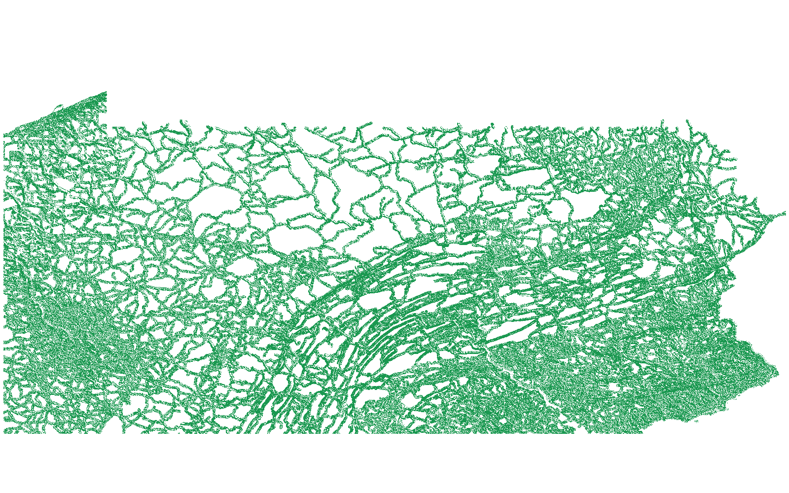
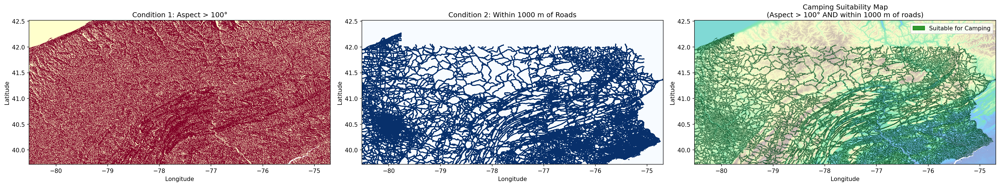
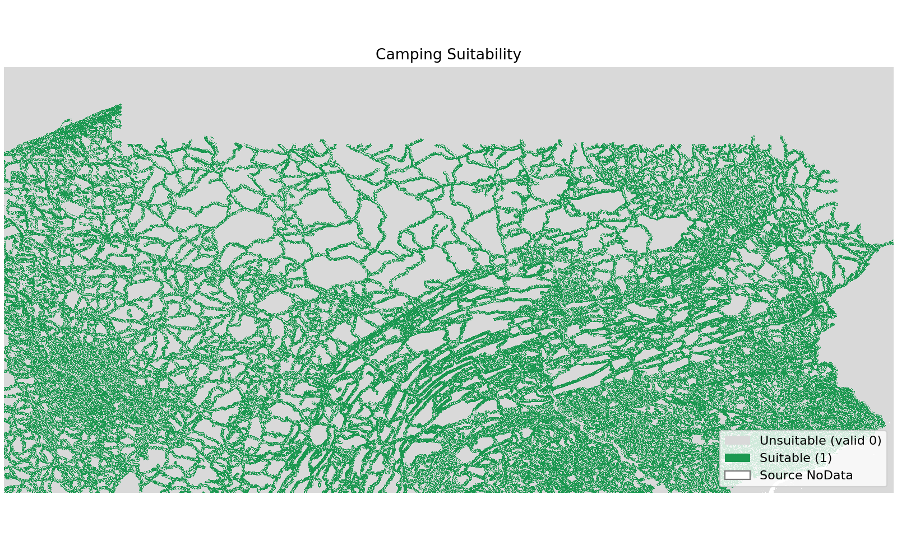

# GIS 错误证据：GeoAgent Task 105

- 主标签：B3 缺失数据误判
- LLM：DeepSeek V4 Pro（DeepSeek thinking 开启）
- 视觉审查：Qwen3-VL（thinking 关闭）

## 1. 任务目标

依据坡向大于 100°且距道路不超过 1000 米两个条件生成露营适宜性栅格和适宜性地图。

## 2. 任务执行工作流

1. 由 DEM 计算坡向条件。
2. 由道路计算 1000 米距离条件。
3. 将两个条件合并为二值栅格：1 表示适宜、0 表示不适宜。
4. 写出 GeoTIFF 并生成三联适宜性地图。

## 3. 错误发生位置

错误发生在最终 GeoTIFF 的输出编码与元数据设置阶段，而不是坡向或道路距离计算阶段：程序先用 0 表示有效不适宜像元，随后又把输出 `nodata` 设置为 0。

## 4. 错误机制与结果影响

输出把有效的不适宜像元编码为 0，同时又把 0 声明为 NoData，导致有效负类在 GIS 软件中被当作缺失值屏蔽。

GIS 软件读取时会把全部有效 0 像元屏蔽为缺失值，使“不适宜”与“无数据”失去区别，最终栅格不能完整表达二值适宜性结果。

## 5. 具体错误证据

- `camping_suitability.py` 用 1 表示适宜、0 表示不适宜。
- 同一输出配置将 `nodata` 设为 0。
- 读取输出时，有效的不适宜像元因此与真正缺失像元不可区分。

## 6. 任务执行结果预览

下列图片为 LLM 执行结果预览，包括最终 GeoTIFF 和三联适宜性地图。GeoTIFF 将 0 同时作为有效不适宜值和 NoData，读取后有效不适宜像元被屏蔽。

### 最终 GIS 成果：camping_suitability.tif

- 源成果文件：`coder/subtask_1/camping_suitability.tif`
- 说明：`camping_suitability.tif` 按其 NoData 元数据读取后的预览；绿色为仍可见的适宜像元，0 值已被屏蔽。

### 最终制图成果：camping_suitability_map.png

- 源成果文件：`coder/subtask_1/camping_suitability_map.png`
- 说明：LLM 生成的三联地图原图：左为坡向条件，中为道路距离条件，右为两条件合并后的最终适宜性地图。

## 7. 解决错误后 GIS 任务应有的结果预览

参考图保留有效不适宜像元 0、适宜像元 1，并仅对源 DEM 的真实 NoData 区域进行掩膜。

## 8. 可视化判读说明

预览图只能辅助观察成果外观。数据错误的审查入口是输出文件元数据、NoData、像元值、字段、文件组件和运行日志中的读写参数。
