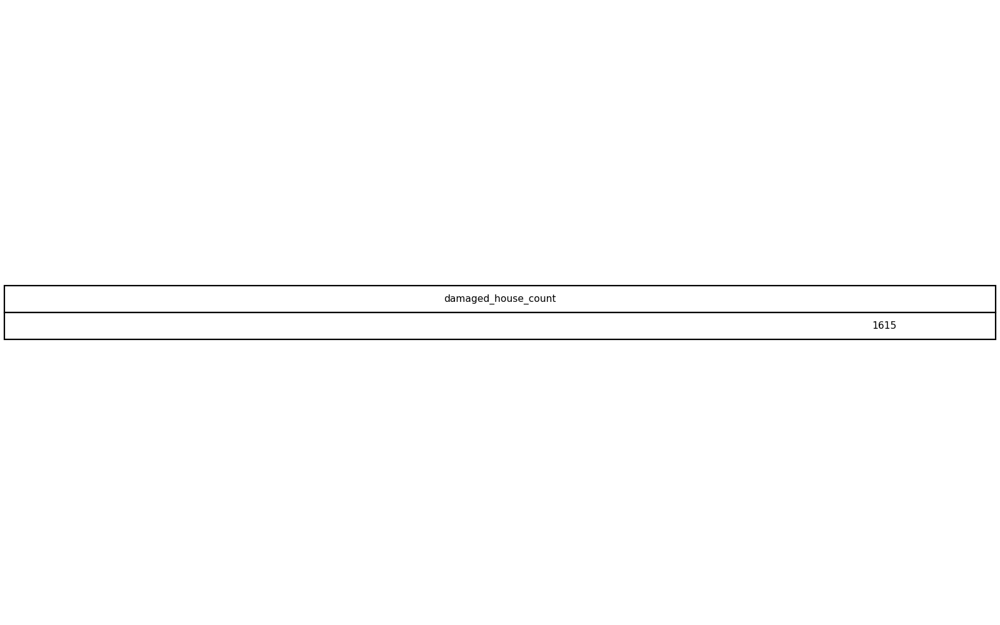
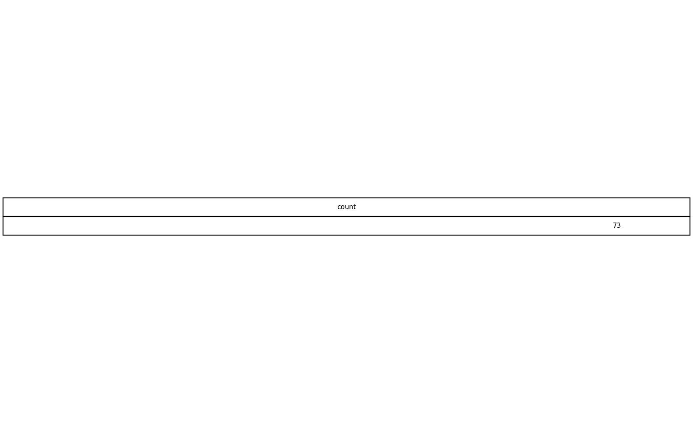

# GIS 错误证据：GeoAgent Task 7

- 主标签：C1 拓扑谓词混淆
- LLM：MiniMax-M2.7-highspeed（minimax）
- 推理配置：thinking 开关未单列记录
- 视觉审查：至少审查一项可视化成果

## 1. 任务目标

有多少受损房屋位于圣安德烈亚斯专项研究区（San Andreas Special Studies Zones）内？

## 2. 任务执行工作流

1. 读取受损房屋点和断层研究区面。
2. 通过空间连接筛选位于研究区内的房屋。
3. 统计筛选结果并导出表格。

## 3. 错误发生位置

错误出在空间连接后的计数范围控制。工作流应只统计落在 San Andreas Special Studies Zones 内的受损房屋，但输出表保留了研究区外的左侧点记录。

## 4. 错误机制与结果影响

任务问的是“有多少受损房屋位于研究区内”，保留外部点会放大计数，`damaged_houses_saf_zone_count.csv` 不能回答该空间包含关系问题。

## 5. 具体错误证据

- `execution_result/workflow/step_01_code.py、execution_result/workflow/step_02_code.py` 包含空间连接和计数步骤。
- 输出 CSV 来自左侧连接结果，而不是严格的 within/intersects 后内侧点集合。
- `damaged_houses_saf_zone_count.csv` 的计数因此包含研究区外房屋。

## 6. 任务执行结果预览

下图由错误运行写出的最终成果生成。图层或表格内容以原文件为准，错误判定依据上述处理逻辑和数值证据。

## 7. 解决错误后 GIS 任务应有的结果预览

下图来自同一任务的正确运行，展示在修正“空间连接保留了不应进入结果的左侧要素”后应得到的最终成果。

## 8. 可视化判读说明

预览图只能辅助观察空间结果。判读重点是第 5 节列出的空间谓词、叠加函数、几何有效性处理、输出要素数、关系类型和来源字段。
