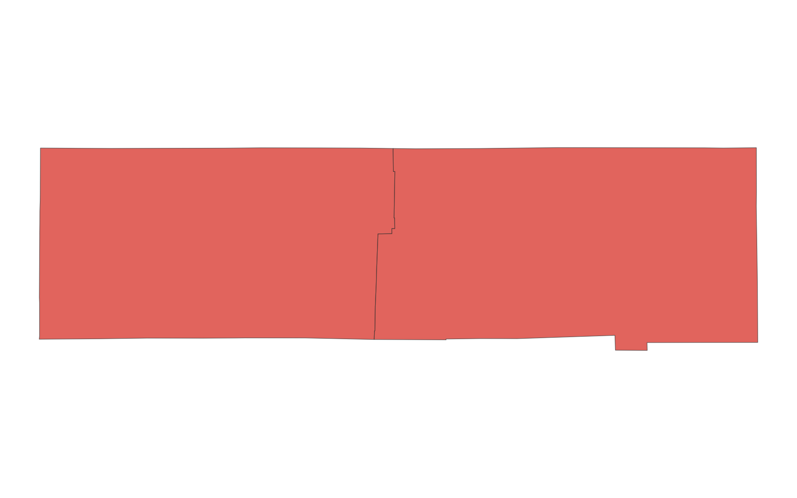
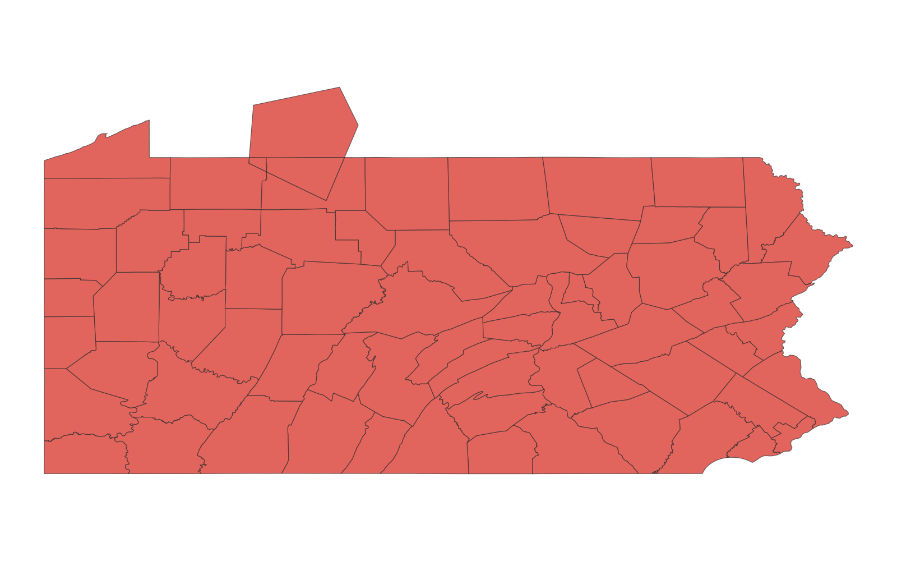

# GIS 错误证据：GeoAgent Task 30

- 主标签：C1 拓扑谓词混淆
- LLM：qwen3.6-plus（dashscope）
- 推理配置：thinking 开关未单列记录
- 视觉审查：未启用视觉审查

## 1. 任务目标

请对这两个所选Shapefile执行合并运算。

## 2. 任务执行工作流

1. 读取两个待合并的面图层。
2. 执行几何联合并保留全部输入要素。
3. 将联合结果写出为新的矢量图层。

## 3. 错误发生位置

错误出在合并前的要素保留规则。任务要求对两个 Shapefile 做合并/联合，`execution_result/workflow/step_01_code.py` 先只保留与 generated_polygon 相交的 Pennsylvania 县界，再写出 `union_result.shp`。

## 4. 错误机制与结果影响

非相交但仍属于输入数据的要素被排除，联合结果缺少应保留的部分，不能作为完整合并结果。

## 5. 具体错误证据

- `execution_result/workflow/step_01_code.py` 调用 `filter_vector_by_spatial_relationship(...)`，并把 `predicate` 固定为 `"intersects"`。
- 该调用的输入是 `pacounties` 和 `generated_polygon`，输出直接写到 `union_result.shp`；代码没有调用 `overlay(..., how="union")`、`geopandas.overlay` 或等价联合操作。
- `intersects` 只能筛出与过滤图层相交的县界要素，不能保留两个输入图层联合后应出现的全部面片。

## 6. 任务执行结果预览

下图由错误运行写出的最终成果生成。图层或表格内容以原文件为准，错误判定依据上述处理逻辑和数值证据。

## 7. 解决错误后 GIS 任务应有的结果预览

下图来自同一任务的正确运行，展示在修正“合并前错误地只保留相交要素”后应得到的最终成果。

## 8. 可视化判读说明

预览图只能辅助观察空间结果。判读重点是第 5 节列出的空间谓词、叠加函数、几何有效性处理、输出要素数、关系类型和来源字段。
