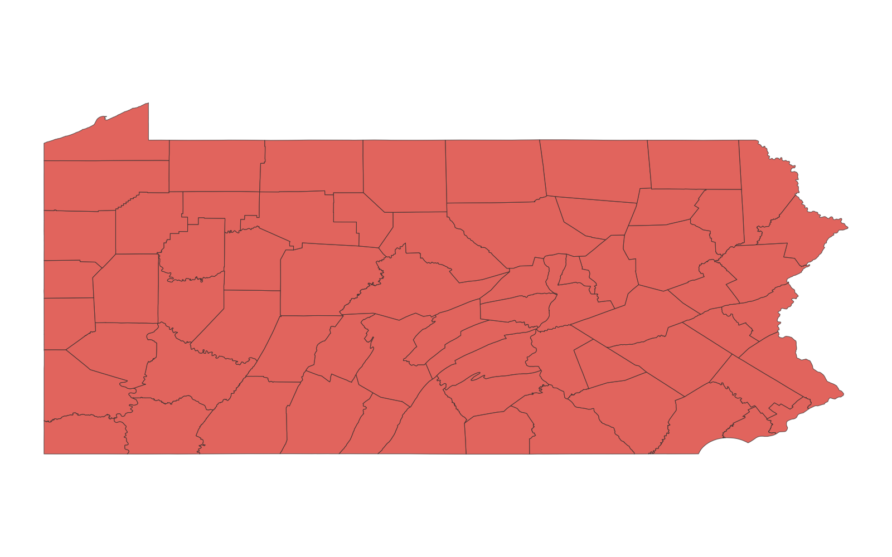
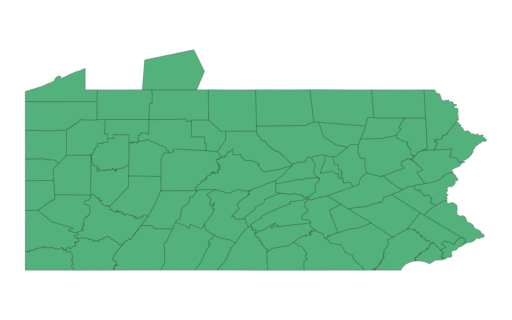

# GIS 错误证据：GeoAgent Task 31

- 主标签：C1 拓扑谓词混淆
- LLM：qwen3.6-plus（dashscope）
- 推理配置：thinking 开关未单列记录
- 视觉审查：至少审查一项可视化成果

## 1. 任务目标

从 generated_polygon 中移除与 Pennsylvania counties 重叠的部分，再把剩余部分与县图层合并。

## 2. 任务执行工作流

1. 读取生成多边形和县界。
2. 使用 `disjoint` 筛选 generated_polygon。
3. 将筛选结果与 67 个县合并。

## 3. 错误发生位置

问题出在移除重叠区域的空间关系选择。`disjoint` 只能保留整幅完全不相交的要素，不能计算一个要素扣除重叠部分后的剩余几何。

## 4. 错误机制与结果影响

generated_polygon 因与县界相交而被整体删除，最终结果只剩 67 个县；正确差集结果还应包含 1 个剩余多边形，共 68 个要素。

## 5. 具体错误证据

- `step_01/code.py` 明确使用 `predicate="disjoint"`。
- 中间差集输出为空，最终 `merged_polygon.shp` 只有 67 个要素。
- 经 `difference` 计算的参考结果为 68 个要素。

## 6. 任务执行结果预览

下图是该实验最终合并结果。它只显示 Pennsylvania 的 67 个县，任务要求保留的 generated_polygon 非重叠部分已经消失。

### 最终成果：merged_polygon.shp

- 源成果文件：`steps/step_02/merged_polygon.shp`

## 7. 解决错误后 GIS 任务应有的结果预览

参考图先计算 generated_polygon 与县界联合几何的差集，再把剩余面与 67 个县合并。

## 8. 可视化判读说明

预览图只能辅助观察空间结果。判读重点是第 5 节列出的空间谓词、叠加函数、几何有效性处理、输出要素数、关系类型和来源字段。
