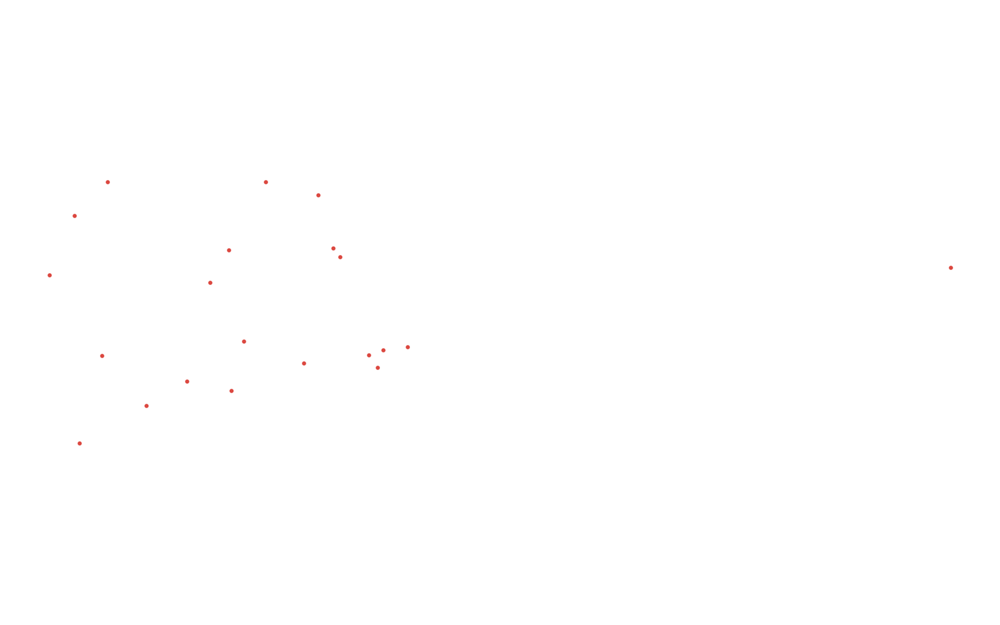
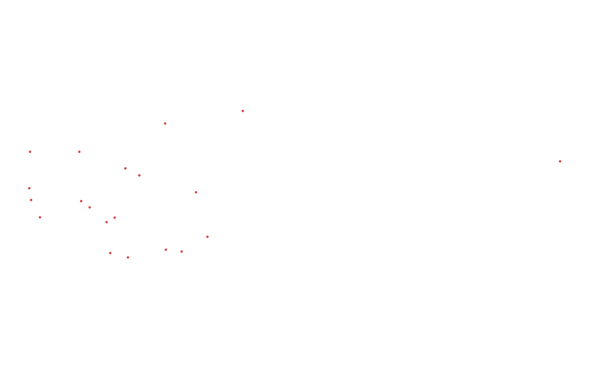

# GIS 错误证据：GeoAgent Task 41

- 主标签：C1 拓扑谓词混淆
- LLM：MiniMax-M2.7-highspeed（minimax）
- 推理配置：thinking 开关未单列记录
- 视觉审查：至少审查一项可视化成果

## 1. 任务目标

在此多边形内生成20个随机点。

## 2. 任务执行工作流

1. 读取圆形研究区面。
2. 在面内均匀生成 20 个随机点。
3. 检查全部点满足 within 关系后写出结果。

## 3. 错误发生位置

错误出在随机点生成后的面内约束验证。任务要求 20 个点全部位于多边形内，输出中存在不满足该约束的点。

## 4. 错误机制与结果影响

`random_points_in_circle.shp` 不能作为面内随机点样本，后续基于这些点的采样或模拟会使用错误位置。

## 5. 具体错误证据

- `execution_result/workflow/step_01_code.py` 生成随机点并写出 Shapefile。
- `random_points_in_circle.shp` 中存在不满足目标面 `within` 关系的点。
- 点写出前缺少对全部 20 个点的面内约束验证。

## 6. 任务执行结果预览

下图由错误运行写出的最终成果生成。图层或表格内容以原文件为准，错误判定依据上述处理逻辑和数值证据。

## 7. 解决错误后 GIS 任务应有的结果预览

下图来自同一任务的正确运行，展示在修正“随机点生成结果没有全部满足面内约束”后应得到的最终成果。

## 8. 可视化判读说明

预览图只能辅助观察空间结果。判读重点是第 5 节列出的空间谓词、叠加函数、几何有效性处理、输出要素数、关系类型和来源字段。
