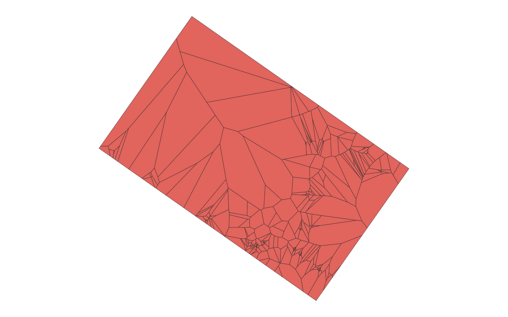
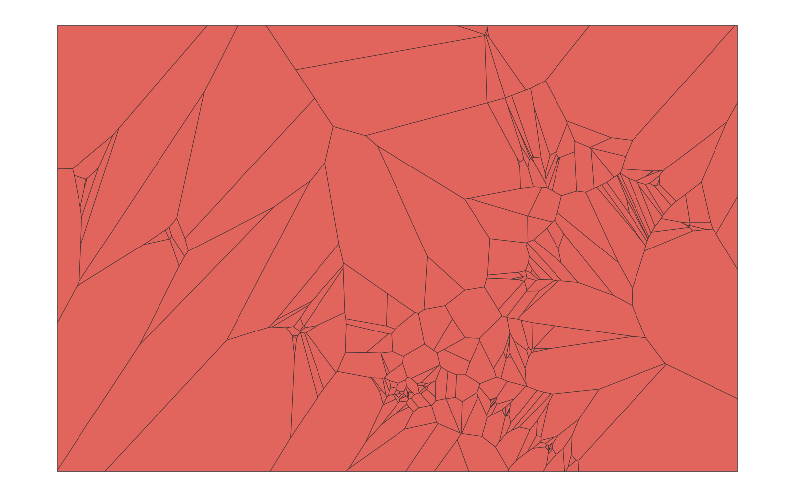

# GIS 错误证据：GeoAgent Task 57

- 主标签：C1 拓扑谓词混淆
- LLM：MiniMax-M2.7-highspeed（minimax）
- 推理配置：thinking 开关未单列记录
- 视觉审查：未启用视觉审查

## 1. 任务目标

为点数据创建Thiessen多边形，使用这些点的外包矩形或更大的矩形作为边界，确保所有点都包含在Thiessen多边形内，最终得到一个完整矩形形状的Thiessen多边形，将最终结果保存为Shapefile。

## 2. 任务执行工作流

1. 读取输入点并计算用于约束结果的边界。
2. 根据全部输入点生成 Thiessen 多边形。
3. 裁剪多边形并检查每个输入点均有对应区域。

## 3. 错误发生位置

错误出在 Thiessen/Voronoi 多边形与输入点的对应关系维护。任务要求所有输入站点都有对应区域，输出未覆盖全部站点。

## 4. 错误机制与结果影响

部分输入点没有对应服务区，`thiessen_rectangular_final.shp` 不能作为完整 Thiessen 多边形结果。

## 5. 具体错误证据

- `execution_result/workflow/step_02_code.py、execution_result/workflow/step_03_code.py、execution_result/workflow/step_04_code.py、execution_result/workflow/step_05_code.py` 生成并裁剪 Voronoi/Thiessen 多边形。
- `thiessen_rectangular_final.shp` 缺少部分输入点的对应区域。
- 裁剪或区域-ID 维护后没有保持全部输入点覆盖关系。

## 6. 任务执行结果预览

下图由错误运行写出的最终成果生成。图层或表格内容以原文件为准，错误判定依据上述处理逻辑和数值证据。

## 7. 解决错误后 GIS 任务应有的结果预览

下图来自同一任务的正确运行，展示在修正“Voronoi 结果未覆盖全部输入站点”后应得到的最终成果。

## 8. 可视化判读说明

预览图只能辅助观察空间结果。判读重点是第 5 节列出的空间谓词、叠加函数、几何有效性处理、输出要素数、关系类型和来源字段。
