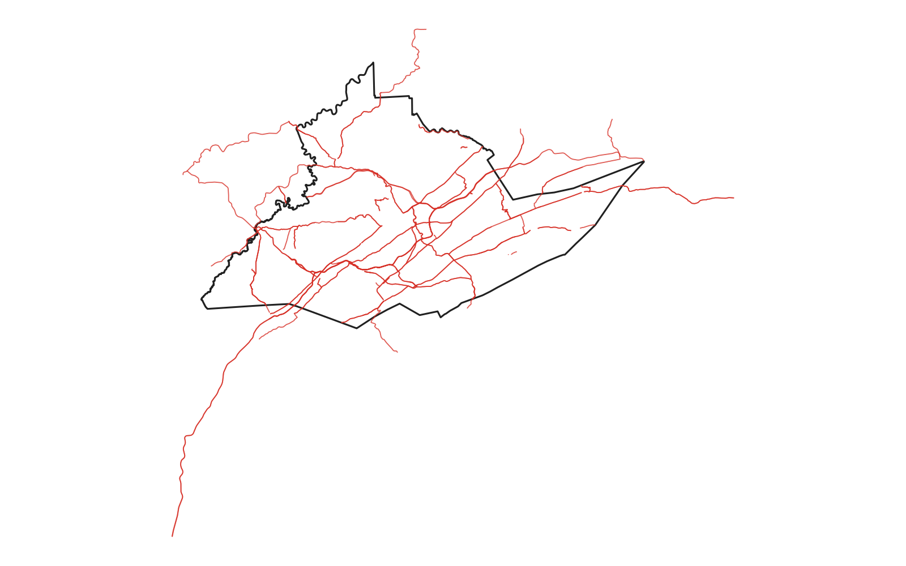
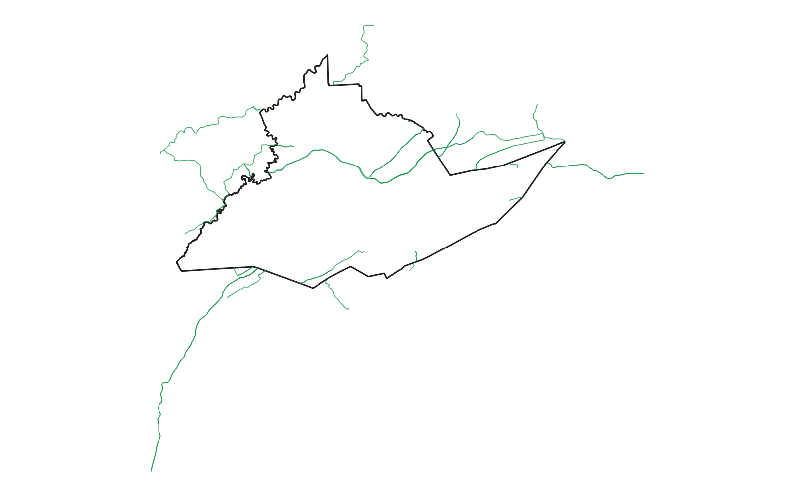

# GIS 错误证据：GeoAgent Task 94

- 主标签：C1 拓扑谓词混淆
- LLM：DeepSeek V4 Pro（DeepSeek thinking 开启）
- 视觉审查：Qwen3-VL（thinking 关闭）

## 1. 任务目标

从道路数据中提取严格穿越 Centre County 的道路并保存为新的 Shapefile。

## 2. 任务执行工作流

1. 读取道路和县界图层并选取 Centre County。
2. 使用空间谓词筛选道路。
3. 将筛选结果写入 `centre_county_roads.shp`。

## 3. 错误发生位置

错误发生在空间关系筛选阶段：代码使用 `intersects` 代替表达严格穿越关系的 `crosses`。

## 4. 错误机制与结果影响

代码将任务要求的穿越关系实现为 `intersects`，把接触和重叠等非穿越关系一并纳入结果，构成拓扑谓词混淆。

`intersects` 同时接纳接触、位于县内和边界重叠等关系，实际输出 374 条道路，扩大了任务要求的道路集合；严格 `crosses` 参考结果为 46 条。

## 5. 具体错误证据

- `code.py` 明确使用 `predicate='intersects'`。
- 代码注释承认 `intersects` 同时包含穿越、接触和重叠关系。
- 同一数据上严格 `crosses` 与 `intersects` 的选择数量明显不同。

## 6. 任务执行结果预览

下图展示 LLM 使用 `intersects` 选出的道路，深色线为 Centre County 边界。结果中不仅包含严格穿越县域的道路，也包含其他与县域相交的道路。

### 最终成果：centre_county_roads.shp

- 源成果文件：`centre_county_roads.shp`
- 说明：`centre_county_roads.shp` 中由 `intersects` 选出的道路；深色边界为 Centre County。

## 7. 解决错误后 GIS 任务应有的结果预览

参考图仅绘制使用 `crosses` 筛选得到的道路以及 Centre County 边界。

## 8. 可视化判读说明

拓扑关系和几何有效性不一定能从预览图直接读出。审查入口是代码中的空间谓词、叠加函数、几何修复步骤、输出要素数和来源字段。
