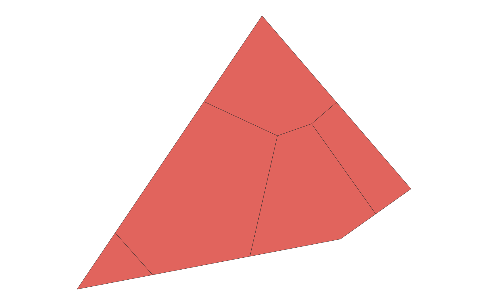
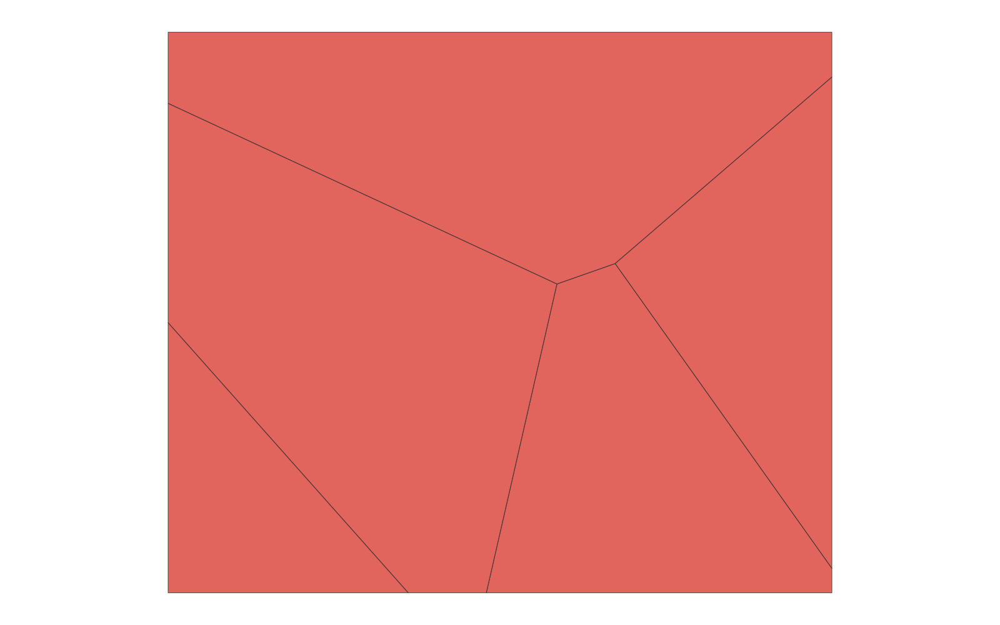

# GIS 错误证据：GeoAgent Task 113

- 主标签：C1 拓扑谓词混淆
- LLM：MiniMax-M2.7-highspeed（minimax）
- 推理配置：thinking 开关未单列记录
- 视觉审查：至少审查一项可视化成果

## 1. 任务目标

请为上传的Shapefile中的点要素创建Thiessen多边形（Voronoi图）。确保所有Tyson多边形都有边界且不会被丢弃。使用geovoronoi包完成任务。结果应保存为新的Shapefile。

## 2. 任务执行工作流

1. 读取输入点并建立覆盖范围。
2. 使用 geovoronoi 生成 Voronoi 多边形。
3. 检查每个点均落入唯一对应区域后写出结果。

## 3. 错误发生位置

错误出在 Voronoi 区域与输入点的对应关系。任务要求每个输入点有对应 Thiessen 区域，运行结果对应关系不完整。

## 4. 错误机制与结果影响

`thiessen_polygons.shp` 不能作为完整的输入点服务区划分。

## 5. 具体错误证据

- `execution_result/workflow/step_01_code.py` 生成 Voronoi/Thiessen 多边形。
- 输出区域数量或来源 ID 没有与全部输入点保持一一对应。
- `thiessen_polygons.shp` 因此遗漏了部分点的服务区。

## 6. 任务执行结果预览

下图由错误运行写出的最终成果生成。图层或表格内容以原文件为准，错误判定依据上述处理逻辑和数值证据。

## 7. 解决错误后 GIS 任务应有的结果预览

下图来自同一任务的正确运行，展示在修正“Voronoi 区域与输入点之间的对应关系不完整”后应得到的最终成果。

## 8. 可视化判读说明

预览图只能辅助观察空间结果。判读重点是第 5 节列出的空间谓词、叠加函数、几何有效性处理、输出要素数、关系类型和来源字段。
