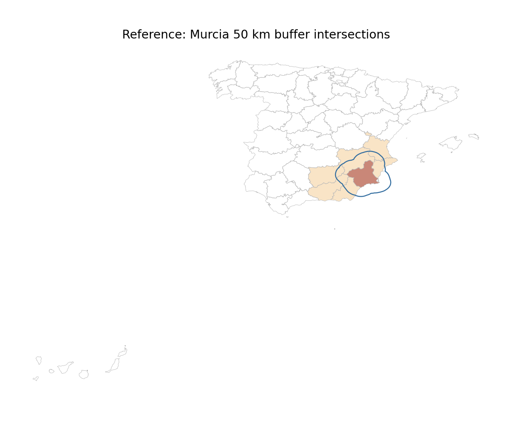

# GIS 错误证据：GeoBenchX/GeoNature Murcia 50km Buffer

- 主标签：C2. Invalid Geometry Handling
- 次标签：无
- LLM 配置：deepseek-v4-pro（DeepSeek）
- 推理配置：direct request；thinking 开关未单列记录
- 来源项目：GeoBenchX tools ported in GeoNatureAgent Benchmark
- 难度：medium

## 1. 任务目标

在米制投影 CRS 中对 Murcia 省界建立 50 km buffer，并用 intersects 谓词筛选所有与 buffer 相交的西班牙省份。

## 2. 任务执行工作流

1. 读取 Spain province GeoJSON。
2. 定位 Murcia 省界。
3. 投影到 EPSG:25830 后执行 50,000 m buffer。
4. 用 intersects 筛选相交省份并输出 GeoJSON、CSV 和地图。
5. 实际运行在第 1 步因退化 ring 中断。

## 3. 错误发生位置

错误发生在 `gpd.read_file(path)` 读入 GeoJSON 阶段。输入 `spain_provinces.geojson` 含多个少于 4 个坐标的退化 ring，生成代码没有执行 ring 清洗、`make_valid()` 或等价防御处理。

## 4. 错误机制与结果影响

这是典型无效几何处理错误：真实行政边界数据常包含小岛、孔洞或退化环，拓扑构造前必须清洗或修复。代码虽选择了正确的米制投影和 intersects 谓词，但没有通过几何有效性门槛，空间分析结果完全无法交付。

## 5. 具体错误证据

```json
{
  "total_features": 52,
  "total_rings": 1124,
  "dropped_degenerate_rings": 834,
  "features_with_dropped_rings": 14,
  "observed_error": "ValueError: A linearring requires at least 4 coordinates.",
  "buffer_distance_m": 50000,
  "projected_crs": "EPSG:25830",
  "intersecting_province_count": 7,
  "intersecting_provinces": [
    "Alacant/Alicante",
    "Albacete",
    "Almería",
    "Granada",
    "Murcia",
    "València/Valencia",
    "Jaén"
  ]
}
```

## 6. 任务执行结果预览

本次错误运行在读入 GeoJSON 时中断，没有生成 `murcia_50km_buffer.geojson`、`murcia_50km_intersecting_provinces.csv` 或地图。失败日志见 `../run_log/run.log`。

## 7. 解决错误后 GIS 任务应有的结果预览



## 8. 可视化判读说明

本案例的关键证据是生成代码、运行日志、错误输出表和参考结果之间的差异。图片只作为空间分析或分类统计结果的可视化辅助，最终判定以第 5 节列出的数值与代码证据为准。
