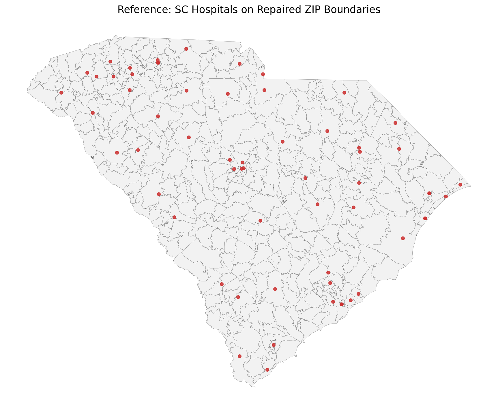

# GIS 错误证据：LLM-Geo Axis_order_SC_hospitals

- 主标签：C2 无效几何处理
- LLM 配置：deepseek-v4-pro（DeepSeek）
- 推理配置：direct request；thinking 开关未单列记录
- 来源项目：LLM-Geo

## 1. 任务目标

构建 South Carolina 医院点图层，将其叠加到 SC ZIP 边界上，统计医院点落在 ZIP 边界并集内的数量，并输出 GeoJSON 点图层和 PNG 地图。

## 2. 任务执行工作流

1. 读取 SC ZIP 边界 Shapefile。
2. 读取医院 CSV，并按 `x = lon_y`、`y = lat_x` 构造点。
3. 对 ZIP polygon 直接执行 `unary_union(sc_zip.geometry.values)`。
4. 在 union 后统计点是否位于边界内，并保存地图与点图层。

## 3. 错误发生位置

错误发生在 `execution_result/workflow/final_direct_code.py` 的 ZIP polygon 并集计算。输入边界中存在 50 个无效 polygon，代码没有在 `unary_union` 前执行 `make_valid`、`buffer(0)` 或等价修复，导致 Shapely 抛出 `TopologyException`。

## 4. 错误机制与结果影响

这是典型的无效几何处理错误：空间 union、overlay、contains/intersects 统计等操作要求输入几何拓扑有效。代码忽略输入有效性检查，使后续空间统计和地图输出全部中断。该错误不是普通 Python 名称错误，而是 GIS 几何拓扑约束被违反后触发的专业错误。

## 5. 具体错误证据

- 输入 ZIP 边界共 424 个 polygon，其中 50 个 `geometry.is_valid == False`。
- 手工复跑生成代码时，`unary_union` 触发 `shapely.errors.GEOSException: TopologyException`。
- 任务要求的 `axis_order_hospitals_points.geojson` 和 `axis_order_hospitals_map.png` 均未生成。
- 参考流程先修复无效 ZIP geometry，再执行 union 和点内判定，可正常生成参考点图层与参考地图。

## 6. 任务执行结果预览

本次错误运行在输出前中断，因此没有最终地图成果。失败日志保存在 `../run_log/manual_reexecution_error.log`。

## 7. 解决错误后 GIS 任务应有的结果预览

