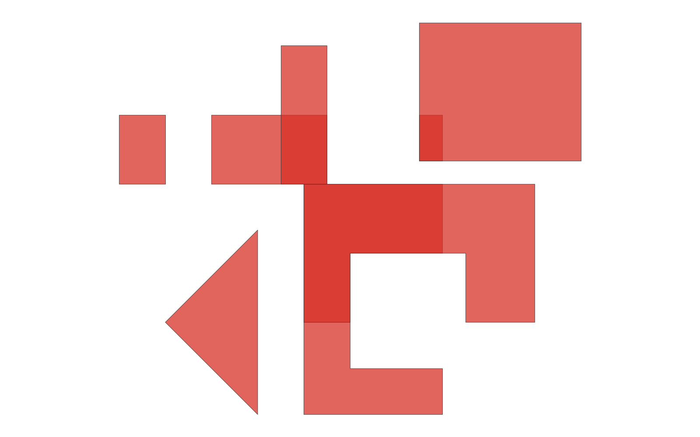
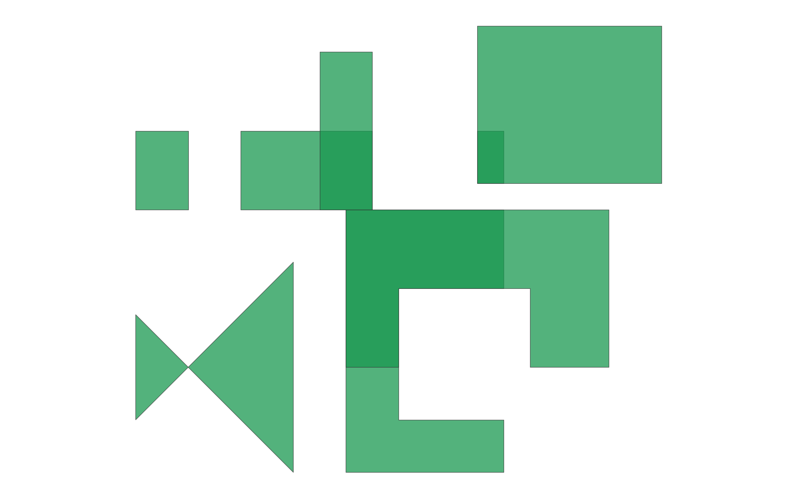

# GIS 错误证据：Self-built GIS Task C2-01

- 主标签：C2 无效几何处理错误
- LLM：DeepSeek V4 Pro（thinking 关闭）
- 视觉审查：Qwen3-VL（thinking 关闭）

## 1. 任务目标

将含自交面、多部件面、孔洞和普通面的分区图层与掩膜面求交；修复后所有有效面片均须保留 source_id 和 mask_id，最终成果只含有效面几何。

## 2. 任务执行工作流

读取含无效几何的分区面和掩膜面；执行相交；保留 source_id 与 mask_id 并写出多边形结果。

## 3. 错误发生位置

错误发生在叠加前的几何修复步骤。执行代码以 `buffer(0)` 修复自交面，而规范参考流程使用 `make_valid()` 后提取全部面部件；`buffer(0)` 在该输入上舍弃了一个有效面片，误差随后传入相交结果。

## 4. 错误机制与结果影响

叠加流程未正确处理输入中的无效和多部件几何，导致最终几何、面片或面积与规范结果不一致。

## 5. 具体错误证据

- `execution_result/workflow/subtask_1_intersect_zones_masks.py` 中的 `safe_buffer()` 直接执行 `geom.buffer(0)`，并把修复后的几何继续用于 zones 与 masks 的叠加。
- `execution_result/workflow/subtask_1_intersect.py` 的清洗流程同样以 `buffer(0)` 修复无效几何，然后 explode 并筛选 Polygon/MultiPolygon。
- `buffer(0)` 在该自交输入上把应拆分保留的面片合并或舍弃为单一修复结果；输出要素数为 8，而 `make_valid()` 后再 explode 面部件的参考结果为 9。
- `make_valid()` 参考流程保留自交面拆分出的有效面片，并让该面片进入后续相交结果；本次输出相对对称差面积为 0.02666667，说明几何内容已发生可量化偏差。
- 输出无效几何数为 0；缺失字段为 无，说明问题不是字段丢失，而是几何修复方法造成面片缺失。

## 6. 任务执行结果预览

## 7. 解决错误后 GIS 任务应有的结果预览

参考图由相同输入通过独立规范流程计算。

## 8. 可视化判读说明

预览图只能显示叠加结果的外观，几何修复错误的审查入口是执行代码中的 `buffer(0)` 或 `make_valid()` 调用、输出要素数、几何有效性和来源字段组合。
