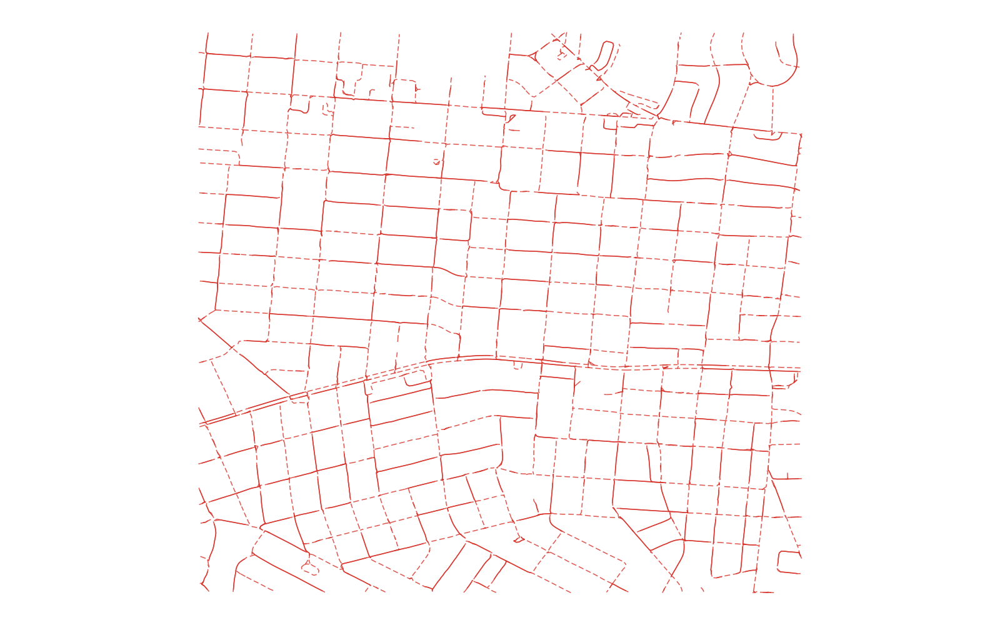
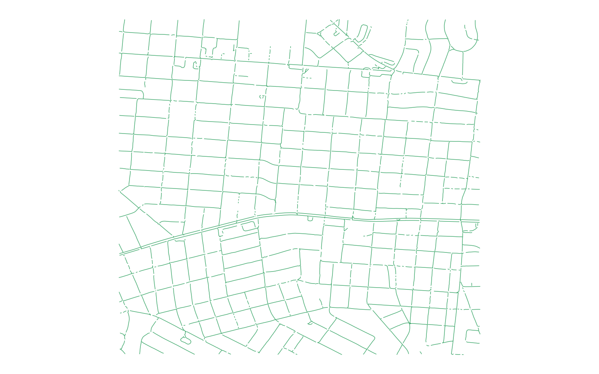

# GIS 错误证据：GeoAgent Task 82

- 主标签：C3 网络连通性误判
- LLM：MiniMax-M2.7-highspeed（minimax）
- 推理配置：thinking 开关未单列记录
- 视觉审查：至少审查一项可视化成果

## 1. 任务目标

依据街景点的前向和后向 panoId 邻接关系，把点连接成连续路径并输出线 Shapefile。

## 2. 任务执行工作流

1. 读取 panoId 与前后邻接字段并建立邻接表。
2. 遍历点并组织路径。
3. 把路径坐标写成 `street_paths.shp`。

## 3. 错误发生位置

问题出在从邻接图组装路径的阶段。程序生成的若干相邻线段并不存在于输入 panoId 邻接图中。

## 4. 错误机制与结果影响

输出覆盖率达到 1.0，但包含 290 条非法边。几何上看似连续的线并不代表测绘车辆的真实连接关系。

## 5. 具体错误证据

- 输入字段明确给出 `link_f_pan` 和 `link_b_pan`。
- 输出线段逐边还原为 panoId 对后，有 290 条边不在输入邻接字段中。
- 参考实验邻接覆盖率为 0.995，且不存在非法边。

## 6. 任务执行结果预览

下图是该实验生成的街景路径。线网外观较完整，但其中 290 条连接不符合 panoId 邻接关系，这类错误不能仅凭几何连续性识别。

### 最终成果：street_paths.shp

- 源成果文件：`steps/step_03/street_paths.shp`

## 7. 解决错误后 GIS 任务应有的结果预览

参考图来自同一任务中通过邻接图逐边验证的路径结果，只连接输入字段明确指定的相邻街景点。

## 8. 可视化判读说明

预览图只能辅助观察空间结果。判读重点是第 5 节列出的空间谓词、叠加函数、几何有效性处理、输出要素数、关系类型和来源字段。
