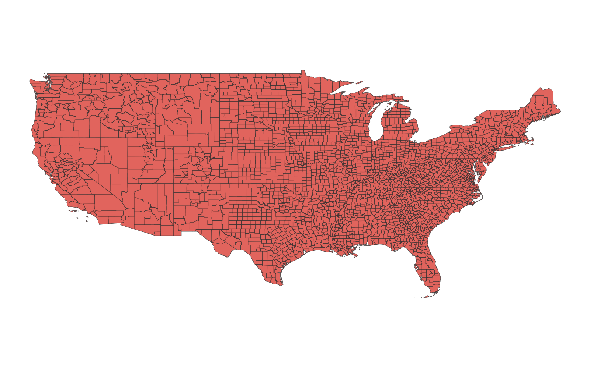

# GIS 错误证据：GeoAgent Task 22

- 主标签：D1 聚合范围混淆
- LLM：MiniMax-M2.7-highspeed（minimax）
- 推理配置：thinking 开关未单列记录
- 视觉审查：未启用视觉审查

## 1. 任务目标

请仅保留美国本土的县数据。

## 2. 任务执行工作流

1. 读取美国县级边界及行政区代码。
2. 按研究范围排除非美国本土行政区。
3. 写出筛选后的县级图层。

## 3. 错误发生位置

错误出在研究范围筛选阶段。任务目标是美国本土县级边界，工作流遗漏了应纳入的行政区域。

## 4. 错误机制与结果影响

输出县界不完整会影响后续全国范围统计、制图和空间汇总，`us_contiguous_counties.shp` 不能代表任务要求的研究区。

## 5. 具体错误证据

- `execution_result/workflow/step_01_code.py` 按行政字段筛选县级边界。
- `us_contiguous_counties.shp` 写出的是该筛选后的县界集合。
- 筛选条件遗漏了任务研究范围内应保留的行政区域。

## 6. 任务执行结果预览

下图由错误运行写出的最终成果生成。图层或表格内容以原文件为准，错误判定依据上述处理逻辑和数值证据。

## 7. 解决错误后 GIS 任务应有的结果预览

下图来自同一任务的正确运行，展示在修正“研究区域筛选遗漏了应纳入的行政区域”后应得到的最终成果。

## 8. 可视化判读说明

本任务的预览图只能呈现成果外观。判读重点是第 5 节列出的函数调用、字段选择、输出元数据和日志参数；这些材料说明错误如何进入 CRS、transform、bounds、像元大小、NoData、字段或 Shapefile 组件。
