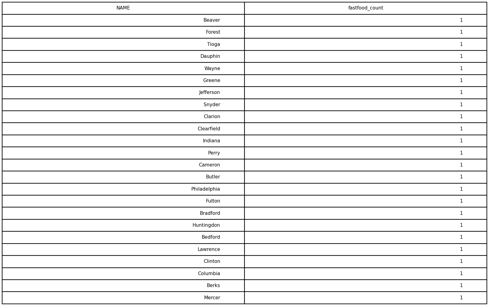
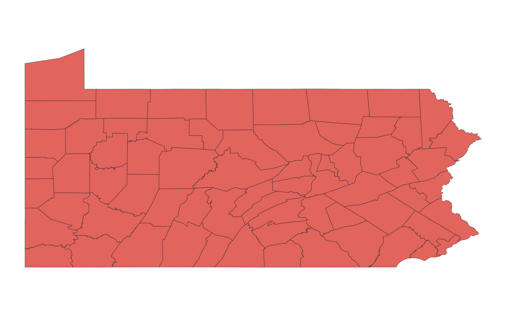

# GIS 错误证据：GeoAgent Task 40

- 主标签：D1 聚合范围混淆
- LLM：MiniMax-M2.7-highspeed（minimax）
- 推理配置：thinking 开关未单列记录
- 视觉审查：至少审查一项可视化成果

## 1. 任务目标

统计宾夕法尼亚州每个县的快餐店数量。

## 2. 任务执行工作流

1. 读取 Pennsylvania 县界和快餐店点。
2. 按点落入县界的空间关系进行连接。
3. 汇总每县快餐店数量并导出结果。

## 3. 错误发生位置

错误出在点落入县界后的分组统计阶段。快餐店点需要按 Pennsylvania 县界归属计数，输出却使用了错误的县级空间计数范围。

## 4. 错误机制与结果影响

每县快餐店数量会被错分或漏分，`pa_fastfood_by_county.csv` 不能回答“每个县的快餐店数量”。

## 5. 具体错误证据

- `execution_result/workflow/step_01_code.py、execution_result/workflow/step_02_code.py` 读取县界和快餐店点并执行空间连接。
- `pa_fastfood_by_county.csv` 是空间连接后的县级汇总表。
- 汇总时使用的县级空间计数关系与 Pennsylvania 县界归属不一致。

## 6. 任务执行结果预览

下图由错误运行写出的最终成果生成。图层或表格内容以原文件为准，错误判定依据上述处理逻辑和数值证据。

## 7. 解决错误后 GIS 任务应有的结果预览

下图来自同一任务的正确运行，展示在修正“点要素的县级空间计数范围错误”后应得到的最终成果。

## 8. 可视化判读说明

本任务的预览图只能呈现成果外观。判读重点是第 5 节列出的函数调用、字段选择、输出元数据和日志参数；这些材料说明错误如何进入 CRS、transform、bounds、像元大小、NoData、字段或 Shapefile 组件。
