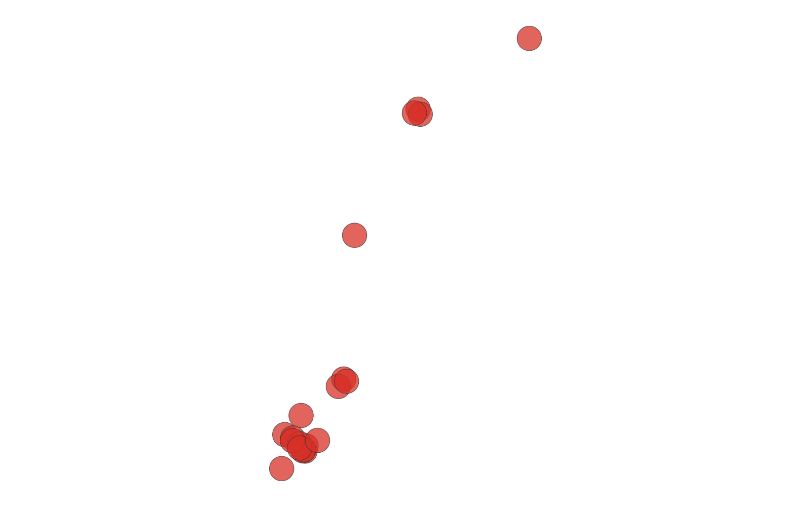
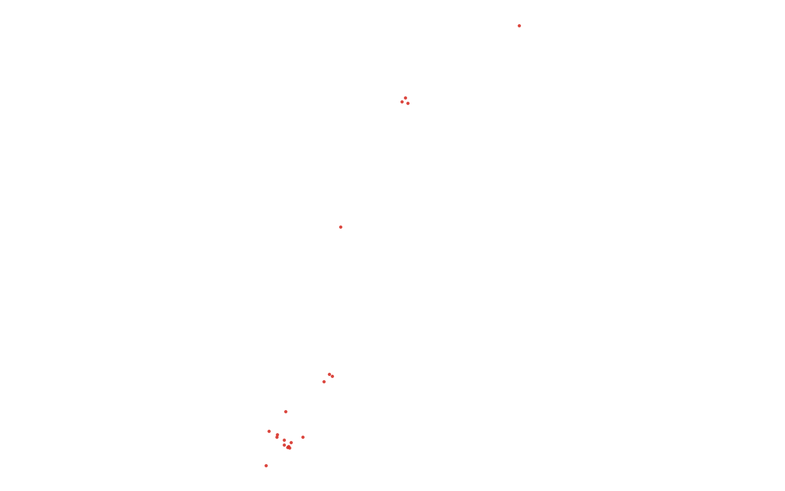

# GIS 错误证据：GeoAgent Task 76

- 主标签：D1 聚合范围混淆
- LLM：qwen3.6-plus（dashscope）
- 推理配置：thinking 开关未单列记录
- 视觉审查：至少审查一项可视化成果

## 1. 任务目标

找出纽约市内在600英尺范围内拥有最多公交站点或地铁入口的前20家咖啡店。将结果保存为Shapefile。

## 2. 任务执行工作流

1. 以咖啡店为中心创建 600 英尺缓冲区。
2. 统计各缓冲区内公交站和地铁入口数量。
3. 按设施数量降序选取前 20 家咖啡店。

## 3. 错误发生位置

错误出在 600 英尺缓冲和设施计数汇总。任务要求按每家咖啡店缓冲范围统计公交站/地铁入口，运行中的范围或汇总几何造成排名失真。

## 4. 错误机制与结果影响

`top20_coffee_shops.shp` 不能代表设施数量最多的前 20 家咖啡店。

## 5. 具体错误证据

- `execution_result/workflow/step_01_code.py、execution_result/workflow/step_02_code.py、execution_result/workflow/step_03_code.py` 包含咖啡店缓冲、设施空间计数和排序。
- 设施数量排序使用的计数范围不是每家咖啡店独立的 600 英尺缓冲范围。
- `top20_coffee_shops.shp` 因此不是按任务定义的设施数量降序得到。

## 6. 任务执行结果预览

下图由错误运行写出的最终成果生成。图层或表格内容以原文件为准，错误判定依据上述处理逻辑和数值证据。

## 7. 解决错误后 GIS 任务应有的结果预览

下图来自同一任务的正确运行，展示在修正“缓冲范围或汇总几何错误导致设施计数排名失真”后应得到的最终成果。

## 8. 可视化判读说明

本任务的预览图只能呈现成果外观。判读重点是第 5 节列出的函数调用、字段选择、输出元数据和日志参数；这些材料说明错误如何进入 CRS、transform、bounds、像元大小、NoData、字段或 Shapefile 组件。
