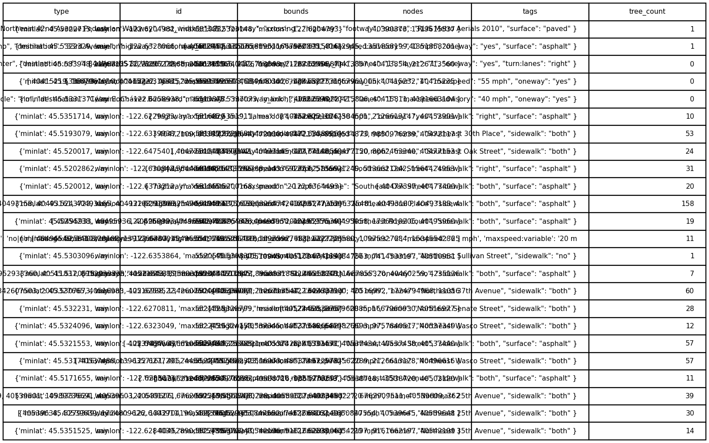
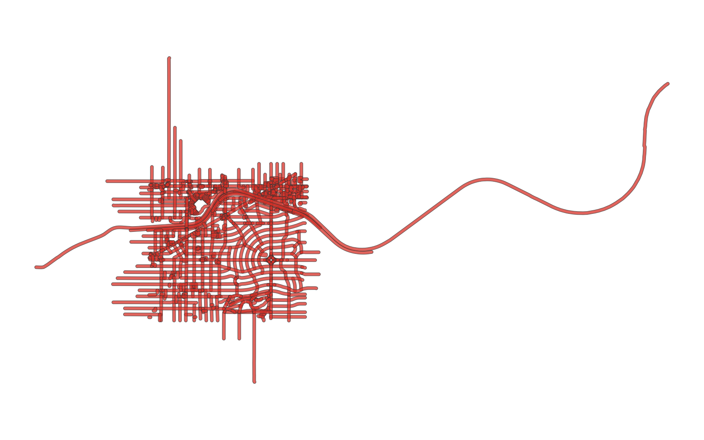

# GIS 错误证据：GeoAgent Task 89

- 主标签：D1 聚合范围混淆
- LLM：MiniMax-M2.7-highspeed（minimax）
- 推理配置：thinking 开关未单列记录
- 视觉审查：至少审查一项可视化成果

## 1. 任务目标

识别每条街道20米缓冲范围内的街道树木数量。

## 2. 任务执行工作流

1. 为街道中心线创建 20 米缓冲区。
2. 通过空间连接统计缓冲区内的街道树。
3. 把计数结果写回街道图层。

## 3. 错误发生位置

错误出在道路 20 米缓冲内的树木计数。任务要求每条街道独立统计缓冲范围内树木，运行中范围或单位不正确。

## 4. 错误机制与结果影响

`street_tree_count_per_street.csv` 中树木数量不能表示每条街道 20 米范围内的树木。

## 5. 具体错误证据

- `execution_result/workflow/step_01_code.py、execution_result/workflow/step_02_code.py` 生成道路缓冲并统计树木点。
- 缓冲参数没有在米制坐标系下稳定表达为 20 米，或统计时没有保持每条道路独立的 20 米邻域。
- `street_tree_count_per_street.csv` 的计数承接了该缓冲结果。

## 6. 任务执行结果预览

下图由错误运行写出的最终成果生成。图层或表格内容以原文件为准，错误判定依据上述处理逻辑和数值证据。

## 7. 解决错误后 GIS 任务应有的结果预览

下图来自同一任务的正确运行，展示在修正“道路缓冲区内树木计数的范围或单位错误”后应得到的最终成果。

## 8. 可视化判读说明

本任务的预览图只能呈现成果外观。判读重点是第 5 节列出的函数调用、字段选择、输出元数据和日志参数；这些材料说明错误如何进入 CRS、transform、bounds、像元大小、NoData、字段或 Shapefile 组件。
