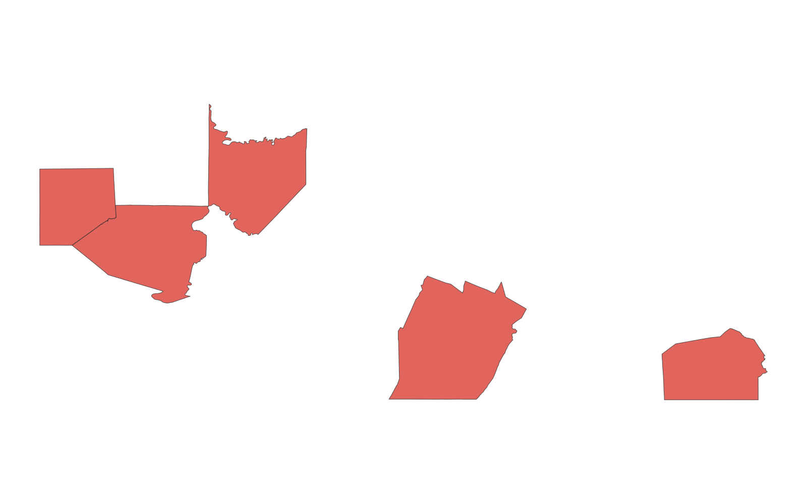
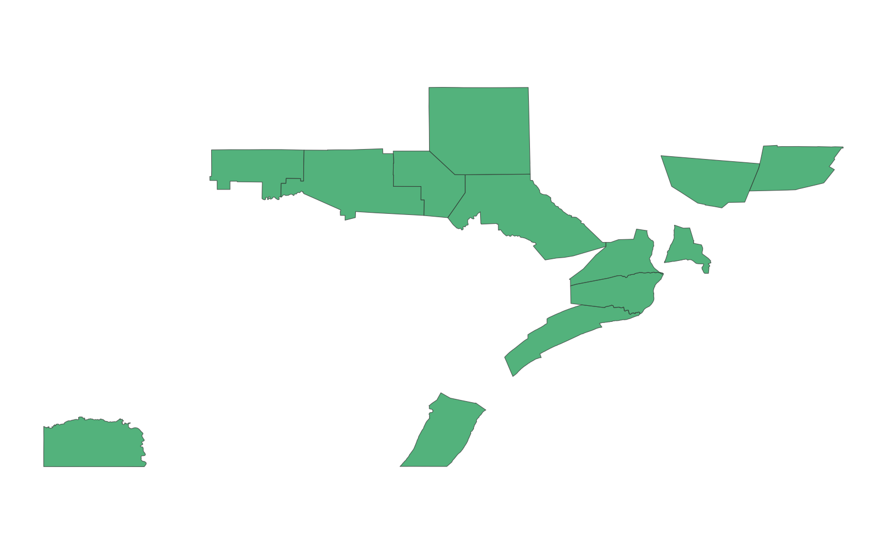

# GIS 错误证据：GeoAgent Task 92

- 主标签：D1 聚合范围混淆
- LLM：qwen3.6-plus（dashscope）
- 推理配置：thinking 开关未单列记录
- 视觉审查：审查全部可视化成果

## 1. 任务目标

统计每个 Pennsylvania 县内的输入点，只保留点数少于 10 的县。

## 2. 任务执行工作流

1. 把点与县界进行空间连接并生成县级计数字段。
2. 动态查找名称包含 `count` 的字段。
3. 按该字段小于 10 筛选县并写出结果。

## 3. 错误发生位置

问题出在县级计数字段识别阶段。代码把名称同样含有 `count` 字符串的 `COUNTYFP` 误认为点计数字段。

## 4. 错误机制与结果影响

筛选实际变成 `COUNTYFP < 10`，只得到 5 个县；按县内点数统计应得到 13 个县。

## 5. 具体错误证据

- `step_02/code.py` 使用 `"count" in c.lower()` 选择字段。
- Shapefile 字段顺序使 `COUNTYFP` 先被匹配。
- 运行记录中的过滤规则为 `COUNTYFP < 10`，输出 5 个县。

## 6. 任务执行结果预览

下图是该实验选出的 5 个县。结果反映的是县 FIPS 字段的数值条件，并不是每县点数少于 10 的空间统计。

### 最终成果：pa_counties_filtered_lt10.shp

- 源成果文件：`steps/step_02/pa_counties_filtered_lt10.shp`

## 7. 解决错误后 GIS 任务应有的结果预览

参考图按点在县内的空间关系分组计数，显示满足点数阈值的 13 个县。

## 8. 可视化判读说明

本任务的预览图只能呈现成果外观。判读重点是第 5 节列出的函数调用、字段选择、输出元数据和日志参数；这些材料说明错误如何进入 CRS、transform、bounds、像元大小、NoData、字段或 Shapefile 组件。
