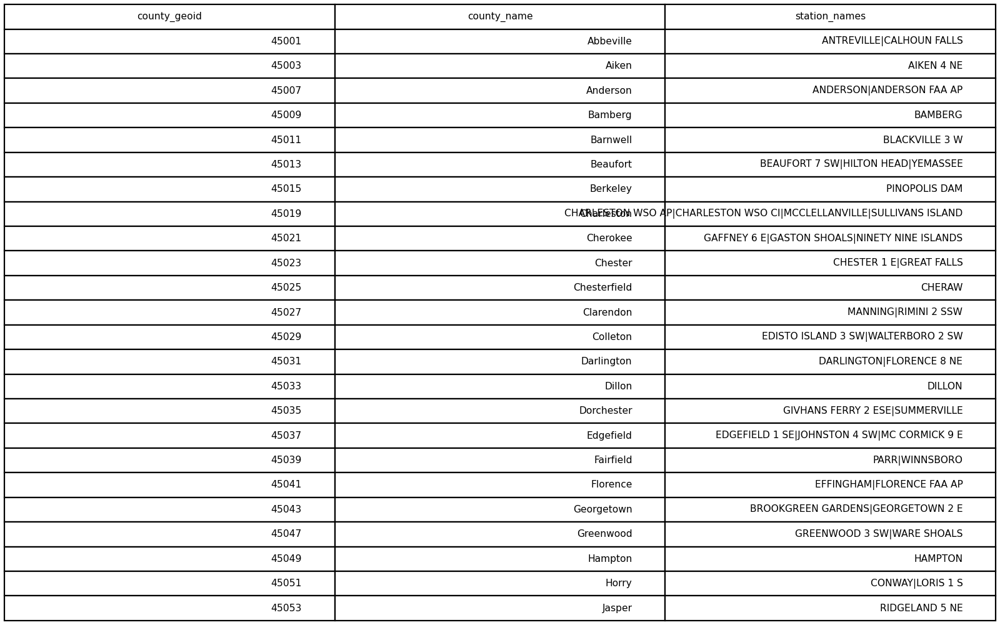
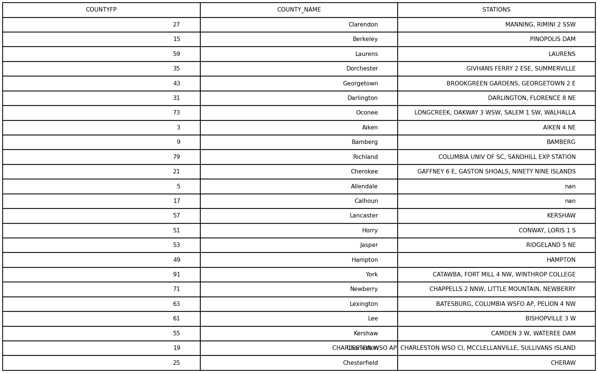

# GIS 错误证据：GeoAgent Task 95

- 主标签：D1 聚合范围混淆
- LLM：MiniMax-M2.7-highspeed（minimax）
- 推理配置：thinking 开关未单列记录
- 视觉审查：审查全部可视化成果

## 1. 任务目标

对于每个县，1）找出位于该县内的气象站，2）列出该县内的气象站名称。

## 2. 任务执行工作流

1. 将气象站点与 South Carolina 县界进行空间连接。
2. 按县汇总站点名称和数量。
3. 生成覆盖全部县的统计表。

## 3. 错误发生位置

错误出在县域内气象站空间汇总。任务要求每个县列出县内气象站，运行中遗漏了部分县或站点。

## 4. 错误机制与结果影响

`county_weather_stations.csv` 不能完整描述每个县内的气象站列表。

## 5. 具体错误证据

- `execution_result/workflow/step_04_code.py、execution_result/workflow/step_05_code.py` 执行县界与站点的空间关系匹配。
- `county_weather_stations.csv` 缺少部分应保留的县或站点记录。
- 缺失记录来自县界—站点空间连接后的汇总结果。

## 6. 任务执行结果预览

下图由错误运行写出的最终成果生成。图层或表格内容以原文件为准，错误判定依据上述处理逻辑和数值证据。

## 7. 解决错误后 GIS 任务应有的结果预览

下图来自同一任务的正确运行，展示在修正“空间汇总遗漏部分行政单元或观测站”后应得到的最终成果。

## 8. 可视化判读说明

本任务的预览图只能呈现成果外观。判读重点是第 5 节列出的函数调用、字段选择、输出元数据和日志参数；这些材料说明错误如何进入 CRS、transform、bounds、像元大小、NoData、字段或 Shapefile 组件。
