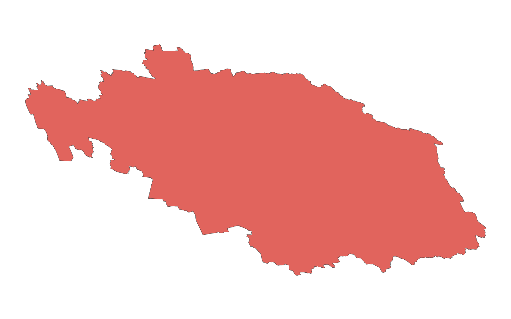

# GIS 错误证据：GeoAgent Task 133

- 主标签：D1 聚合范围混淆
- LLM：MiniMax-M2.7-highspeed（minimax）
- 推理配置：thinking 开关未单列记录
- 视觉审查：未启用视觉审查

## 1. 任务目标

请收集指定区域内不同区域的降雨统计数据，并将每个区域的降水数据保存为新的 Shapefile 文件。

## 2. 任务执行工作流

1. 将降水观测点与区域面进行空间连接。
2. 按区域汇总降水统计量。
3. 为每个区域输出对应的降水空间成果。

## 3. 错误发生位置

错误出在降水观测值与目标区域的空间汇总。任务要求为指定区域保存降雨统计，运行中区域与降水值的对应关系错误。

## 4. 错误机制与结果影响

`zone_44_rainfall.shp` 的降水属性不能代表该区域的正确降雨统计。

## 5. 具体错误证据

- `execution_result/workflow/step_01_code.py、execution_result/workflow/step_02_code.py` 将降水数据汇总到区域面。
- 降水观测值没有按目标区域的正确空间关系汇总到 `zone_44_rainfall.shp`。
- 输出区域 44 的降水属性承接了错误空间匹配结果。

## 6. 任务执行结果预览

下图由错误运行写出的最终成果生成。图层或表格内容以原文件为准，错误判定依据上述处理逻辑和数值证据。

## 7. 解决错误后 GIS 任务应有的结果预览

下图来自同一任务的正确运行，展示在修正“降水值与区域之间的空间汇总关系错误”后应得到的最终成果。

## 8. 可视化判读说明

本任务的预览图只能呈现成果外观。判读重点是第 5 节列出的函数调用、字段选择、输出元数据和日志参数；这些材料说明错误如何进入 CRS、transform、bounds、像元大小、NoData、字段或 Shapefile 组件。
