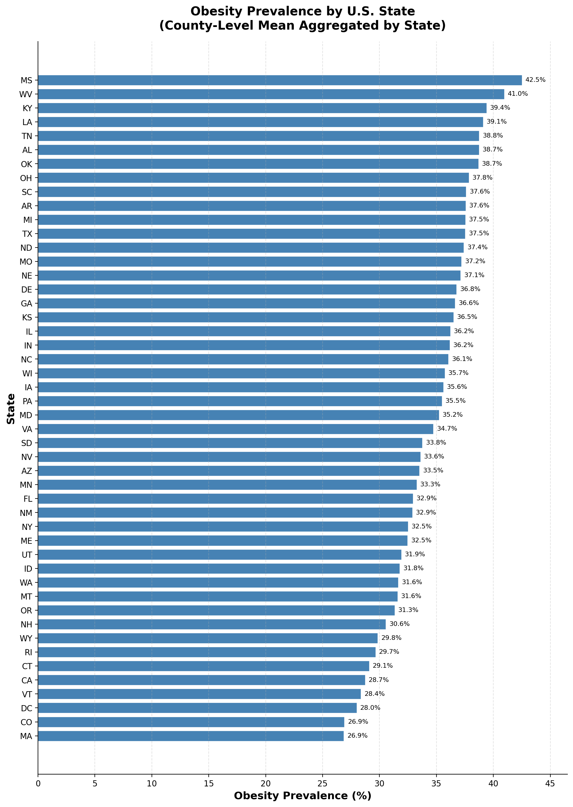
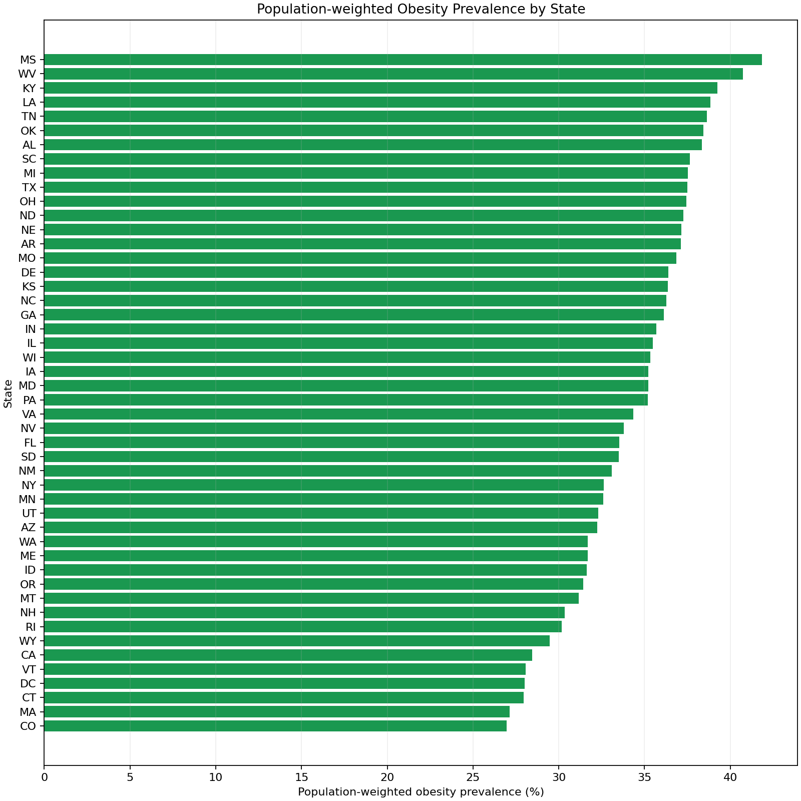

# GIS 错误证据：GeoAgent Task 2

- 主标签：D2 空间分配错误
- LLM：DeepSeek V4 Pro（DeepSeek thinking 关闭）
- 视觉审查：Qwen3-VL（thinking 关闭）

## 1. 任务目标

制作美国肥胖率柱状图，并保证图表标签清晰。

## 2. 任务执行工作流

1. 读取县级肥胖率和人口数据。
2. 按州对县级肥胖率求简单平均。
3. 将州级均值绘制为柱状图。

## 3. 错误发生位置

错误发生在图表数据聚合阶段：州级比例由县级百分比简单平均得到，没有按县人口加权。

## 4. 错误机制与结果影响

图表对县级肥胖率进行州内简单平均，未按县人口加权，导致州级总体肥胖率及其排序发生偏差。

州内各县被赋予相同权重，使柱高和州际排序偏离总体人口肥胖率。

## 5. 具体错误证据

- `obesity_barchart.py` 对每州县级百分比直接求均值。
- 源数据含县人口，可以从同一数据计算人口加权参考。
- 两种聚合方法产生不同州级柱高和排序。

## 6. 任务执行结果预览

下图是 LLM 生成的肥胖率柱状图。柱高来自各州县级肥胖率的简单平均，因此图表外观虽然完整，所表达的州级肥胖率口径却不正确。

### 最终图表成果：obesity_prevalence_barchart.png

- 源成果文件：`coder/subtask_1/obesity_prevalence_barchart.png`
- 说明：LLM 生成的州级肥胖率柱状图原图。

## 7. 解决错误后 GIS 任务应有的结果预览

参考图以县人口为权重计算州级肥胖率，并按同一图表任务绘制清晰标签。

## 8. 可视化判读说明

统计和空间分配错误通常不能由图像直接确认。审查入口是代码中的聚合范围、权重字段、统计公式和输出表字段。
