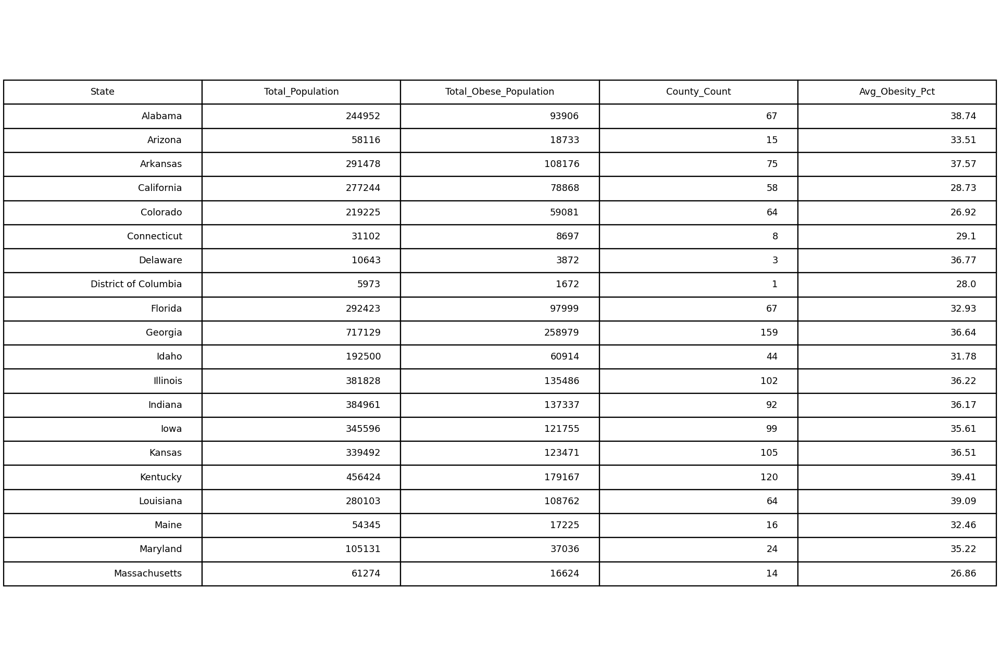
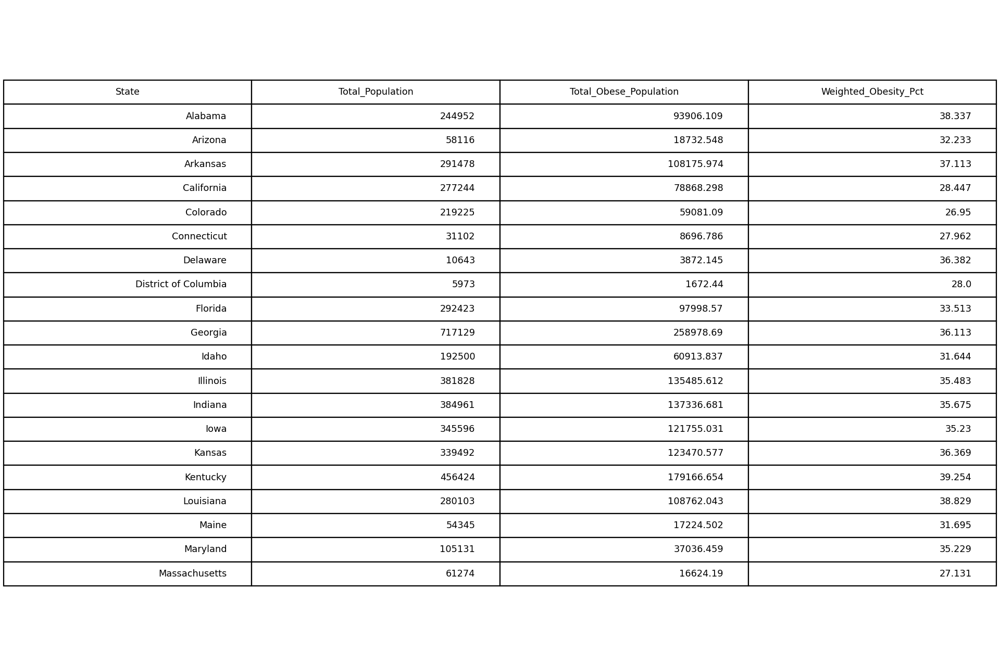

# GIS 错误证据：GeoAgent Task 75

- 主标签：D2 空间分配错误
- LLM：DeepSeek V4 Pro（DeepSeek thinking 开启）
- 视觉审查：Qwen3-VL（thinking 关闭）

## 1. 任务目标

将县级人口和肥胖率聚合到州级，得到各州人口与肥胖人口统计。

## 2. 任务执行工作流

1. 读取县级人口和肥胖率。
2. 计算县级肥胖人口并按州汇总人口和肥胖人口。
3. 同时对县级肥胖率求简单平均，写入 `state_obesity_aggregation.csv`。

## 3. 错误发生位置

错误发生在州级肥胖率计算阶段：`Avg_Obesity_Pct` 把每个县视为等权观测，没有使用县人口作为权重。

## 4. 错误机制与结果影响

脚本以县为等权单位计算州级肥胖率，忽略各县人口规模差异，使强度型指标的州级聚合结果产生系统偏差。

人口规模差异被忽略，小县与大县对州级比例产生相同影响，导致州级肥胖率与人口加权结果不一致。

## 5. 具体错误证据

- `aggregate_obesity.py` 以县为等权单位计算 `Avg_Obesity_Pct`。
- 脚本同时拥有县人口并计算了肥胖人口，具备加权计算条件。
- 简单平均与人口加权结果在若干州存在可见差异。

## 6. 任务执行结果预览

下图预览 LLM 输出的州级统计表。`Total_Population` 和 `Total_Obese_Population` 为州级汇总值，`Avg_Obesity_Pct` 则是县级肥胖率的简单平均值，也是本任务错误出现的字段。

### 最终成果：state_obesity_aggregation.csv

- 源成果文件：`coder/subtask_1/state_obesity_aggregation.csv`
- 说明：`state_obesity_aggregation.csv` 的前 20 个州数据预览，字段名和数值直接来自 LLM 输出。

## 7. 解决错误后 GIS 任务应有的结果预览

参考表保留州总人口和肥胖人口，并以二者计算人口加权州级肥胖率。

## 8. 可视化判读说明

统计和空间分配错误通常不能由图像直接确认。审查入口是代码中的聚合范围、权重字段、统计公式和输出表字段。
