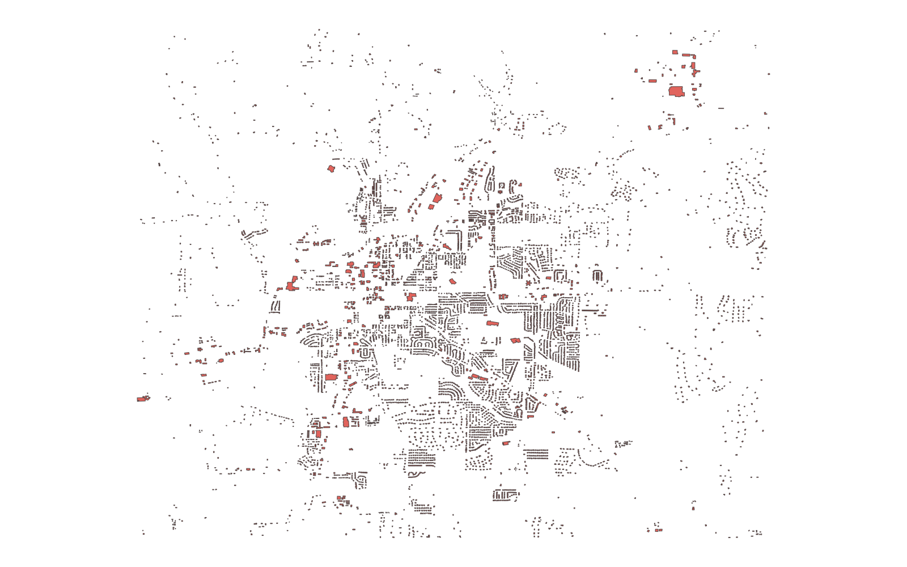
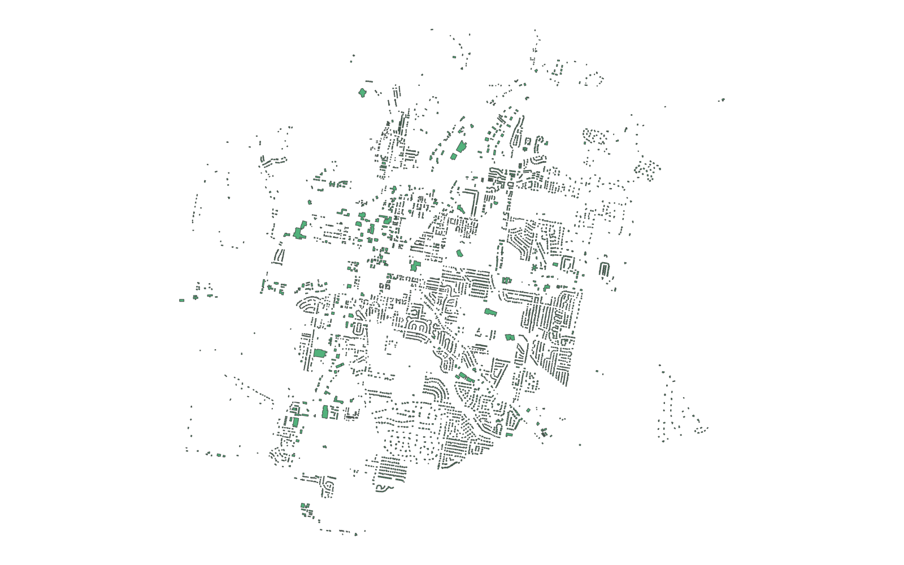

# GIS 错误证据：GeoAgent Task 84

- 主标签：D2 空间分配错误
- LLM：MiniMax-M2.7-highspeed（minimax）
- 推理配置：thinking 开关未单列记录
- 视觉审查：审查全部可视化成果

## 1. 任务目标

把每个人口普查街区组的人口按建筑面积比例分配到组内建筑，并输出建筑级 Shapefile。

## 2. 任务执行工作流

1. 读取建筑与街区组数据。
2. 为建筑附加人口字段。
3. 按建筑字段 `cbfips` 分组，以 `sqft` 比例分配人口。

## 3. 错误发生位置

问题出在空间单元匹配和人口字段选择阶段。程序没有以街区组边界完成空间匹配，而是直接把建筑自身的 `cbfips` 当作 block_group_id。

## 4. 错误机制与结果影响

输出形成 504 个伪街区组，而输入实际只有 14 个街区组；程序还选择了错误的人口字段，最终建筑人口分配失去街区组总量约束。

## 5. 具体错误证据

- `step_03/code.py` 固定使用 `bg_id_col = 'cbfips'`。
- 代码通过模糊字段搜索选择人口列，没有使用正确街区组总人口。
- 输出结果形成 504 个分组，按输入街区组边界应为 14 个分组。

## 6. 任务执行结果预览

下图是该实验生成的建筑人口分配结果。建筑几何仍然完整，但属性中的人口被分配到 504 个错误分组，地图外观不能证明分配守恒。

### 最终成果：pop_rolla_buildings.shp

- 源成果文件：`steps/step_03/pop_rolla_buildings.shp`

## 7. 解决错误后 GIS 任务应有的结果预览

参考图来自正确完成建筑—街区组空间连接并按组内建筑面积分配人口的实验结果。

## 8. 可视化判读说明

本任务的预览图只能呈现成果外观。判读重点是第 5 节列出的函数调用、字段选择、输出元数据和日志参数；这些材料说明错误如何进入 CRS、transform、bounds、像元大小、NoData、字段或 Shapefile 组件。
