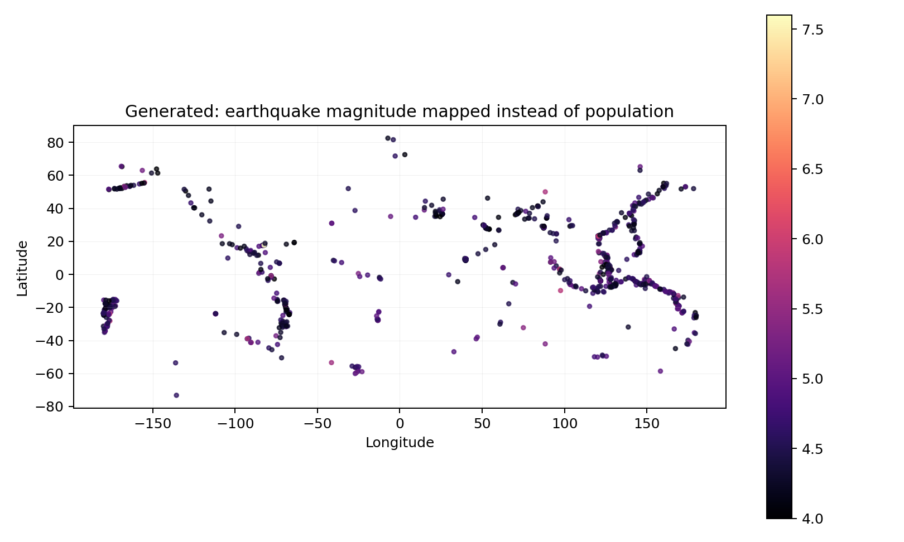
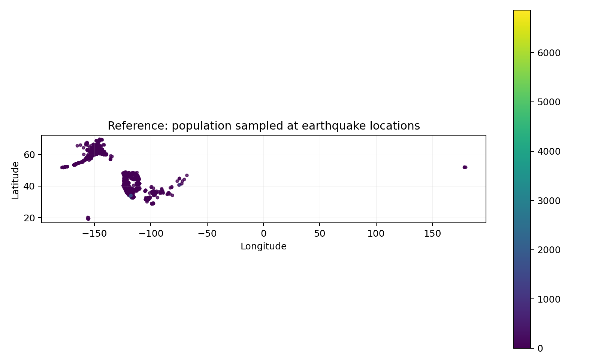

# GIS 错误证据：GeoBenchX Earthquake Population Heatmap

- 主标签：D2. Spatial Allocation Error
- 次标签：无
- LLM 配置：claude-3-5-haiku-20241022（GeoBenchX evaluator tuning set published trace）
- 来源项目：GeoBenchX
- 难度：hard

## 1. 任务目标

用地震点位叠加 1 km 人口栅格，先把人口值提取到地震位置，再按人口值生成受地震影响区域的人口集中热力图。

## 2. 任务执行工作流

1. 读取地震点数据。
2. 参考流程读取 USA 1km 人口栅格并用 `get_values_from_raster_with_geometries` 将人口值分配到地震点。
3. 错误流程只读取栅格路径但没有抽样/分配人口值。
4. 错误流程直接按 `mag` 字段绘制热力图。

## 3. 错误发生位置

错误发生在 GeoBenchX 生成工具调用序列的第 3-4 步：缺少 `get_values_from_raster_with_geometries`，且 `make_heatmap` 的 `value_column` 从参考的 `earthquake_population` 变成了 `mag`。

## 4. 错误机制与结果影响

这是典型的空间分配/栅格值提取错误。任务目标是把人口栅格的空间属性分配到地震点位，再用人口值表达受影响人口集中度；模型没有完成 raster-vector 数据融合，导致最终地图变量从人口暴露变成了地震震级。

## 5. 具体错误证据

```json
{
  "earthquake_count": 9176,
  "generated_filtered_count_mag_ge_4": 1030,
  "population_sample_non_null_count": 7270,
  "population_sample_positive_count": 3251,
  "reference_value_column": "earthquake_population",
  "generated_value_column": "mag",
  "missing_reference_steps": [
    "get_values_from_raster_with_geometries"
  ],
  "extra_generated_steps": [
    "filter_numerical"
  ],
  "human_score": 0,
  "human_reasoning": "The candidate solution does not match to any of the reference solutions. It does load correct datasets, but misses important step 'get_values_from_raster_with_geometries' to get population in earthquakes locations and produces heatmap of earthquakes instead of population. Also it contains extra step \"filter_numerical\" to select major earthquakes though the task does not require this."
}
```

## 6. 任务执行结果预览



## 7. 解决错误后 GIS 任务应有的结果预览



## 8. 可视化判读说明

本案例的核心证据是 GeoBenchX 发布的人审工具调用轨迹、生成方案与参考方案的步骤差异，以及本地数据审计重新计算出的参考指标/错误指标。预览图用于展示错误工作流与参考工作流表达的主题变量不同，最终判定以第 5 节的指标和 `execution_result/workflow/` 下的工具调用 JSON 为准。
