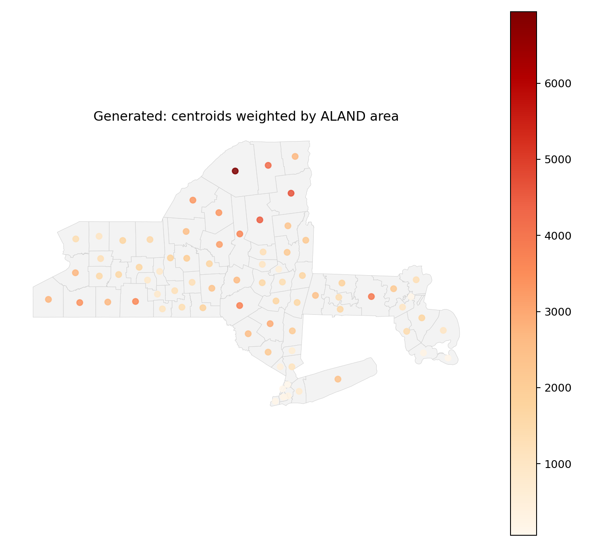
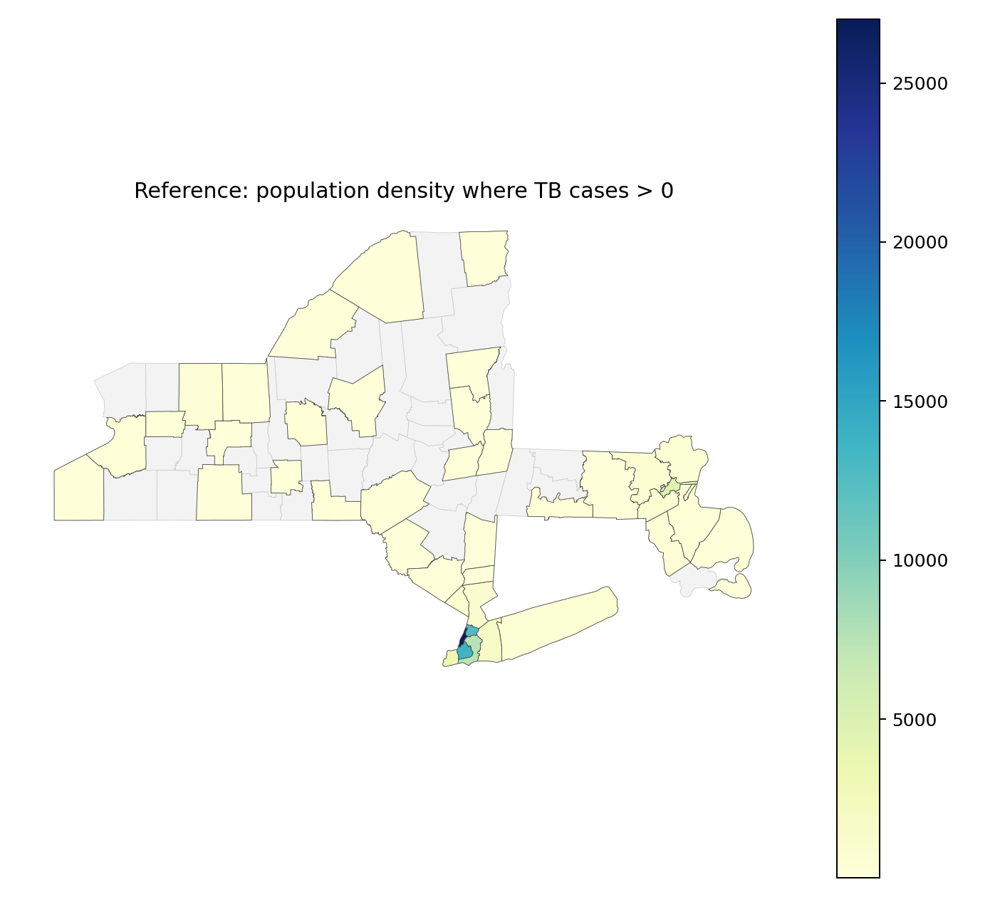

# GIS 错误证据：GeoBenchX TB County Population Density Heatmap

- 主标签：D2. Spatial Allocation Error
- 次标签：D1. Aggregation Scope Confusion
- LLM 配置：claude-3-5-haiku-20241022（GeoBenchX evaluator tuning set published trace）
- 来源项目：GeoBenchX
- 难度：hard

## 1. 任务目标

识别有 2023 年 TB 报告病例的县，并在县域尺度表达这些县的人口密度，而不是用县质心或县面积替代县域人口密度。

## 2. 任务执行工作流

1. GeoBenchX 参考方案认为该任务在给定工具约束下应拒绝。
2. 错误流程读取 MA/NY TB 表、USA 人口栅格和县界。
3. 错误流程只按州 FIPS 选出所有 MA/NY 县，没有把 TB 病例表连接到县界并筛选有病例县。
4. 错误流程生成县质心，但最终 `make_heatmap` 使用 `ALAND` 字段，而不是县域人口密度。诊断参考用人口栅格按县面掩膜求和后除以 `ALAND`。

## 3. 错误发生位置

错误发生在生成工具调用序列的第 5-8 步：`filter_categorical` 只筛 MA/NY 州，缺少 TB 病例县筛选；`get_values_from_raster_with_geometries` 的结果没有用于制图；`make_heatmap` 的 `value_column` 被设置为 `ALAND`。

## 4. 错误机制与结果影响

这是典型的空间分配错误。人口密度是面域上的强度变量，需要把人口栅格按县域进行有效汇总并除以面积；模型把面域问题简化成县质心点图，并用县面积作为热力图权重，导致空间变量、分析单元和制图对象全部错位。

## 5. 具体错误证据

```json
{
  "ma_ny_county_count": 76,
  "tb_table_county_records": 76,
  "matched_tb_counties": 76,
  "reference_reported_tb_counties": 42,
  "generated_heatmap_counties": 76,
  "generated_heatmap_geodataframe": "ma_ny_centroids",
  "generated_heatmap_value_column": "ALAND",
  "generated_uses_area_as_heatmap_weight": true,
  "generated_links_tb_tables_to_counties": false,
  "reference_density_column": "reference_population_density_people_per_km2",
  "reference_density_max": 27003.116623712674,
  "generated_area_max_m2": 6939939685.0,
  "top_reference_density_counties": [
    {
      "NAME": "New York",
      "STATEFP": "36",
      "tb_cases_2023": 101.0,
      "reference_population_density_people_per_km2": 27003.116623712674
    },
    {
      "NAME": "Kings",
      "STATEFP": "36",
      "tb_cases_2023": 188.0,
      "reference_population_density_people_per_km2": 13716.587379734648
    },
    {
      "NAME": "Bronx",
      "STATEFP": "36",
      "tb_cases_2023": 103.0,
      "reference_population_density_people_per_km2": 12670.760943996467
    },
    {
      "NAME": "Queens",
      "STATEFP": "36",
      "tb_cases_2023": 279.0,
      "reference_population_density_people_per_km2": 7541.9713546378935
    },
    {
      "NAME": "Suffolk",
      "STATEFP": "25",
      "tb_cases_2023": 46.0,
      "reference_population_density_people_per_km2": 4730.965424016654
    },
    {
      "NAME": "Richmond",
      "STATEFP": "36",
      "tb_cases_2023": 13.0,
      "reference_population_density_people_per_km2": 3203.1933056416783
    },
    {
      "NAME": "Nassau",
      "STATEFP": "36",
      "tb_cases_2023": 45.0,
      "reference_population_density_people_per_km2": 1767.825237286902
    },
    {
      "NAME": "Westchester",
      "STATEFP": "36",
      "tb_cases_2023": 35.0,
      "reference_population_density_people_per_km2": 846.2983831356509
    }
  ],
  "top_generated_area_counties": [
    {
      "NAME": "St. Lawrence",
      "STATEFP": "36",
      "generated_heatmap_weight": 6939939685
    },
    {
      "NAME": "Essex",
      "STATEFP": "36",
      "generated_heatmap_weight": 4646753184
    },
    {
      "NAME": "Hamilton",
      "STATEFP": "36",
      "generated_heatmap_weight": 4447989312
    },
    {
      "NAME": "Franklin",
      "STATEFP": "36",
      "generated_heatmap_weight": 4219857156
    },
    {
      "NAME": "Worcester",
      "STATEFP": "25",
      "generated_heatmap_weight": 3912636723
    },
    {
      "NAME": "Delaware",
      "STATEFP": "36",
      "generated_heatmap_weight": 3736306657
    },
    {
      "NAME": "Herkimer",
      "STATEFP": "36",
      "generated_heatmap_weight": 3653400323
    },
    {
      "NAME": "Steuben",
      "STATEFP": "36",
      "generated_heatmap_weight": 3601403378
    }
  ],
  "human_score": 0,
  "human_reasoning": "Since there is only one reference solution and it is 'reject_task', the candidate solution should end with 'reject_task' to be considered a match. There is no 'reject_task' in candidate solution, so it is not a match. Taking values from population raster will give only the population density at the centroid. It will not give the population density in the whole county."
}
```

## 6. 任务执行结果预览



## 7. 解决错误后 GIS 任务应有的结果预览



## 8. 可视化判读说明

本案例的核心证据是 GeoBenchX 发布的人审工具调用轨迹、生成方案与参考方案的步骤差异，以及本地数据审计重新计算出的参考指标/错误指标。预览图用于展示错误工作流与参考工作流表达的主题变量不同，最终判定以第 5 节的指标和 `execution_result/workflow/` 下的工具调用 JSON 为准。
